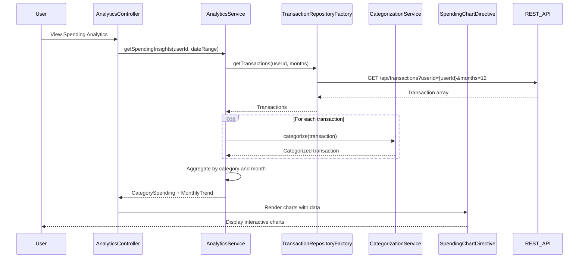

# Low-Level Design: Transaction Analytics and Spending Insights
**Epic ID:** QE-9184

## a. Architecture Mapping

- **User Interface** → AngularJS Module: `analytics.module.js` + Controller: `AnalyticsController` + View: `analytics.html`
- **Analytics Service** → AngularJS Service: `AnalyticsService` (orchestrates data aggregation and processing)
- **Transaction Data Repository** → AngularJS Factory: `TransactionRepositoryFactory` (REST API for transaction data)
- **Categorization Engine** → AngularJS Service: `CategorizationService` (classifies transactions into 9 categories)
- **Visualization Component** → AngularJS Directive: `spendingChartDirective` (wraps Chart.js or D3.js for rendering)

**Recommended Folder Structure:**
```
app/
├── modules/
│   └── analytics/
│       ├── analytics.module.js
│       ├── analytics.controller.js
│       ├── analytics.html
│       └── analytics.css
├── services/
│   ├── analytics.service.js
│   ├── categorization.service.js
│   └── transaction-repository.factory.js
├── directives/
│   └── spending-chart.directive.js
└── assets/js/
    └── chart.min.js
```

## b. Component Specifications

| Name | Artifact Type | Responsibility | Key Dependencies |
|------|---------------|----------------|------------------|
| AnalyticsModule | AngularJS Module | Encapsulates analytics feature, registers controllers/services/directives | angular, ui.router, chart.js |
| AnalyticsController | Controller | Manages analytics view, fetches transaction data, handles user interactions | AnalyticsService, $scope, $filter |
| AnalyticsService | Service | Orchestrates transaction retrieval, categorization, and aggregation | TransactionRepositoryFactory, CategorizationService, $q |
| TransactionRepositoryFactory | Factory | Fetches transaction history from REST API (up to 12 months) | $http, $q |
| CategorizationService | Service | Classifies transactions into 9 predefined categories using rule-based logic | None |
| SpendingChartDirective | Directive | Renders interactive charts (pie, bar, line) using Chart.js | Chart.js library |

## c. Data Model

**Transaction Object:**
```javascript
{
  transactionId: String,
  cardId: String,
  merchantName: String,
  amount: Number,
  transactionDate: String,  // ISO format
  category: String,  // one of 9 categories
  description: String
}
```

**CategorySpending Object:**
```javascript
{
  category: String,  // Food & Dining, Fuel, Shopping, etc.
  totalAmount: Number,
  transactionCount: Number,
  percentage: Number
}
```

**MonthlyTrend Object:**
```javascript
{
  month: String,  // YYYY-MM
  totalSpend: Number,
  categoryBreakdown: Array<CategorySpending>
}
```

**Categories Enum:**
```javascript
const CATEGORIES = ['Food & Dining', 'Fuel', 'Shopping', 'Travel', 'Entertainment', 'Utilities', 'Healthcare', 'Education', 'Miscellaneous'];
```

## d. Data Flow

User navigates to analytics view → AnalyticsController calls AnalyticsService.getSpendingInsights(userId, dateRange) → Service invokes TransactionRepositoryFactory.getTransactions() which calls REST API /api/transactions?userId={userId}&months=12 → Transaction array returned → Service passes each transaction to CategorizationService.categorize(transaction) which applies rule-based logic to assign category → Categorized transactions aggregated by category and month → AnalyticsService returns CategorySpending array and MonthlyTrend array → Controller binds data to $scope → SpendingChartDirective renders interactive pie chart (category-wise) and line chart (monthly trends) using Chart.js → User sees visual spending insights.

## e. Primary Sequence Diagram



## f. Implementation Notes

- Use AngularJS DI to inject AnalyticsService and $filter into AnalyticsController.
- Implement CategorizationService with rule-based keyword matching (e.g., merchant name contains "restaurant" → Food & Dining).
- Use Chart.js library wrapped in SpendingChartDirective with isolate scope; pass chartData and chartType as directive attributes.
- Leverage ES6 Array methods (map, filter, reduce) for transaction aggregation and category grouping.
- Implement client-side caching in TransactionRepositoryFactory to avoid redundant API calls; invalidate cache after 5 minutes.

## g. Error Handling

HTTP interceptor handles API errors; controller displays fallback message if categorization fails; try/catch blocks in aggregation logic with user notification via Bootstrap alerts.

## h. Security Notes

Standard input validation and secure API calls assumed; transaction data filtered by authenticated userId to prevent unauthorized access.