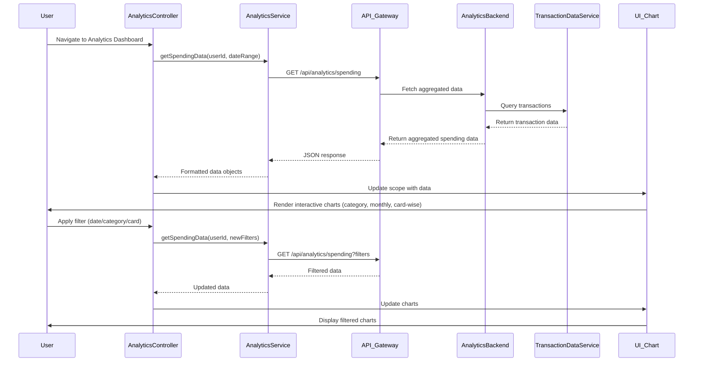

# Low-Level Design: QE-9185 - Spending Analytics and Insights

## a. Architecture Mapping

- **AngularJS Module**: `creditCard.analytics` - Root module for analytics features
- **Controller**: `AnalyticsController` - Manages analytics dashboard state and user interactions
- **Service**: `AnalyticsService` - Handles API calls to Analytics Service and data transformation
- **Service**: `TransactionDataService` - Retrieves historical transaction data
- **Directive**: `spendingChart` - Renders interactive charts (category-wise, monthly trend, card-wise)
- **Factory**: `CategoryFactory` - Provides category mappings and color schemes

**Folder Structure:**
```
/app
  /modules
    /analytics
      analytics.module.js
      analytics.controller.js
      analytics.service.js
      analytics.html
      /directives
        spending-chart.directive.js
      /factories
        category.factory.js
```

## b. Component Specifications

| Component Name | Artifact Type | Responsibility | Key Dependencies |
|----------------|---------------|----------------|------------------|
| creditCard.analytics | Module | Register analytics components and routes | ngRoute, chart.js |
| AnalyticsController | Controller | Manage dashboard state, handle filters, coordinate data loading | AnalyticsService, CategoryFactory, $scope |
| AnalyticsService | Service | Fetch aggregated spending data from API, format for visualization | $http, $q, API_CONFIG |
| TransactionDataService | Service | Retrieve transaction history with date range filters | $http, $q, API_CONFIG |
| spendingChart | Directive | Render interactive charts (pie, bar, line) with drill-down | chart.js, $timeout |
| CategoryFactory | Factory | Provide nine category definitions and color mappings | None |

## c. Data Model

**SpendingAnalytics (JS Object)**
- `userId`: String - User identifier
- `dateRange`: Object - `{ startDate: Date, endDate: Date }`
- `categoryBreakdown`: Array - `[{ category: String, amount: Number, percentage: Number }]`
- `monthlyTrend`: Array - `[{ month: String, totalSpend: Number }]`
- `cardWiseSpend`: Array - `[{ cardId: String, cardName: String, totalSpend: Number }]`

**Category (JS Object)**
- `id`: String - Category identifier
- `name`: String - Category display name (Food & Dining, Fuel, Shopping, Travel, Entertainment, Utilities, Healthcare, Education, Miscellaneous)
- `color`: String - Hex color code for visualization

## d. Data Flow

User navigates to analytics dashboard → AnalyticsController initializes and calls AnalyticsService.getSpendingData() with user ID and default date range → AnalyticsService sends GET request to `/api/analytics/spending` via API Gateway → Analytics Service aggregates transaction data from Transaction Data Service, groups by category using Transaction Categorization Service, and calculates monthly trends and card-wise totals → Aggregated data returns to AnalyticsService → Controller updates $scope with categoryBreakdown, monthlyTrend, and cardWiseSpend → spendingChart directive watches scope changes and renders three interactive charts (category pie/bar, monthly line, card comparison bar) using chart.js → User applies filters (date range, category, card) → Controller re-fetches data and charts update reactively.

## e. Primary Sequence Diagram



## f. Implementation Notes

- Use AngularJS dependency injection to inject AnalyticsService and CategoryFactory into AnalyticsController.
- Implement AnalyticsService using $http with promise-based API calls; cache aggregated data for 5 minutes using $cacheFactory.
- Use chart.js library wrapped in spendingChart directive with isolated scope for reusability; pass data via two-way binding.
- Apply ES6 arrow functions and template literals for cleaner service and controller code.
- Implement lazy loading for analytics module using ngRoute resolve to pre-fetch data before view renders.

## g. Error Handling

HTTP interceptor captures API errors; AnalyticsService returns rejected promises with user-friendly messages; Controller displays error notifications using toastr or similar.

## h. Security Notes

Requires token-based auth via existing SSO; all API calls include JWT in Authorization header; category data is read-only and non-sensitive.