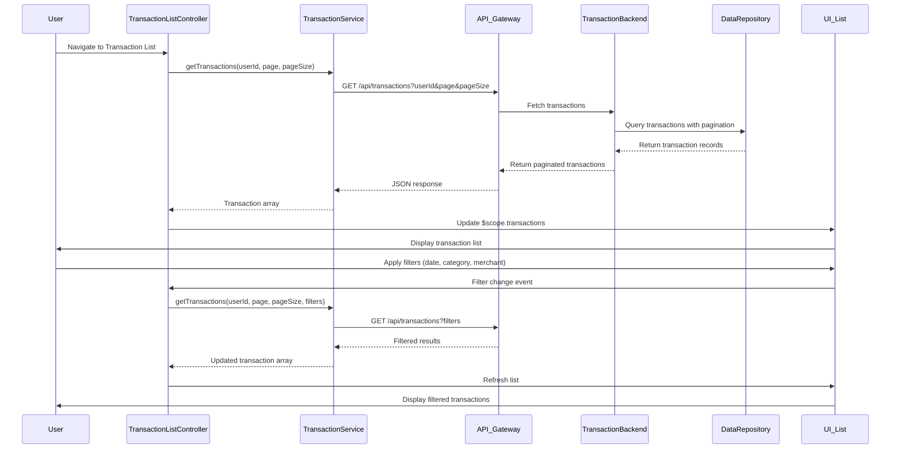

# Low-Level Design: QE-9186 - Transaction Management and Monitoring

## a. Architecture Mapping

- **AngularJS Module**: `creditCard.transactions` - Root module for transaction features
- **Controller**: `TransactionListController` - Manages transaction list view, search, and filters
- **Controller**: `TransactionDetailController` - Manages individual transaction detail view
- **Service**: `TransactionService` - Handles API calls for transaction retrieval and search
- **Service**: `CategoryService` - Provides transaction category enrichment
- **Directive**: `transactionFilter` - Renders filter UI (date, amount, category, merchant)
- **Factory**: `TransactionFactory` - Provides transaction model and utility methods

**Folder Structure:**
```
/app
  /modules
    /transactions
      transactions.module.js
      transaction-list.controller.js
      transaction-detail.controller.js
      transaction.service.js
      transaction-list.html
      transaction-detail.html
      /directives
        transaction-filter.directive.js
      /factories
        transaction.factory.js
```

## b. Component Specifications

| Component Name | Artifact Type | Responsibility | Key Dependencies |
|----------------|---------------|----------------|------------------|
| creditCard.transactions | Module | Register transaction components and routes | ngRoute, ui.bootstrap |
| TransactionListController | Controller | Manage transaction list, pagination, search/filter state | TransactionService, $scope, $location |
| TransactionDetailController | Controller | Display single transaction details | TransactionService, $routeParams, $scope |
| TransactionService | Service | Fetch transactions from API with search/filter params, handle pagination | $http, $q, API_CONFIG |
| CategoryService | Service | Enrich transactions with category data | $http, $q, API_CONFIG |
| transactionFilter | Directive | Render filter form and emit filter change events | $timeout, $scope |
| TransactionFactory | Factory | Define transaction model, provide formatting utilities (date, currency) | None |

## c. Data Model

**Transaction (JS Object)**
- `transactionId`: String - Unique transaction identifier
- `cardId`: String - Associated credit card ID
- `merchantName`: String - Merchant/vendor name
- `transactionDate`: Date - Transaction timestamp
- `amount`: Number - Transaction amount (positive for charges)
- `category`: String - Transaction category (from categorization service)
- `description`: String - Transaction description/memo
- `status`: String - Transaction status (posted, pending, declined)

**TransactionFilter (JS Object)**
- `cardIds`: Array - Selected card IDs
- `categories`: Array - Selected categories
- `dateRange`: Object - `{ startDate: Date, endDate: Date }`
- `amountRange`: Object - `{ min: Number, max: Number }`
- `searchTerm`: String - Merchant or description search keyword

## d. Data Flow

User navigates to transaction list → TransactionListController initializes and calls TransactionService.getTransactions() with user ID and default pagination (page 1, 50 records) → TransactionService sends GET request to `/api/transactions` via API Gateway → Transaction Service queries Credit Card Data Repository with user ID → Transactions retrieved and enriched with category data from Transaction Categorization Service → Paginated results return to TransactionService → Controller updates $scope.transactions array → UI renders transaction list with merchant, date, amount, category → User applies filters via transactionFilter directive → Directive emits filter change event → Controller calls TransactionService.getTransactions() with filter params → Updated results render in list → User clicks transaction row → App navigates to transaction detail view → TransactionDetailController fetches single transaction via TransactionService.getTransactionById() → Detail view displays full transaction info.

## e. Primary Sequence Diagram



## f. Implementation Notes

- Use AngularJS $http service with interceptors for authentication token injection and error handling.
- Implement pagination using ui.bootstrap pagination directive; maintain page state in $location.search() for deep linking.
- Use ES6 const/let for variable declarations; apply arrow functions in service promise chains.
- Implement debounce (300ms) on search input using $timeout to minimize API calls during typing.
- Cache transaction list results for 2 minutes using $cacheFactory; invalidate on filter change.

## g. Error Handling

HTTP interceptor handles 401/403 errors with redirect to login; TransactionService catches API errors and returns rejected promises with user messages; Controller displays errors via toast notifications.

## h. Security Notes

Requires token-based auth via existing SSO; all API requests include JWT; transaction queries filtered by authenticated user ID server-side to prevent unauthorized access.