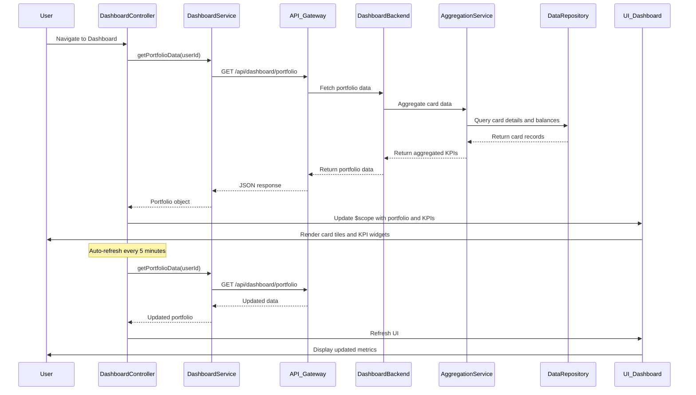

# Low-Level Design: QE-9187 - Credit Card Portfolio Management and Dashboard KPIs

## a. Architecture Mapping

- **AngularJS Module**: `creditCard.dashboard` - Root module for dashboard features
- **Controller**: `DashboardController` - Manages dashboard state and KPI display
- **Service**: `DashboardService` - Handles API calls to Dashboard Service for portfolio data
- **Service**: `CardService` - Retrieves individual card details and balances
- **Directive**: `cardSummary` - Renders individual card summary tile
- **Directive**: `kpiWidget` - Renders KPI metric widget (monthly spend, credit limit, available credit, outstanding)
- **Factory**: `PortfolioFactory` - Provides portfolio aggregation logic and calculations

**Folder Structure:**
```
/app
  /modules
    /dashboard
      dashboard.module.js
      dashboard.controller.js
      dashboard.service.js
      dashboard.html
      /directives
        card-summary.directive.js
        kpi-widget.directive.js
      /factories
        portfolio.factory.js
```

## b. Component Specifications

| Component Name | Artifact Type | Responsibility | Key Dependencies |
|----------------|---------------|----------------|------------------|
| creditCard.dashboard | Module | Register dashboard components and routes | ngRoute, ngAnimate |
| DashboardController | Controller | Manage dashboard state, coordinate data loading, handle refresh | DashboardService, PortfolioFactory, $scope, $interval |
| DashboardService | Service | Fetch portfolio data from API, handle real-time refresh | $http, $q, API_CONFIG |
| CardService | Service | Retrieve individual card details and balances | $http, $q, API_CONFIG |
| cardSummary | Directive | Render card tile with card name, last 4 digits, balance, limit | $filter |
| kpiWidget | Directive | Render KPI metric with label, value, and trend indicator | $filter |
| PortfolioFactory | Factory | Aggregate KPIs across cards, calculate totals and utilization | None |

## c. Data Model

**Portfolio (JS Object)**
- `userId`: String - User identifier
- `cards`: Array - `[CreditCard]` array
- `totalMonthlySpend`: Number - Sum of current month spend across all cards
- `totalCreditLimit`: Number - Sum of credit limits across all cards
- `totalAvailableCredit`: Number - Sum of available credit across all cards
- `totalOutstanding`: Number - Sum of outstanding balances across all cards
- `creditUtilization`: Number - Percentage (totalOutstanding / totalCreditLimit * 100)
- `lastUpdated`: Date - Timestamp of last data refresh

**CreditCard (JS Object)**
- `cardId`: String - Unique card identifier
- `cardName`: String - Card display name (e.g., "Visa Platinum")
- `lastFourDigits`: String - Last 4 digits of card number
- `creditLimit`: Number - Card credit limit
- `availableCredit`: Number - Available credit balance
- `outstandingBalance`: Number - Current outstanding balance
- `monthlySpend`: Number - Current month spend
- `status`: String - Card status (active, blocked, expired)

## d. Data Flow

User authenticates and navigates to dashboard → DashboardController initializes and calls DashboardService.getPortfolioData() with user ID → DashboardService sends GET request to `/api/dashboard/portfolio` via API Gateway → Dashboard Service queries Financial Data Aggregation Service → Aggregation Service retrieves card details from Credit Card Data Repository → KPIs calculated (monthly spend, credit limits, available credit, outstanding amounts) → Portfolio data returns to DashboardService → PortfolioFactory aggregates totals and calculates credit utilization → Controller updates $scope.portfolio and $scope.kpis → UI renders card summary tiles via cardSummary directive and KPI widgets via kpiWidget directive → $interval triggers auto-refresh every 5 minutes → DashboardService re-fetches data and UI updates reactively.

## e. Primary Sequence Diagram



## f. Implementation Notes

- Use AngularJS $interval service to implement 5-minute auto-refresh; cancel interval on $scope.$destroy to prevent memory leaks.
- Implement DashboardService with $http and promise chaining; use $q.all() to parallelize card detail requests if needed.
- Apply ES6 template literals for dynamic API endpoint construction; use const for configuration constants.
- Use AngularJS filters ($filter('currency'), $filter('number')) in directives for consistent formatting of monetary values.
- Implement loading spinner using ngAnimate and CSS transitions during data fetch; disable refresh button during active requests.

## g. Error Handling

HTTP interceptor captures API errors; DashboardService returns rejected promises; DashboardController displays error banner with retry option using custom notification service.

## h. Security Notes

Requires token-based auth via existing SSO; all API calls include JWT in Authorization header; portfolio data filtered by authenticated user ID server-side; encryption at rest and in transit per NFR.