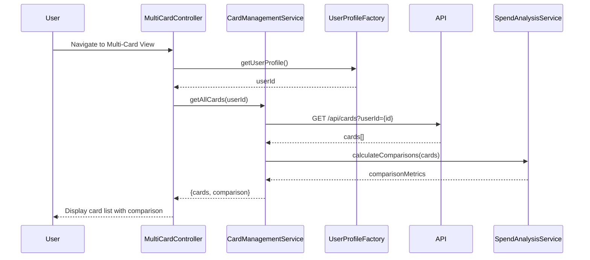

# Low-Level Design: QE-9188 - Multi-Card Management and Tracking

## a. Architecture Mapping

- **User Interface** → AngularJS Module (`creditCard.multiCardModule`) with Controller (`MultiCardController`) and Views (HTML templates)
- **Card Management Service** → AngularJS Service (`CardManagementService`) for orchestrating card operations
- **User Profile Service** → AngularJS Factory (`UserProfileFactory`) for user-card association
- **Credit Card Database** → REST API endpoints (`/api/cards`, `/api/cards/:id`)
- **Spend Analysis Engine** → AngularJS Service (`SpendAnalysisService`) for card-wise analytics

**Folder Structure:**
```
/app
  /modules
    /multi-card
      multi-card.module.js
      multi-card.controller.js
      multi-card.view.html
  /services
    card-management.service.js
    spend-analysis.service.js
  /factories
    user-profile.factory.js
  /models
    card.model.js
```

## b. Component Specifications

| Name | Artifact Type | Responsibility | Key Dependencies |
|------|---------------|----------------|------------------|
| MultiCardModule | AngularJS Module | Container for multi-card management feature | ngRoute, ngResource |
| MultiCardController | Controller | Manages card list display, selection, and comparison UI logic | CardManagementService, SpendAnalysisService, $scope |
| CardManagementService | Service | Retrieves and manages multiple card data, coordinates with API | $http, UserProfileFactory, Card model |
| SpendAnalysisService | Service | Calculates card-wise spending patterns and comparisons | $http, $q |
| UserProfileFactory | Factory | Provides user profile and card associations | $resource |
| CardListDirective | Directive | Renders individual card tiles with details | CardManagementService |
| CardComparisonDirective | Directive | Displays comparative metrics across cards | SpendAnalysisService |

## c. Data Model

**Card Model:**
```javascript
{
  cardId: String,
  userId: String,
  cardNumber: String (masked),
  cardType: String,
  creditLimit: Number,
  currentBalance: Number,
  availableCredit: Number,
  utilizationRate: Number,
  monthlySpend: Number,
  lastUpdated: Date
}
```

**CardComparison Model:**
```javascript
{
  cards: Array<Card>,
  metrics: {
    totalCreditLimit: Number,
    totalUtilization: Number,
    highestSpendCard: String,
    lowestUtilizationCard: String
  }
}
```

## d. Data Flow

User navigates to multi-card view → MultiCardController initializes and calls CardManagementService.getAllCards() → Service retrieves userId from UserProfileFactory → Service makes GET request to `/api/cards?userId={id}` → API returns array of up to 10+ cards → CardManagementService enriches each card with real-time balance data → SpendAnalysisService.calculateComparisons() is invoked to compute card-wise metrics → Controller updates $scope.cards and $scope.comparison → View renders card list using CardListDirective and comparison panel using CardComparisonDirective → User interactions (select card, view details) trigger controller methods that update view state.

## e. Primary Sequence Diagram



## f. Implementation Notes

- Use AngularJS Dependency Injection to inject services into controllers; follow singleton pattern for services.
- Implement card retrieval with `$http` or `$resource`; cache card data in service for 60 seconds to reduce API calls.
- Use `ng-repeat` with `track by cardId` for efficient card list rendering; apply filters for sorting/searching.
- Leverage ES6 arrow functions and template literals in services; use Promises or `$q` for async operations.
- Apply Bootstrap grid system (col-md-4) for responsive card tiles; use Bootstrap cards component for individual card display.

## g. Error Handling

HTTP interceptor captures API errors; display user-friendly messages via Bootstrap alerts; retry logic for transient failures with exponential backoff.

## h. Security Notes

Requires token-based auth via existing SSO; card numbers are masked on client-side; API enforces user-card ownership validation.