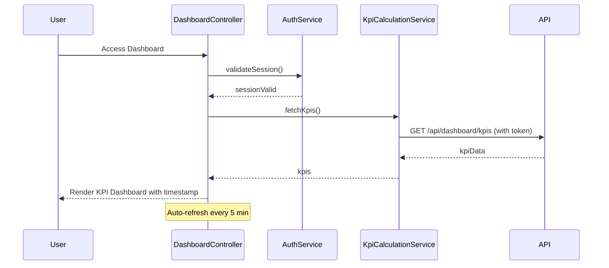

# Low-Level Design: QE-9189 - Credit Card Dashboard and KPI Monitoring

## a. Architecture Mapping

- **Dashboard UI** → AngularJS Module (`creditCard.dashboardModule`) with Controller (`DashboardController`) and View (dashboard.view.html)
- **Authentication Service** → AngularJS Service (`AuthService`) for user authentication and session management
- **KPI Calculation Engine** → AngularJS Service (`KpiCalculationService`) for aggregating metrics
- **Credit Card Database** → REST API endpoints (`/api/dashboard/kpis`, `/api/cards/summary`)

**Folder Structure:**
```
/app
  /modules
    /dashboard
      dashboard.module.js
      dashboard.controller.js
      dashboard.view.html
  /services
    auth.service.js
    kpi-calculation.service.js
  /components
    kpi-card.directive.js
    kpi-card.template.html
  /models
    kpi.model.js
```

## b. Component Specifications

| Name | Artifact Type | Responsibility | Key Dependencies |
|------|---------------|----------------|------------------|
| DashboardModule | AngularJS Module | Container for dashboard feature | ngRoute, ngAnimate |
| DashboardController | Controller | Manages dashboard state, KPI display, and refresh logic | KpiCalculationService, AuthService, $scope, $interval |
| AuthService | Service | Validates user authentication and manages session tokens | $http, $window |
| KpiCalculationService | Service | Retrieves and aggregates KPIs (monthly spend, credit limit, available credit, outstanding) | $http, $q |
| KpiCardDirective | Directive | Renders individual KPI metric cards with icons and values | None |
| RefreshIndicatorDirective | Directive | Displays last update timestamp and refresh status | $interval |

## c. Data Model

**KPI Model:**
```javascript
{
  userId: String,
  monthlySpend: Number,
  totalCreditLimit: Number,
  availableCredit: Number,
  outstandingAmount: Number,
  lastUpdated: Date,
  cardCount: Number
}
```

**DashboardState Model:**
```javascript
{
  kpis: KPI,
  isLoading: Boolean,
  lastRefresh: Date,
  refreshInterval: Number
}
```

## d. Data Flow

User accesses dashboard → DashboardController initializes and calls AuthService.validateSession() → On successful auth, controller invokes KpiCalculationService.fetchKpis() → Service makes GET request to `/api/dashboard/kpis` with auth token → API retrieves all user cards from database, calculates aggregated KPIs (sum of credit limits, sum of outstanding, monthly spend from transactions) → API returns KPI object → KpiCalculationService updates local state and returns to controller → Controller updates $scope.kpis and $scope.lastRefresh → View renders four KPI cards using KpiCardDirective with Bootstrap responsive grid → Auto-refresh via $interval every 5 minutes triggers same flow.

## e. Primary Sequence Diagram



## f. Implementation Notes

- Use AngularJS `$interval` for auto-refresh; clear interval on $scope.$on('$destroy') to prevent memory leaks.
- Implement KPI cards with Bootstrap col-lg-3 for 4-column layout on desktop, col-sm-6 for 2-column on tablet, col-xs-12 for mobile.
- Use `ng-if` to show loading spinner during API calls; apply CSS3 transitions for smooth KPI value updates.
- Leverage ES6 destructuring for KPI data; use `$q.all()` if multiple API calls are needed for different KPIs.
- Cache KPI data in service for 5 minutes; use timestamp comparison to determine if fresh fetch is needed.

## g. Error Handling

HTTP interceptor with try/catch in service methods; display error banner using Bootstrap alert-danger; fallback to cached data if API fails.

## h. Security Notes

Requires token-based auth via existing SSO; all API calls include Authorization header; session timeout redirects to login.