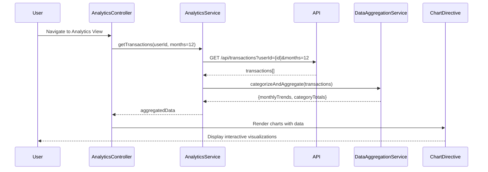

# Low-Level Design: QE-9190 - Spending Analytics and Trend Visualization

## a. Architecture Mapping

- **User Interface** → AngularJS Module (`creditCard.analyticsModule`) with Controller (`AnalyticsController`) and View (analytics.view.html)
- **Analytics Service** → AngularJS Service (`AnalyticsService`) for orchestrating data retrieval and visualization
- **Data Aggregation Service** → AngularJS Service (`DataAggregationService`) for processing and categorizing transactions
- **Transaction Data Repository** → REST API endpoints (`/api/transactions`, `/api/analytics/trends`)
- **Visualization Framework** → Chart.js library integrated via AngularJS directive (`chartDirective`)

**Folder Structure:**
```
/app
  /modules
    /analytics
      analytics.module.js
      analytics.controller.js
      analytics.view.html
  /services
    analytics.service.js
    data-aggregation.service.js
  /directives
    chart.directive.js
  /models
    transaction.model.js
    spending-category.model.js
```

## b. Component Specifications

| Name | Artifact Type | Responsibility | Key Dependencies |
|------|---------------|----------------|------------------|
| AnalyticsModule | AngularJS Module | Container for spending analytics feature | ngRoute, chart.js |
| AnalyticsController | Controller | Manages analytics view state, chart configuration, and user interactions | AnalyticsService, DataAggregationService, $scope |
| AnalyticsService | Service | Retrieves transaction data and coordinates visualization rendering | $http, $q |
| DataAggregationService | Service | Processes transactions, calculates category totals, and monthly trends | None (pure logic) |
| ChartDirective | Directive | Renders interactive charts using Chart.js library | Chart.js |
| CategoryFilterDirective | Directive | Provides UI for filtering by spending categories | None |

## c. Data Model

**Transaction Model:**
```javascript
{
  transactionId: String,
  userId: String,
  cardId: String,
  amount: Number,
  category: String, // One of 9 categories
  date: Date,
  description: String
}
```

**SpendingCategory Model:**
```javascript
{
  categoryName: String, // Food & Dining, Fuel, Shopping, Travel, Entertainment, Utilities, Healthcare, Education, Miscellaneous
  totalAmount: Number,
  transactionCount: Number,
  percentage: Number
}
```

**MonthlyTrend Model:**
```javascript
{
  month: String,
  totalSpend: Number,
  categoryBreakdown: Array<SpendingCategory>
}
```

## d. Data Flow

User navigates to analytics view → AnalyticsController calls AnalyticsService.getTransactions() → Service makes GET request to `/api/transactions?userId={id}&months=12` → API returns array of transactions (up to 1000+) → DataAggregationService.categorizeAndAggregate(transactions) processes data into nine categories and calculates monthly trends → Aggregated data is structured for Chart.js (labels, datasets) → AnalyticsController updates $scope.chartData and $scope.categoryData → ChartDirective renders interactive line chart for monthly trends and pie chart for category breakdown → User can filter by date range or category, triggering re-aggregation and chart update.

## e. Primary Sequence Diagram



## f. Implementation Notes

- Use Chart.js via AngularJS directive with isolated scope; pass chart type, data, and options as directive attributes.
- Implement DataAggregationService as pure JavaScript ES6 class with static methods for performance; use `Array.reduce()` for category aggregation.
- Cache transaction data in AnalyticsService for session duration; invalidate on user-triggered refresh.
- Use Bootstrap tabs for switching between monthly trend view and category breakdown view.
- Apply responsive chart configuration with `maintainAspectRatio: false` and container-based sizing for mobile compatibility.

## g. Error Handling

HTTP interceptor for API errors; display error message using Bootstrap alert; gracefully degrade to "No data available" state if aggregation fails.

## h. Security Notes

Requires token-based auth via existing SSO; API enforces user-transaction ownership; no sensitive transaction details exposed beyond amount and category.