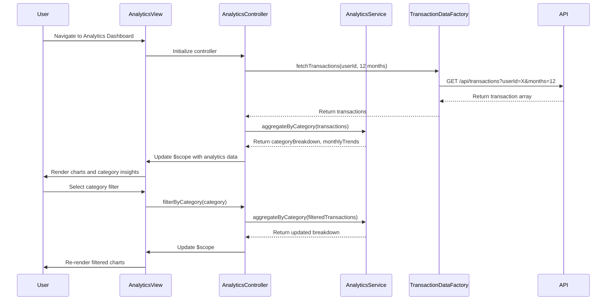

# Low-Level Design: QE-9191 - Spending Analytics and Category-wise Insights

## a. Architecture Mapping

**HLD Component → AngularJS Artifact:**
- User Analytics Dashboard → AngularJS Module (`app.analytics`) + Controller (`AnalyticsController`)
- Analytics Engine (client-side aggregation) → Service (`AnalyticsService`)
- Transaction Data Service integration → Factory (`TransactionDataFactory`)
- Data Visualization rendering → Directive (`spendingChart`)
- Category filter and selection → Controller helper methods + Filter (`categoryFilter`)

**Recommended Folder Structure:**
```
app/
├── modules/
│   └── analytics/
│       ├── analytics.module.js
│       ├── analytics.controller.js
│       ├── analytics.service.js
│       ├── analytics.html
│       └── directives/
│           └── spending-chart.directive.js
├── shared/
│   ├── factories/
│   │   └── transaction-data.factory.js
│   └── filters/
│       └── category.filter.js
└── assets/
    └── css/
        └── analytics.css
```

## b. Component Specifications

| Component Name | Artifact Type | Responsibility | Key Dependencies |
|----------------|---------------|----------------|------------------|
| `app.analytics` | Module | Root module for analytics feature; declares all analytics components | `ngRoute`, `chart.js` (or similar charting library) |
| `AnalyticsController` | Controller | Manages analytics view state, user interactions, date range selection, category filtering | `AnalyticsService`, `TransactionDataFactory`, `$scope` |
| `AnalyticsService` | Service | Aggregates transaction data by category, calculates monthly trends, prepares chart datasets | `TransactionDataFactory` |
| `TransactionDataFactory` | Factory | Fetches transaction data from REST API, caches results, provides query methods | `$http`, `$q` |
| `spendingChart` | Directive | Renders interactive spending visualizations (bar/pie/line charts) with smooth transitions | `AnalyticsService`, charting library (e.g., Chart.js) |
| `categoryFilter` | Filter | Filters and formats category names for display consistency | None |

## c. Data Model

**SpendingAnalytics (JS Object):**
```javascript
{
  userId: String,
  dateRange: { startDate: Date, endDate: Date },
  categoryBreakdown: [
    {
      category: String, // 'Food & Dining', 'Fuel', 'Shopping', 'Travel', 'Entertainment', 'Utilities', 'Healthcare', 'Education', 'Miscellaneous'
      totalSpend: Number,
      transactionCount: Number,
      percentageOfTotal: Number
    }
  ],
  monthlyTrends: [
    {
      month: String, // 'YYYY-MM'
      totalSpend: Number,
      categorySpends: Object // { category: amount }
    }
  ],
  cardWiseSpend: [
    {
      cardId: String,
      cardName: String,
      totalSpend: Number
    }
  ]
}
```

**Transaction (JS Object - consumed from API):**
```javascript
{
  transactionId: String,
  cardId: String,
  amount: Number,
  category: String,
  merchant: String,
  date: Date,
  description: String
}
```

## d. Data Flow

User navigates to the Analytics Dashboard view, triggering `AnalyticsController` initialization. The controller invokes `TransactionDataFactory` to fetch the user's transaction history via REST API (`GET /api/transactions?userId={id}&months=12`). Once data is retrieved, `AnalyticsService` aggregates transactions by category and month, calculating totals, percentages, and trends. The processed datasets are bound to `$scope` and passed to the `spendingChart` directive, which renders interactive visualizations using a charting library. User interactions (e.g., selecting a category or date range) trigger controller methods that re-invoke the service to filter and re-aggregate data, updating the view reactively.

## e. Primary Sequence Diagram



## f. Implementation Notes

- Use AngularJS dependency injection to inject `AnalyticsService` and `TransactionDataFactory` into `AnalyticsController` for testability and modularity.
- Leverage ES6 classes or factory patterns for service definitions; use `$http` promises and handle with `.then()` and `.catch()` for async API calls.
- Integrate a lightweight charting library (e.g., Chart.js or D3.js) via a custom directive that watches scope data and re-renders charts on data changes with smooth CSS transitions.
- Implement client-side caching in `TransactionDataFactory` using `$cacheFactory` to avoid redundant API calls when navigating between views.
- Use AngularJS filters for date formatting (`date` filter) and category name display (`categoryFilter`) to maintain consistent UI presentation.

## g. Error Handling

HTTP interceptor captures API errors (4xx/5xx); display user-friendly error messages via a shared notification service and log errors to console for debugging.

## h. Security Notes

Requires token-based authentication via existing SSO; API calls include Authorization header with JWT token for secure access to user transaction data.