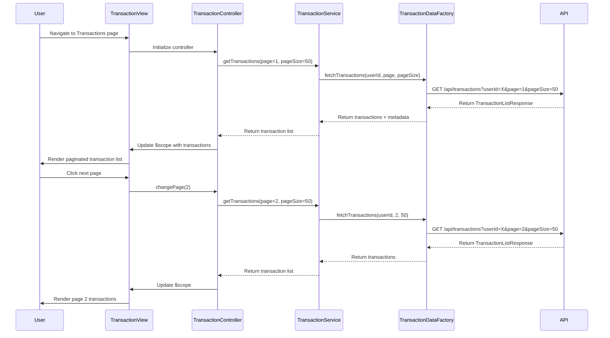

# Low-Level Design: QE-9192 - Transaction Management and Monitoring

## a. Architecture Mapping

**HLD Component → AngularJS Artifact:**
- User Interface Transaction View → AngularJS Module (`app.transactions`) + Controller (`TransactionController`)
- Transaction Processing System integration → Service (`TransactionService`)
- Credit Card Transaction Database access → Factory (`TransactionDataFactory`)
- Category Mapping Service integration → Service (`CategoryMappingService`)
- Pagination and filtering logic → Controller methods + Directive (`transactionList`)

**Recommended Folder Structure:**
```
app/
├── modules/
│   └── transactions/
│       ├── transactions.module.js
│       ├── transactions.controller.js
│       ├── transactions.service.js
│       ├── transactions.html
│       └── directives/
│           └── transaction-list.directive.js
├── shared/
│   ├── factories/
│   │   └── transaction-data.factory.js
│   └── services/
│       └── category-mapping.service.js
└── assets/
    └── css/
        └── transactions.css
```

## b. Component Specifications

| Component Name | Artifact Type | Responsibility | Key Dependencies |
|----------------|---------------|----------------|------------------|
| `app.transactions` | Module | Root module for transaction management; declares transaction components | `ngRoute`, `ui.bootstrap` (for pagination) |
| `TransactionController` | Controller | Manages transaction list view, pagination state, filtering, sorting, and detail display | `TransactionService`, `CategoryMappingService`, `$scope` |
| `TransactionService` | Service | Orchestrates transaction retrieval, filtering, and sorting logic; manages pagination state | `TransactionDataFactory` |
| `TransactionDataFactory` | Factory | Fetches transaction data from REST API with pagination and filtering parameters | `$http`, `$q` |
| `CategoryMappingService` | Service | Maps transaction category codes to display names and provides category metadata | None (or static config) |
| `transactionList` | Directive | Renders paginated transaction list with responsive layout and detail expansion | `TransactionService` |

## c. Data Model

**Transaction (JS Object):**
```javascript
{
  transactionId: String,
  cardId: String,
  cardName: String,
  amount: Number,
  currency: String, // e.g., 'USD'
  category: String, // 'Food & Dining', 'Fuel', etc.
  merchant: String,
  date: Date,
  description: String,
  status: String // 'Posted', 'Pending'
}
```

**TransactionListResponse (API Response):**
```javascript
{
  transactions: Array<Transaction>,
  totalCount: Number,
  pageSize: Number,
  currentPage: Number
}
```

**PaginationState (Controller State):**
```javascript
{
  currentPage: Number,
  pageSize: Number,
  totalPages: Number,
  sortBy: String, // 'date', 'amount', 'merchant'
  sortOrder: String, // 'asc', 'desc'
  filterCategory: String,
  filterCardId: String
}
```

## d. Data Flow

User navigates to the Transaction Management view, triggering `TransactionController` initialization. The controller invokes `TransactionService.getTransactions()` with default pagination parameters (page 1, pageSize 50). `TransactionService` calls `TransactionDataFactory`, which sends a GET request to `/api/transactions?page=1&pageSize=50&userId={id}`. The API returns a paginated transaction list, which is passed through `CategoryMappingService` to enrich category display names. The controller binds the transaction array and pagination metadata to `$scope`, and the `transactionList` directive renders the data in a responsive table. User interactions (page navigation, sorting, filtering) update the pagination state and trigger new API calls, refreshing the view with updated transaction data.

## e. Primary Sequence Diagram



## f. Implementation Notes

- Use AngularJS dependency injection to inject `TransactionService`, `CategoryMappingService`, and `TransactionDataFactory` into `TransactionController`.
- Implement pagination using UI Bootstrap's `uib-pagination` directive or custom pagination controls bound to controller methods.
- Use `$http` with query parameters for API calls; handle promises with `.then()` and `.catch()` for error handling.
- Implement client-side sorting and filtering for the current page to reduce API calls; trigger API call only when changing pages or applying new filters.
- Use AngularJS `ng-repeat` with `track by transactionId` for efficient list rendering and `limitTo` filter for client-side pagination if needed.

## g. Error Handling

HTTP interceptor-based error handling; display user-friendly messages for API failures (e.g., "Unable to load transactions") and retry option via notification service.

## h. Security Notes

Requires token-based auth via existing SSO; all API requests include Authorization header with JWT token to ensure secure access to user-specific transaction data.