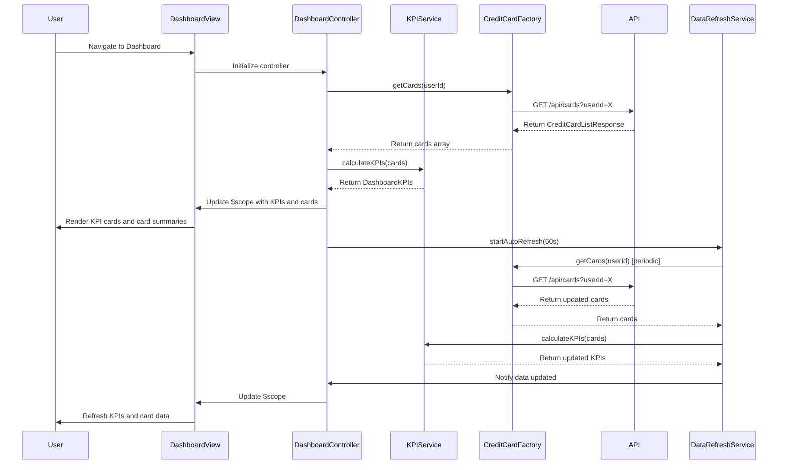

# Low-Level Design: QE-9193 - Credit Card Portfolio Management and Dashboard KPIs

## a. Architecture Mapping

**HLD Component → AngularJS Artifact:**
- User Interface Dashboard → AngularJS Module (`app.dashboard`) + Controller (`DashboardController`)
- KPI Calculation Engine (client-side aggregation) → Service (`KPIService`)
- Credit Card Information API integration → Factory (`CreditCardFactory`)
- Credit Card Data Repository access → Factory (`CreditCardFactory`)
- Real-time data refresh → Service (`DataRefreshService`) with `$interval`

**Recommended Folder Structure:**
```
app/
├── modules/
│   └── dashboard/
│       ├── dashboard.module.js
│       ├── dashboard.controller.js
│       ├── dashboard.service.js
│       ├── dashboard.html
│       └── components/
│           ├── kpi-card.component.js
│           └── card-summary.component.js
├── shared/
│   ├── factories/
│   │   └── credit-card.factory.js
│   └── services/
│       └── data-refresh.service.js
└── assets/
    └── css/
        └── dashboard.css
```

## b. Component Specifications

| Component Name | Artifact Type | Responsibility | Key Dependencies |
|----------------|---------------|----------------|------------------|
| `app.dashboard` | Module | Root module for dashboard feature; declares dashboard components | `ngRoute` |
| `DashboardController` | Controller | Manages dashboard view state, initiates KPI calculations, handles card selection | `KPIService`, `CreditCardFactory`, `DataRefreshService`, `$scope` |
| `KPIService` | Service | Aggregates credit card data to calculate monthly spend, total credit limit, available credit, outstanding amount | `CreditCardFactory` |
| `CreditCardFactory` | Factory | Fetches credit card data from REST API, caches card information, provides card query methods | `$http`, `$q` |
| `DataRefreshService` | Service | Manages periodic data refresh using `$interval` to keep KPIs up-to-date | `$interval`, `KPIService` |
| `kpiCard` | Component | Reusable component to display individual KPI (e.g., Monthly Spend) with label, value, and icon | None |
| `cardSummary` | Component | Displays summary information for a single credit card (name, limit, available credit, outstanding) | None |

## c. Data Model

**CreditCard (JS Object):**
```javascript
{
  cardId: String,
  cardName: String,
  cardNumber: String, // masked, e.g., '**** **** **** 1234'
  cardType: String, // 'Visa', 'MasterCard', 'Amex'
  creditLimit: Number,
  availableCredit: Number,
  outstandingAmount: Number,
  monthlySpend: Number,
  dueDate: Date,
  status: String // 'Active', 'Blocked'
}
```

**DashboardKPIs (JS Object):**
```javascript
{
  totalMonthlySpend: Number,
  totalCreditLimit: Number,
  totalAvailableCredit: Number,
  totalOutstandingAmount: Number,
  cardCount: Number,
  lastUpdated: Date
}
```

**CreditCardListResponse (API Response):**
```javascript
{
  cards: Array<CreditCard>,
  userId: String
}
```

## d. Data Flow

User navigates to the Dashboard view, triggering `DashboardController` initialization. The controller invokes `CreditCardFactory.getCards()` to fetch the user's credit card portfolio via REST API (`GET /api/cards?userId={id}`). Once card data is retrieved, `KPIService.calculateKPIs()` aggregates the data to compute total monthly spend, total credit limit, total available credit, and total outstanding amount across all cards. The calculated KPIs and individual card details are bound to `$scope` and rendered via `kpiCard` and `cardSummary` components. `DataRefreshService` initiates a periodic refresh (e.g., every 60 seconds) using `$interval`, re-fetching card data and updating KPIs to ensure real-time accuracy. User interactions (e.g., selecting a specific card) update the view to display detailed card information.

## e. Primary Sequence Diagram



## f. Implementation Notes

- Use AngularJS dependency injection to inject `KPIService`, `CreditCardFactory`, and `DataRefreshService` into `DashboardController` for modularity and testability.
- Implement `DataRefreshService` using `$interval` to poll the API every 60 seconds; ensure proper cleanup with `$interval.cancel()` in controller `$destroy` event.
- Use AngularJS components (`kpiCard`, `cardSummary`) with one-way bindings (`<`) for reusable, isolated UI elements.
- Leverage `$http` with promise chaining (`.then()`, `.catch()`) for API calls; implement caching in `CreditCardFactory` using `$cacheFactory` to reduce redundant requests.
- Apply Bootstrap grid system and responsive utilities (e.g., `col-md-3`, `col-sm-6`) to ensure dashboard layout adapts to desktop, tablet, and mobile devices.

## g. Error Handling

HTTP interceptor captures API errors; display user-friendly error messages (e.g., "Unable to load credit card data") via notification service and provide manual refresh option.

## h. Security Notes

Requires token-based auth via existing SSO; all API calls include Authorization header with JWT token to securely access user-specific credit card information.