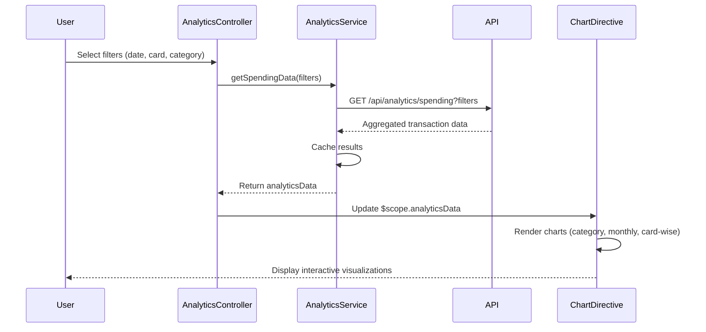

# Low-Level Design: QE-9194 - Spending Analytics and Insights

## a. Architecture Mapping

- **AnalyticsModule** (ng.module) - Root module for analytics feature
- **AnalyticsController** - Manages UI state, filter selections, and chart interactions
- **AnalyticsService** - Orchestrates data aggregation and API calls
- **CategoryService** - Handles transaction categorization logic
- **ChartDirective** - Encapsulates visualization rendering (wraps D3/Chart.js)
- **FilterFactory** - Provides reusable filter utilities for date/card/category

**Folder Structure:**
```
/app
  /analytics
    analytics.module.js
    analytics.controller.js
    analytics.service.js
    analytics.html
    /directives
      chart.directive.js
    /services
      category.service.js
    /factories
      filter.factory.js
```

## b. Component Specifications

| Component | Artifact Type | Responsibility | Key Dependencies |
|-----------|--------------|----------------|------------------|
| AnalyticsModule | Module | Registers all analytics components and routes | ngRoute, ui.bootstrap |
| AnalyticsController | Controller | Manages filter state, triggers data refresh, binds chart data to view | AnalyticsService, FilterFactory, $scope |
| AnalyticsService | Service | Fetches transaction data, aggregates by category/month/card, caches results | $http, $q, CategoryService |
| CategoryService | Service | Maps transactions to 9 predefined categories | None |
| ChartDirective | Directive | Renders interactive charts (pie, bar, line) using D3.js or Chart.js | $timeout |
| FilterFactory | Factory | Provides date range, card, and category filter utilities | None |

## c. Data Model

**SpendingAnalytics** (JS Object):
```javascript
{
  categoryBreakdown: Array<{category: String, amount: Number, percentage: Number}>,
  monthlyTrends: Array<{month: String, totalSpend: Number}>,
  cardWiseSpend: Array<{cardId: String, cardName: String, totalSpend: Number}>,
  filters: {dateRange: {start: Date, end: Date}, cardIds: Array<String>, categories: Array<String>}
}
```

**Transaction** (JS Object):
```javascript
{
  id: String,
  cardId: String,
  amount: Number,
  date: Date,
  merchant: String,
  category: String // One of 9 predefined categories
}
```

## d. Data Flow

User selects filters (date range, card, category) in AnalyticsController → Controller invokes AnalyticsService.getSpendingData(filters) → Service calls REST API /api/analytics/spending with filter params → API returns aggregated transaction data → CategoryService validates/enriches category data → AnalyticsService caches results and returns to Controller → Controller updates $scope.analyticsData → ChartDirective watches data changes and re-renders interactive charts (category pie chart, monthly trend line chart, card-wise bar chart) → User interactions (hover, click) trigger chart events handled by directive.

## e. Primary Sequence Diagram



## f. Implementation Notes

- Use AngularJS Dependency Injection for all services/factories; inject via constructor pattern for testability
- Leverage $http interceptors for API error handling and loading states
- Implement client-side caching in AnalyticsService using $cacheFactory with 5-minute TTL
- Use ES6 arrow functions and const/let for cleaner service/controller code
- ChartDirective should use isolated scope with two-way binding for data updates

## g. Error Handling

HTTP interceptor captures API errors; display user-friendly toast notifications via ui-bootstrap $uibModal or toastr; fallback to cached data if available.

## h. Security Notes

Standard input validation and secure API calls assumed; API endpoints require token-based auth via existing SSO.