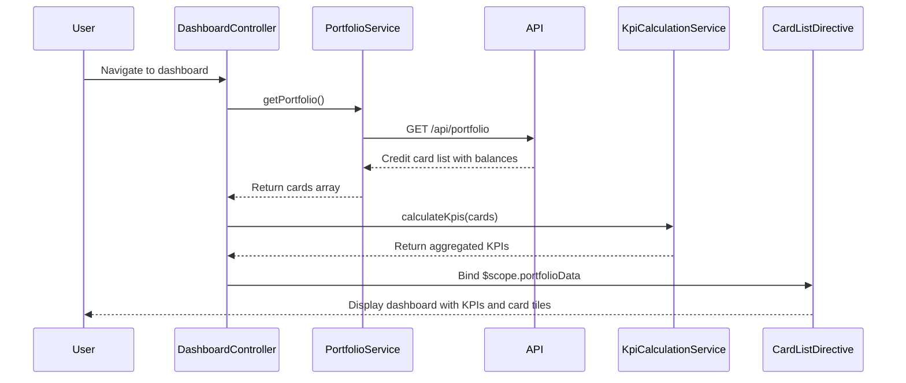

# Low-Level Design: QE-9195 - Credit Card Portfolio Management and KPI Dashboard

## a. Architecture Mapping

- **DashboardModule** (ng.module) - Root module for dashboard feature
- **DashboardController** - Manages KPI display, card list, and real-time refresh
- **PortfolioService** - Fetches credit card portfolio data and KPIs
- **KpiCalculationService** - Computes monthly spend, available credit, outstanding amounts
- **CardListDirective** - Renders individual card tiles with details
- **RefreshFactory** - Provides auto-refresh mechanism for real-time KPI updates

**Folder Structure:**
```
/app
  /dashboard
    dashboard.module.js
    dashboard.controller.js
    dashboard.service.js
    dashboard.html
    /directives
      card-list.directive.js
    /services
      portfolio.service.js
      kpi-calculation.service.js
    /factories
      refresh.factory.js
```

## b. Component Specifications

| Component | Artifact Type | Responsibility | Key Dependencies |
|-----------|--------------|----------------|------------------|
| DashboardModule | Module | Registers dashboard components, routes, and resolves | ngRoute, ui.bootstrap |
| DashboardController | Controller | Binds KPI data to view, triggers refresh, handles user interactions | PortfolioService, KpiCalculationService, RefreshFactory, $scope |
| PortfolioService | Service | Fetches user's credit card list and balances from API | $http, $q |
| KpiCalculationService | Service | Aggregates monthly spend, total credit limit, available credit, outstanding amounts | None |
| CardListDirective | Directive | Displays card tiles with card name, limit, available credit, outstanding | None |
| RefreshFactory | Factory | Implements polling mechanism for real-time KPI updates (every 30 seconds) | $interval |

## c. Data Model

**CreditCardPortfolio** (JS Object):
```javascript
{
  cards: Array<{cardId: String, cardName: String, creditLimit: Number, availableCredit: Number, outstandingAmount: Number}>,
  kpis: {monthlySpend: Number, totalCreditLimit: Number, totalAvailableCredit: Number, totalOutstanding: Number}
}
```

**CreditCard** (JS Object):
```javascript
{
  cardId: String,
  cardName: String,
  cardNumber: String, // Masked
  creditLimit: Number,
  availableCredit: Number,
  outstandingAmount: Number,
  lastUpdated: Date
}
```

## d. Data Flow

User authenticates and navigates to dashboard → DashboardController invokes PortfolioService.getPortfolio() → Service calls REST API /api/portfolio → API returns user's credit card list with balances → KpiCalculationService.calculateKpis(cards) aggregates monthly spend, total limits, available credit, outstanding amounts → Controller updates $scope.portfolioData → CardListDirective renders individual card tiles → RefreshFactory polls API every 30 seconds → On data change, Controller updates view with new KPIs → User sees real-time dashboard with sub-2-second initial load.

## e. Primary Sequence Diagram



## f. Implementation Notes

- Use AngularJS $http service with promise chaining for API calls; handle errors via .catch()
- Implement KPI calculations in pure JS functions for unit testability
- RefreshFactory uses $interval to poll API; cancel interval on $scope.$destroy to prevent memory leaks
- Use ng-repeat with track by cardId in CardListDirective for efficient DOM updates
- Apply Bootstrap grid system for responsive card tiles (col-md-4, col-sm-6, col-xs-12)

## g. Error Handling

$http interceptor catches API failures; display error banner via $scope.errorMessage; retry mechanism with exponential backoff in RefreshFactory.

## h. Security Notes

Requires token-based auth via existing SSO; API endpoints validate user session; card numbers displayed in masked format.