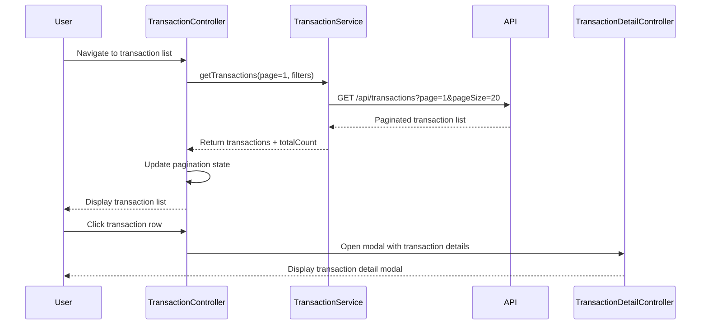

# Low-Level Design: QE-9196 - Transaction Management and Viewing

## a. Architecture Mapping

- **TransactionModule** (ng.module) - Root module for transaction management feature
- **TransactionController** - Manages transaction list, search, filter, pagination
- **TransactionService** - Fetches transaction data from API with pagination/filtering
- **TransactionDetailController** - Displays individual transaction details in modal
- **SearchFilterDirective** - Provides search and filter UI controls
- **PaginationFactory** - Handles pagination logic and state

**Folder Structure:**
```
/app
  /transactions
    transaction.module.js
    transaction.controller.js
    transaction-detail.controller.js
    transaction.service.js
    transaction-list.html
    transaction-detail.html
    /directives
      search-filter.directive.js
    /factories
      pagination.factory.js
```

## b. Component Specifications

| Component | Artifact Type | Responsibility | Key Dependencies |
|-----------|--------------|----------------|------------------|
| TransactionModule | Module | Registers transaction components, routes, and modal configs | ngRoute, ui.bootstrap |
| TransactionController | Controller | Manages transaction list state, search/filter inputs, pagination controls | TransactionService, PaginationFactory, $scope |
| TransactionService | Service | Fetches paginated transaction data from API with search/filter params | $http, $q |
| TransactionDetailController | Controller | Displays transaction details in modal (merchant, amount, date, category) | $uibModalInstance, transaction |
| SearchFilterDirective | Directive | Renders search input and card/date filter dropdowns | None |
| PaginationFactory | Factory | Calculates page offsets, total pages, and manages pagination state | None |

## c. Data Model

**Transaction** (JS Object):
```javascript
{
  transactionId: String,
  cardId: String,
  cardName: String,
  merchant: String,
  amount: Number,
  date: Date,
  category: String,
  status: String // e.g., "Posted", "Pending"
}
```

**TransactionListResponse** (API Response):
```javascript
{
  transactions: Array<Transaction>,
  totalCount: Number,
  page: Number,
  pageSize: Number
}
```

## d. Data Flow

User navigates to transaction list → TransactionController invokes TransactionService.getTransactions(page, filters) → Service calls REST API /api/transactions?page=1&pageSize=20&cardId=X&dateRange=Y → API returns paginated transaction list with totalCount → Controller updates $scope.transactions and pagination state via PaginationFactory → SearchFilterDirective binds filter inputs to $scope → User applies search/filter → Controller re-invokes TransactionService with new params → Updated transaction list rendered → User clicks transaction row → TransactionDetailController opens modal with full transaction details.

## e. Primary Sequence Diagram



## f. Implementation Notes

- Use AngularJS $http with query params for pagination/filtering; debounce search input with $timeout (300ms)
- PaginationFactory maintains immutable state; returns new state object on page change
- TransactionService caches last request to avoid redundant API calls on back navigation
- Use ui-bootstrap $uibModal for transaction detail modal; pass transaction object via resolve
- Apply ng-table or custom pagination directive with Bootstrap pagination component

## g. Error Handling

$http interceptor handles API errors; display inline error message in transaction list; retry button triggers TransactionService.getTransactions() again.

## h. Security Notes

Standard input validation and secure API calls assumed; API endpoints require token-based auth via existing SSO.