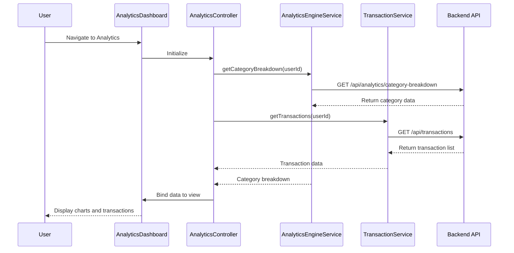

# Low-Level Design: QE-9197 - Spending Analytics and Transaction Insights

## a. Architecture Mapping

- **Analytics Dashboard UI** → AngularJS Module (`spendingAnalytics`) + HTML5 View Templates
- **Analytics Controller** → AngularJS Controller (`AnalyticsController`)
- **Transaction Service Integration** → AngularJS Service (`TransactionService`)
- **Analytics Engine Integration** → AngularJS Service (`AnalyticsEngineService`)
- **Visualization Component** → AngularJS Directive (`spendingChart`)

**Recommended Folder Structure:**
```
app/
  modules/
    spending-analytics/
      controllers/
      services/
      directives/
      views/
      spending-analytics.module.js
```

## b. Component Specifications

| Name | Artifact Type | Responsibility | Key Dependencies |
|------|---------------|----------------|------------------|
| spendingAnalytics | Module | Root module for spending analytics feature | ngRoute, ui.bootstrap |
| AnalyticsController | Controller | Manages analytics dashboard state, user interactions, and data binding | TransactionService, AnalyticsEngineService, $scope |
| TransactionService | Service | Fetches raw transaction data from backend REST API | $http, $q |
| AnalyticsEngineService | Service | Aggregates and processes spending data by category and time period | $http, $q |
| spendingChart | Directive | Renders interactive category-wise spending charts using D3/Chart.js | AnalyticsEngineService |
| transactionList | Directive | Displays paginated transaction history with filtering | TransactionService |

## c. Data Model

**SpendingAnalytics Object:**
```javascript
{
  userId: String,
  monthlyTrends: Array<{month: String, totalSpend: Number}>,
  categoryBreakdown: Array<{category: String, amount: Number, percentage: Number}>,
  transactions: Array<Transaction>
}
```

**Transaction Object:**
```javascript
{
  transactionId: String,
  cardId: String,
  amount: Number,
  category: String, // Food & Dining, Fuel, Shopping, Travel, Entertainment, Utilities, Healthcare, Education, Miscellaneous
  date: Date,
  merchant: String,
  description: String
}
```

## d. Data Flow

User navigates to Analytics Dashboard → View loads and AnalyticsController initializes → Controller calls TransactionService.getTransactions() and AnalyticsEngineService.getCategoryBreakdown() via REST APIs → Services return aggregated spending data and transaction list → Controller binds data to $scope → spendingChart directive renders interactive visualizations and transactionList directive displays transaction history → User interactions (filter, date range) trigger controller methods that re-fetch data and update UI.

## e. Primary Sequence Diagram



## f. Implementation Notes

- Use AngularJS Dependency Injection for all services and controllers
- Implement REST API calls using $http service with promise-based error handling
- Leverage ES6 classes for service definitions and arrow functions for callbacks
- Use Chart.js or D3.js wrapped in AngularJS directive for interactive visualizations
- Apply Bootstrap grid system for responsive layout across devices

## g. Error Handling

HTTP interceptor captures API errors; controller displays user-friendly notifications using Bootstrap alerts or toast messages.

## h. Security Notes

Standard input validation and secure API calls assumed; token-based auth via existing SSO.