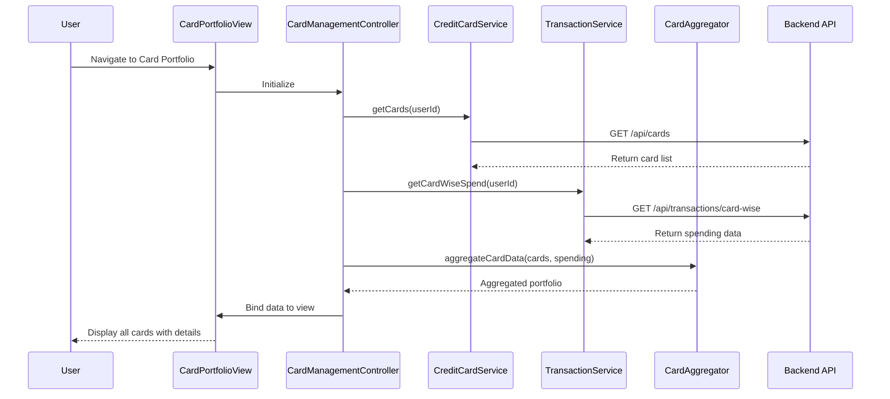

# Low-Level Design: QE-9198 - Multiple Credit Card Management and Viewing

## a. Architecture Mapping

- **Card Portfolio View UI** → AngularJS Module (`cardManagement`) + HTML5 View Templates
- **Card Management Controller** → AngularJS Controller (`CardManagementController`)
- **Credit Card Data Service Integration** → AngularJS Service (`CreditCardService`)
- **Transaction Service Integration** → AngularJS Service (`TransactionService`)
- **Card Aggregation Module** → AngularJS Factory (`CardAggregator`)

**Recommended Folder Structure:**
```
app/
  modules/
    card-management/
      controllers/
      services/
      factories/
      views/
      card-management.module.js
```

## b. Component Specifications

| Name | Artifact Type | Responsibility | Key Dependencies |
|------|---------------|----------------|------------------|
| cardManagement | Module | Root module for credit card management feature | ngRoute, ui.bootstrap |
| CardManagementController | Controller | Manages card portfolio display, user interactions, and data binding | CreditCardService, TransactionService, CardAggregator, $scope |
| CreditCardService | Service | Fetches credit card information, limits, and balances from backend REST API | $http, $q |
| TransactionService | Service | Retrieves card-wise spending data and transaction details | $http, $q |
| CardAggregator | Factory | Aggregates and normalizes multi-card data for consistent UI display | CreditCardService, TransactionService |
| cardDetails | Directive | Renders individual card details with credit limit, balance, and spend info | CardAggregator |

## c. Data Model

**CreditCard Object:**
```javascript
{
  cardId: String,
  userId: String,
  cardType: String, // Visa, MasterCard, Amex
  cardNumber: String, // masked
  creditLimit: Number,
  currentBalance: Number,
  availableCredit: Number,
  outstandingAmount: Number,
  expiryDate: String
}
```

**CardPortfolio Object:**
```javascript
{
  userId: String,
  cards: Array<CreditCard>,
  totalCreditLimit: Number,
  totalAvailableCredit: Number,
  totalOutstanding: Number
}
```

## d. Data Flow

User navigates to Card Portfolio View → View loads and CardManagementController initializes → Controller calls CreditCardService.getCards() to fetch all user cards via REST API → CardAggregator processes and aggregates card data → Controller calls TransactionService.getCardWiseSpend() for spending details → Services return card portfolio data → Controller binds aggregated data to $scope → cardDetails directive renders each card with relevant information → User can view, compare, and monitor individual card details in unified interface.

## e. Primary Sequence Diagram



## f. Implementation Notes

- Use AngularJS Dependency Injection for services, controllers, and factories
- Implement REST API calls using $http service with promise chaining
- Use ES6 template literals for dynamic card number masking
- Apply Bootstrap card components for responsive multi-card layout
- Leverage ng-repeat with track by for efficient card list rendering

## g. Error Handling

HTTP interceptor-based error handling with try/catch blocks; user notifications via Bootstrap modals or inline alerts.

## h. Security Notes

Requires token-based auth via existing SSO; card numbers are masked on client-side for PCI compliance.