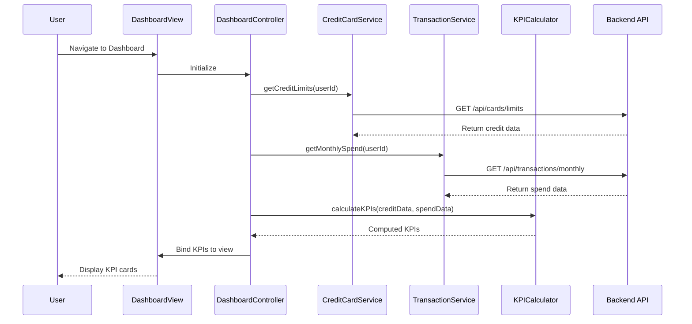

# Low-Level Design: QE-9199 - Credit Card Dashboard and KPI Management

## a. Architecture Mapping

- **Dashboard UI** → AngularJS Module (`dashboardKPI`) + HTML5 View Templates
- **Dashboard Controller** → AngularJS Controller (`DashboardController`)
- **Credit Card Data Service Integration** → AngularJS Service (`CreditCardService`)
- **Transaction Service Integration** → AngularJS Service (`TransactionService`)
- **KPI Calculation Engine** → AngularJS Factory (`KPICalculator`)

**Recommended Folder Structure:**
```
app/
  modules/
    dashboard/
      controllers/
      services/
      factories/
      views/
      dashboard.module.js
```

## b. Component Specifications

| Name | Artifact Type | Responsibility | Key Dependencies |
|------|---------------|----------------|------------------|
| dashboardKPI | Module | Root module for dashboard KPI feature | ngRoute, ui.bootstrap |
| DashboardController | Controller | Manages dashboard state, KPI display, and user interactions | CreditCardService, TransactionService, KPICalculator, $scope |
| CreditCardService | Service | Fetches card balances and credit limits from backend REST API | $http, $q |
| TransactionService | Service | Retrieves monthly spend and outstanding amounts data | $http, $q |
| KPICalculator | Factory | Computes KPI values (monthly spend, total credit limit, available credit, outstanding) | CreditCardService, TransactionService |
| kpiCard | Directive | Renders individual KPI widget with value, label, and visual indicator | KPICalculator |

## c. Data Model

**DashboardKPI Object:**
```javascript
{
  userId: String,
  monthlySpend: Number,
  totalCreditLimit: Number,
  availableCredit: Number,
  outstandingAmount: Number,
  lastUpdated: Date
}
```

**KPIMetric Object:**
```javascript
{
  label: String,
  value: Number,
  unit: String, // currency symbol
  trend: String, // up, down, stable
  icon: String // CSS class for icon
}
```

## d. Data Flow

User navigates to Dashboard → View loads and DashboardController initializes → Controller calls CreditCardService.getCreditLimits() and TransactionService.getMonthlySpend() via REST APIs → KPICalculator processes raw data and computes all four KPIs → Controller binds calculated KPI metrics to $scope → kpiCard directive renders each KPI in responsive card layout → Dashboard updates in near real-time or on user refresh action.

## e. Primary Sequence Diagram



## f. Implementation Notes

- Use AngularJS Dependency Injection for all services, controllers, and factories
- Implement REST API calls using $http service with promise-based async handling
- Use ES6 const/let for variable declarations and arrow functions for callbacks
- Apply Bootstrap grid and card components for responsive KPI layout
- Leverage AngularJS filters for currency formatting and number display

## g. Error Handling

Interceptor-based API error handling; controller displays fallback values or error messages using Bootstrap alerts.

## h. Security Notes

Requires token-based auth via existing SSO; standard input validation and secure API calls assumed.