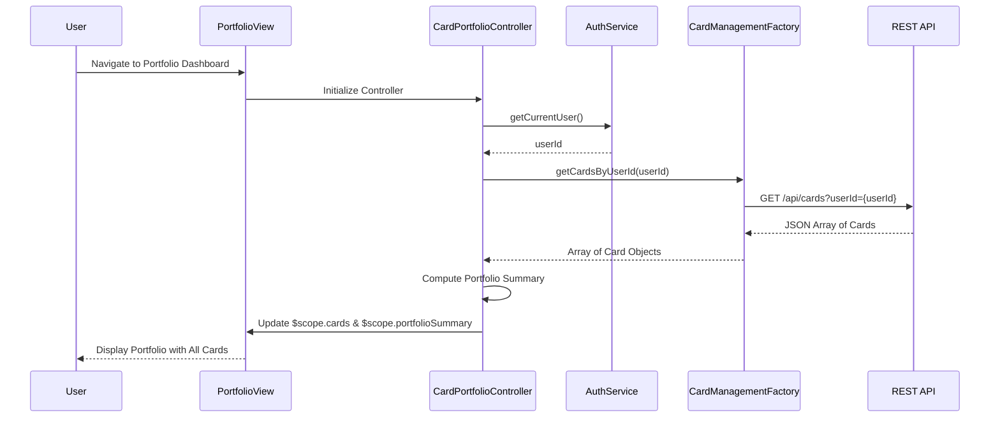

# Low-Level Design: Multiple Credit Card Portfolio Management
**Epic ID:** QE-9200  
**Tech Stack:** AngularJS 1.x, JavaScript ES6, HTML5, CSS3, Bootstrap, REST APIs, MVC Architecture

---

## a. Architecture Mapping

- **Portfolio Management UI** → AngularJS Module (`creditCardPortfolioModule`) + View Template (`portfolio-dashboard.html`)
- **Card Management Controller** → AngularJS Controller (`CardPortfolioController`)
- **User Profile Service** → AngularJS Service (`AuthService`) for authentication
- **Card Management Service** → AngularJS Factory (`CardManagementFactory`) for REST API calls
- **Card Data Repository** → Backend REST API endpoints (consumed by Factory)

**Folder Structure:**
```
/app
  /modules
    /portfolio
      portfolio.module.js
      portfolio.controller.js
      portfolio.service.js
      portfolio.factory.js
      portfolio.html
  /common
    /services
      auth.service.js
  /assets
    /css
      portfolio.css
```

---

## b. Component Specifications

| Name | Artifact Type | Responsibility | Key Dependencies |
|------|---------------|----------------|------------------|
| creditCardPortfolioModule | Module | Defines the portfolio management feature module | angular, ngRoute, ngResource |
| CardPortfolioController | Controller | Manages UI state, handles user interactions, coordinates card data retrieval | CardManagementFactory, AuthService, $scope |
| AuthService | Service | Handles user authentication and session management | $http, $window (localStorage) |
| CardManagementFactory | Factory | Encapsulates REST API calls for card CRUD operations and batch retrieval | $resource or $http |
| portfolioDirective | Directive | Renders individual card detail component with two-way binding | None |
| CardModel | ES6 Class/Object | Represents card entity with properties: cardId, userId, cardNumber, creditLimit, outstandingBalance, cardType | None |

---

## c. Data Model

**CardModel (ES6 Class)**
```javascript
class Card {
  constructor(cardId, userId, cardNumber, creditLimit, outstandingBalance, cardType, issuer) {
    this.cardId = cardId;              // String
    this.userId = userId;              // String
    this.cardNumber = cardNumber;      // String (masked: **** **** **** 1234)
    this.creditLimit = creditLimit;    // Number
    this.outstandingBalance = outstandingBalance; // Number
    this.availableCredit = creditLimit - outstandingBalance; // Number (computed)
    this.cardType = cardType;          // String (e.g., 'Visa', 'MasterCard')
    this.issuer = issuer;              // String
  }
}
```

**PortfolioSummary (Object)**
```javascript
{
  totalCards: Number,
  totalCreditLimit: Number,
  totalOutstanding: Number,
  totalAvailableCredit: Number
}
```

---

## d. Data Flow

User logs in and navigates to the portfolio dashboard → `CardPortfolioController` initializes and calls `AuthService.getCurrentUser()` to retrieve authenticated user context → Controller invokes `CardManagementFactory.getCardsByUserId(userId)` which sends a GET request to `/api/cards?userId={userId}` → Backend returns JSON array of card objects → Factory maps response to `Card` model instances → Controller updates `$scope.cards` array and computes `$scope.portfolioSummary` → View (`portfolio.html`) renders card list using `ng-repeat` with Bootstrap grid, displaying individual card details and aggregate portfolio metrics → User can click on a card to view detailed information, triggering `$scope.viewCardDetails(cardId)` which updates the UI with expanded card view.

---

## e. Primary Sequence Diagram



---

## f. Implementation Notes

- Use AngularJS Dependency Injection to inject `CardManagementFactory` and `AuthService` into `CardPortfolioController` for testability and modularity.
- Implement `CardManagementFactory` using `$resource` for RESTful operations with batch retrieval endpoint `/api/cards?userId={userId}` to meet <300ms latency.
- Apply ES6 classes for `Card` model with computed properties (e.g., `availableCredit`) to encapsulate business logic.
- Use Bootstrap grid system (`col-md-4`) with `ng-repeat` to render responsive card tiles; apply CSS transitions for card selection/hover effects.
- Implement data isolation by always passing `userId` from authenticated session; backend enforces user-level access control.

---

## g. Error Handling

HTTP interceptor (`$httpProvider.interceptors`) captures API errors (4xx/5xx), displays user-friendly notifications via Bootstrap alerts, and logs errors to console.

---

## h. Security Notes

Requires token-based authentication via existing SSO; userId-based data isolation enforced at API layer to prevent unauthorized card access.

---