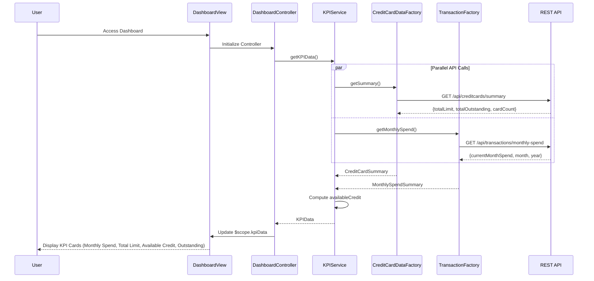

# Low-Level Design: Dashboard and KPI Management
**Epic ID:** QE-9201  
**Tech Stack:** AngularJS 1.x, JavaScript ES6, HTML5, CSS3, Bootstrap, REST APIs, MVC Architecture

---

## a. Architecture Mapping

- **Dashboard UI** → AngularJS Module (`dashboardModule`) + View Template (`dashboard.html`)
- **KPI Aggregation Service** → AngularJS Service (`KPIService`) for business logic and aggregation
- **Credit Card Data Service** → AngularJS Factory (`CreditCardDataFactory`) for card-related REST API calls
- **Transaction Service** → AngularJS Factory (`TransactionFactory`) for transaction-related REST API calls
- **Real-Time Data Refresh** → AngularJS `$interval` service for periodic polling or WebSocket integration

**Folder Structure:**
```
/app
  /modules
    /dashboard
      dashboard.module.js
      dashboard.controller.js
      dashboard.service.js
      dashboard.html
  /common
    /factories
      creditcard-data.factory.js
      transaction.factory.js
  /assets
    /css
      dashboard.css
```

---

## b. Component Specifications

| Name | Artifact Type | Responsibility | Key Dependencies |
|------|---------------|----------------|------------------|
| dashboardModule | Module | Defines the dashboard feature module | angular, ngRoute |
| DashboardController | Controller | Manages dashboard state, triggers KPI data fetch, handles refresh logic | KPIService, $scope, $interval |
| KPIService | Service | Aggregates data from multiple factories, computes KPIs (monthly spend, total limit, available credit, outstanding) | CreditCardDataFactory, TransactionFactory, $q for promises |
| CreditCardDataFactory | Factory | Encapsulates REST API calls to `/api/creditcards/summary` for card limits and balances | $http |
| TransactionFactory | Factory | Encapsulates REST API calls to `/api/transactions/monthly-spend` for monthly spend calculation | $http |
| kpiCardDirective | Directive | Reusable component to display individual KPI metric with icon and value | None |

---

## c. Data Model

**KPIData (Object)**
```javascript
{
  monthlySpend: Number,           // Total spend in current month
  totalCreditLimit: Number,       // Sum of all card limits
  availableCredit: Number,        // totalCreditLimit - totalOutstanding
  totalOutstanding: Number        // Sum of all outstanding balances
}
```

**CreditCardSummary (Object)**
```javascript
{
  totalLimit: Number,
  totalOutstanding: Number,
  cardCount: Number
}
```

**MonthlySpendSummary (Object)**
```javascript
{
  currentMonthSpend: Number,
  month: String,              // e.g., 'November 2026'
  year: Number
}
```

---

## d. Data Flow

User navigates to dashboard → `DashboardController` initializes and calls `KPIService.getKPIData()` → Service makes parallel API calls via `$q.all()`: `CreditCardDataFactory.getSummary()` (GET `/api/creditcards/summary`) and `TransactionFactory.getMonthlySpend()` (GET `/api/transactions/monthly-spend`) → Both factories return promises with JSON responses → `KPIService` aggregates responses, computes `availableCredit = totalLimit - totalOutstanding`, and returns `KPIData` object → Controller updates `$scope.kpiData` → View renders four KPI cards using `kpiCardDirective` with Bootstrap grid → `$interval` triggers `KPIService.getKPIData()` every 30 seconds for real-time refresh, updating `$scope.kpiData` and re-rendering UI.

---

## e. Primary Sequence Diagram



---

## f. Implementation Notes

- Use `$q.all()` in `KPIService` to execute parallel API calls to `CreditCardDataFactory` and `TransactionFactory`, reducing total load time to meet <2s requirement.
- Implement `$interval(KPIService.getKPIData, 30000)` in `DashboardController` for real-time refresh; cancel interval on `$scope.$on('$destroy')` to prevent memory leaks.
- Apply Bootstrap responsive grid (`col-xs-12 col-sm-6 col-md-3`) for KPI cards to ensure mobile and desktop compatibility.
- Use AngularJS one-time binding (`::`) for static labels to optimize digest cycle performance.
- Cache KPI data in `KPIService` with timestamp; skip API call if cache is <5 seconds old to reduce backend load during rapid navigation.

---

## g. Error Handling

HTTP interceptor captures API failures; fallback displays cached KPI data with "Last Updated" timestamp and retry button; user notifications via Bootstrap toast.

---

## h. Security Notes

Standard input validation and secure API calls assumed; token-based auth via existing SSO ensures user-specific KPI data retrieval.

---