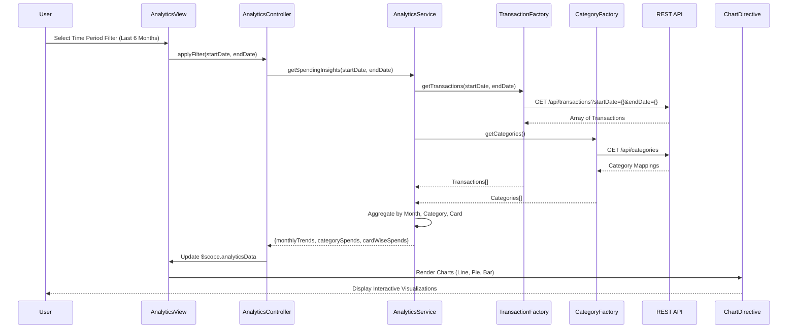

# Low-Level Design: Analytics and Spending Insights
**Epic ID:** QE-9202  
**Tech Stack:** AngularJS 1.x, JavaScript ES6, HTML5, CSS3, Bootstrap, REST APIs, MVC Architecture

---

## a. Architecture Mapping

- **User Interface** → AngularJS Module (`analyticsModule`) + View Template (`analytics.html`)
- **Analytics Controller** → AngularJS Controller (`AnalyticsController`)
- **Transaction Service** → AngularJS Factory (`TransactionFactory`) for raw transaction data
- **Category Classification Service** → AngularJS Factory (`CategoryFactory`) for category mappings
- **Analytics Engine** → AngularJS Service (`AnalyticsService`) for data aggregation and trend calculation
- **Data Visualization Layer** → AngularJS Directive (`chartDirective`) wrapping Chart.js or D3.js

**Folder Structure:**
```
/app
  /modules
    /analytics
      analytics.module.js
      analytics.controller.js
      analytics.service.js
      analytics.html
  /common
    /factories
      transaction.factory.js
      category.factory.js
    /directives
      chart.directive.js
  /assets
    /css
      analytics.css
```

---

## b. Component Specifications

| Name | Artifact Type | Responsibility | Key Dependencies |
|------|---------------|----------------|------------------|
| analyticsModule | Module | Defines the analytics feature module | angular, ngRoute, chart.js |
| AnalyticsController | Controller | Manages analytics view state, handles user filter selections (time period, card), triggers data fetch | AnalyticsService, $scope, $filter |
| AnalyticsService | Service | Aggregates transaction data by time period and category, computes trends and card-wise breakdowns | TransactionFactory, CategoryFactory, $q |
| TransactionFactory | Factory | Encapsulates REST API calls to `/api/transactions?startDate={}&endDate={}` for historical transaction data | $http |
| CategoryFactory | Factory | Encapsulates REST API calls to `/api/categories` for category mappings (Food & Dining, Fuel, etc.) | $http |
| chartDirective | Directive | Renders interactive charts (bar, line, pie) using Chart.js; accepts chart type, data, and options as attributes | Chart.js library |

---

## c. Data Model

**Transaction (Object)**
```javascript
{
  transactionId: String,
  cardId: String,
  amount: Number,
  category: String,           // One of 9 predefined categories
  date: Date,
  description: String
}
```

**CategorySpend (Object)**
```javascript
{
  category: String,           // e.g., 'Food & Dining'
  totalSpend: Number,
  transactionCount: Number,
  percentage: Number          // Percentage of total spend
}
```

**MonthlyTrend (Object)**
```javascript
{
  month: String,              // e.g., 'Jan 2026'
  totalSpend: Number
}
```

**CardWiseSpend (Object)**
```javascript
{
  cardId: String,
  cardName: String,           // e.g., 'Visa *1234'
  totalSpend: Number,
  categoryBreakdown: Array<CategorySpend>
}
```

---

## d. Data Flow

User navigates to analytics view and selects time period filter (e.g., last 6 months) → `AnalyticsController` calls `AnalyticsService.getSpendingInsights(startDate, endDate)` → Service invokes `TransactionFactory.getTransactions(startDate, endDate)` (GET `/api/transactions?startDate={}&endDate={}`) to fetch raw transaction array → Service calls `CategoryFactory.getCategories()` (GET `/api/categories`) for category mappings → `AnalyticsService` aggregates transactions by month for monthly trends, by category for category-wise breakdown, and by cardId for card-wise analysis → Service returns structured objects: `monthlyTrends[]`, `categorySpends[]`, `cardWiseSpends[]` → Controller updates `$scope.analyticsData` → View renders three chart sections using `chartDirective`: line chart for monthly trends, pie chart for category breakdown, bar chart for card-wise spend → User interactions (hover, click) trigger chart tooltips and detail views.

---

## e. Primary Sequence Diagram



---

## f. Implementation Notes

- Use `$q.all()` in `AnalyticsService` to fetch transactions and categories in parallel; apply ES6 `Array.reduce()` for efficient aggregation by category and month.
- Implement `chartDirective` as an isolated scope directive with attributes `chart-type`, `chart-data`, `chart-options`; use Chart.js for rendering with responsive configuration.
- Apply AngularJS `$filter('date')` and `$filter('currency')` for consistent date and currency formatting in charts and tables.
- Cache category mappings in `CategoryFactory` using a singleton pattern to avoid redundant API calls; transactions are fetched on-demand based on user filter.
- Use `ng-if` to conditionally render chart sections based on data availability; display "No data available" message if transaction array is empty.

---

## g. Error Handling

HTTP interceptor captures API errors; display user-friendly error message in analytics view with retry button; log errors to console for debugging.

---

## h. Security Notes

Standard input validation and secure API calls assumed; token-based auth via existing SSO ensures user-specific transaction data retrieval.

---