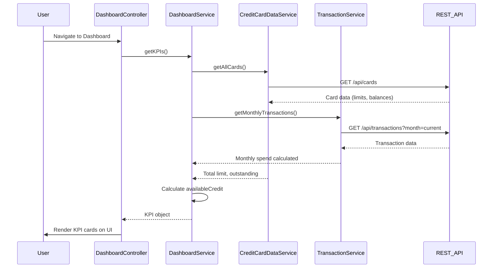

# Low-Level Design: QE-9203 - Dashboard KPIs and Overview

## a. Architecture Mapping

**AngularJS Artifacts:**
- **dashboardModule** (Module) - Root module for dashboard feature
- **DashboardController** (Controller) - Manages KPI data binding and user interactions
- **DashboardService** (Service) - Orchestrates data aggregation from backend services
- **CreditCardDataService** (Factory) - Fetches credit card details, limits, and balances via REST API
- **TransactionService** (Factory) - Calculates monthly spend and outstanding amounts via REST API
- **kpiCard** (Directive) - Reusable component for rendering individual KPI cards

**Folder Structure:**
```
/app
  /dashboard
    dashboard.module.js
    dashboard.controller.js
    dashboard.service.js
    dashboard.html
    /directives
      kpi-card.directive.js
      kpi-card.template.html
  /services
    credit-card-data.service.js
    transaction.service.js
  /common
    auth.interceptor.js
```

## b. Component Specifications

| Component Name | Artifact Type | Responsibility | Key Dependencies |
|---|---|---|---|
| dashboardModule | Module | Registers all dashboard components and routing | ngRoute, ngResource |
| DashboardController | Controller | Binds KPI data to view, handles refresh actions | DashboardService, $scope, $interval |
| DashboardService | Service | Aggregates data from CreditCardDataService and TransactionService, calculates KPIs | CreditCardDataService, TransactionService, $q |
| CreditCardDataService | Factory | Makes REST API calls to fetch card details, limits, balances | $http, API_ENDPOINTS |
| TransactionService | Factory | Makes REST API calls to fetch monthly spend and outstanding amounts | $http, API_ENDPOINTS |
| kpiCard | Directive | Renders individual KPI card with title, value, and icon | None |
| authInterceptor | Factory | Attaches auth token to all outgoing API requests | $window, $q |

## c. Data Model

**KPI Model (dashboardKpi):**
```javascript
{
  monthlySpend: Number,        // Current month's total spend across all cards
  totalCreditLimit: Number,    // Sum of credit limits across all cards
  availableCredit: Number,     // totalCreditLimit - outstandingAmount
  outstandingAmount: Number,   // Total outstanding balance across all cards
  lastUpdated: Date            // Timestamp of last data refresh
}
```

**Credit Card Summary Model (cardSummary):**
```javascript
{
  cardId: String,
  creditLimit: Number,
  currentBalance: Number,
  availableBalance: Number
}
```

## d. Data Flow

User navigates to dashboard → DashboardController initializes and calls DashboardService.getKPIs() → DashboardService concurrently invokes CreditCardDataService.getAllCards() and TransactionService.getMonthlyTransactions() → Both services make REST API calls to backend endpoints → CreditCardDataService aggregates total credit limit and outstanding amounts from card data → TransactionService calculates monthly spend from transaction data → DashboardService computes availableCredit (totalLimit - outstanding) and returns aggregated KPI object → DashboardController binds KPI data to $scope → kpiCard directives render each KPI with Bootstrap styling → User can trigger manual refresh, repeating the flow with $interval for auto-refresh every 30 seconds.

## e. Primary Sequence Diagram



## f. Implementation Notes

- Use AngularJS Dependency Injection to inject services into controllers; register all artifacts in dashboardModule
- Leverage $q.all() in DashboardService to parallelize CreditCardDataService and TransactionService API calls for faster load time
- Implement $http interceptor (authInterceptor) to attach JWT token to all API requests for secure authentication
- Use $interval service for auto-refresh every 30 seconds; ensure to cancel interval on $scope.$destroy to prevent memory leaks
- Apply Bootstrap grid (col-md-3) for responsive KPI card layout; use CSS3 media queries for mobile/tablet breakpoints

## g. Error Handling

HTTP interceptor captures API errors (4xx/5xx), displays user-friendly notifications via Angular toaster, and logs errors to console; try/catch in service methods for graceful degradation.

## h. Security Notes

Requires token-based authentication via existing SSO; JWT token attached to all API requests via HTTP interceptor; standard input validation and secure API calls assumed.