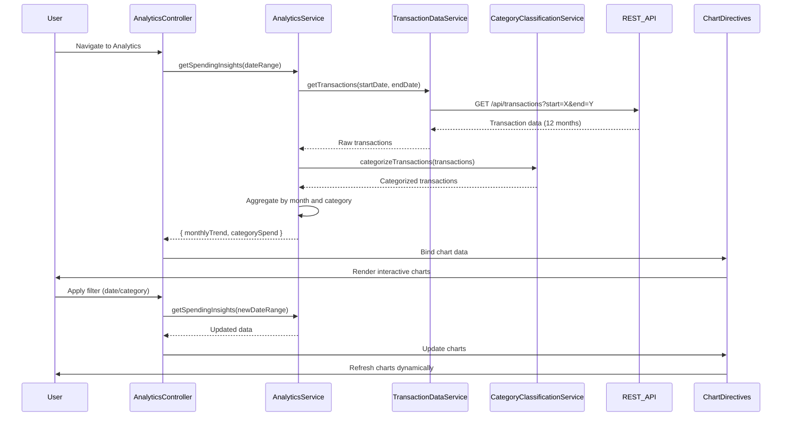

# Low-Level Design: QE-9204 - Spending Analytics and Insights

## a. Architecture Mapping

**AngularJS Artifacts:**
- **analyticsModule** (Module) - Root module for analytics feature
- **AnalyticsController** (Controller) - Manages analytics view state, filters, and chart interactions
- **AnalyticsService** (Service) - Aggregates transaction data and computes category-wise and monthly trends
- **TransactionDataService** (Factory) - Fetches historical transaction data (up to 12 months) via REST API
- **CategoryClassificationService** (Factory) - Categorizes transactions into 9 predefined categories
- **spendTrendChart** (Directive) - Renders monthly spend trend line chart using Chart.js
- **categoryPieChart** (Directive) - Renders category-wise spending pie chart using Chart.js

**Folder Structure:**
```
/app
  /analytics
    analytics.module.js
    analytics.controller.js
    analytics.service.js
    analytics.html
    /directives
      spend-trend-chart.directive.js
      category-pie-chart.directive.js
  /services
    transaction-data.service.js
    category-classification.service.js
  /common
    chart-config.factory.js
```

## b. Component Specifications

| Component Name | Artifact Type | Responsibility | Key Dependencies |
|---|---|---|---|
| analyticsModule | Module | Registers all analytics components, routing, and Chart.js library | ngRoute, chart.js |
| AnalyticsController | Controller | Manages filter state (date range, category), binds chart data to view | AnalyticsService, $scope, $filter |
| AnalyticsService | Service | Aggregates transactions by month and category, computes spending trends | TransactionDataService, CategoryClassificationService, $q |
| TransactionDataService | Factory | Fetches historical transactions (12 months) via REST API | $http, API_ENDPOINTS |
| CategoryClassificationService | Factory | Categorizes transactions into 9 predefined categories using business rules | None |
| spendTrendChart | Directive | Renders interactive line chart for monthly spend trends | Chart.js, $timeout |
| categoryPieChart | Directive | Renders interactive pie chart for category-wise spending breakdown | Chart.js, $timeout |
| chartConfigFactory | Factory | Provides reusable Chart.js configuration for responsive, interactive charts | None |

## c. Data Model

**Transaction Model (transaction):**
```javascript
{
  transactionId: String,
  cardId: String,
  amount: Number,
  date: Date,
  merchantName: String,
  category: String  // One of 9 predefined categories
}
```

**Monthly Spend Trend Model (monthlyTrend):**
```javascript
[
  { month: String, totalSpend: Number },  // e.g., { month: "Jan 2024", totalSpend: 5000 }
  ...
]
```

**Category Spend Model (categorySpend):**
```javascript
[
  { category: String, amount: Number },  // e.g., { category: "Food & Dining", amount: 1500 }
  ...  // 9 categories: Food & Dining, Fuel, Shopping, Travel, Entertainment, Utilities, Healthcare, Education, Miscellaneous
]
```

## d. Data Flow

User navigates to analytics view → AnalyticsController initializes and calls AnalyticsService.getSpendingInsights(dateRange) → AnalyticsService invokes TransactionDataService.getTransactions(startDate, endDate) → TransactionDataService makes REST API call to fetch 12 months of transaction data → CategoryClassificationService categorizes each transaction into one of 9 predefined categories → AnalyticsService aggregates transactions by month (monthlyTrend) and by category (categorySpend) → AnalyticsService returns aggregated data to AnalyticsController → AnalyticsController binds data to $scope → spendTrendChart directive renders line chart showing monthly trends → categoryPieChart directive renders pie chart showing category breakdown → User interacts with filters (date range, category selection) → AnalyticsController re-invokes AnalyticsService with updated filters → Charts update dynamically via two-way data binding.

## e. Primary Sequence Diagram



## f. Implementation Notes

- Use Chart.js library integrated via angular-chart.js wrapper for responsive, interactive charts with built-in drill-down support
- Implement CategoryClassificationService with switch/case logic mapping merchant names or transaction types to 9 predefined categories
- Leverage AngularJS $filter service in AnalyticsController for client-side date range and category filtering to reduce API calls
- Use $timeout in chart directives to ensure DOM is ready before Chart.js rendering; destroy chart instances on $scope.$destroy to prevent memory leaks
- Apply Bootstrap grid and CSS3 flexbox for responsive chart layout across mobile, tablet, and desktop viewports

## g. Error Handling

HTTP interceptor captures API errors, displays user-friendly error messages via Angular toaster; try/catch in AnalyticsService for data aggregation errors with fallback to empty chart state.

## h. Security Notes

Requires token-based auth via existing SSO; JWT token attached to all API requests; standard input validation and secure API calls assumed.