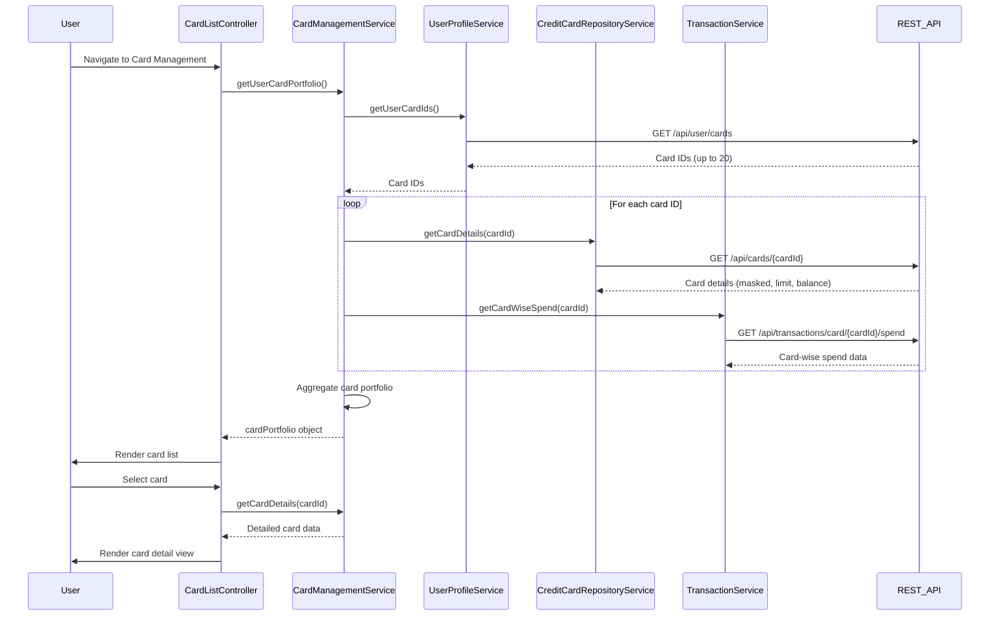

# Low-Level Design: QE-9205 - Multiple Credit Card Management

## a. Architecture Mapping

**AngularJS Artifacts:**
- **cardManagementModule** (Module) - Root module for card management feature
- **CardListController** (Controller) - Manages card list view, selection, and filtering
- **CardDetailController** (Controller) - Manages individual card detail view and card-wise spend analysis
- **CardManagementService** (Service) - Orchestrates card data retrieval and aggregation
- **UserProfileService** (Factory) - Fetches user-card associations via REST API
- **CreditCardRepositoryService** (Factory) - Fetches card details (limits, balances, masked numbers) via REST API
- **TransactionService** (Factory) - Fetches card-wise spend calculations via REST API
- **cardListItem** (Directive) - Reusable component for rendering individual card in list view
- **cardDetailView** (Directive) - Reusable component for rendering detailed card information

**Folder Structure:**
```
/app
  /card-management
    card-management.module.js
    card-list.controller.js
    card-detail.controller.js
    card-management.service.js
    card-list.html
    card-detail.html
    /directives
      card-list-item.directive.js
      card-detail-view.directive.js
  /services
    user-profile.service.js
    credit-card-repository.service.js
    transaction.service.js
```

## b. Component Specifications

| Component Name | Artifact Type | Responsibility | Key Dependencies |
|---|---|---|---|
| cardManagementModule | Module | Registers all card management components and routing | ngRoute, ngResource |
| CardListController | Controller | Manages card list display, filtering, and selection logic | CardManagementService, $scope, $filter |
| CardDetailController | Controller | Manages individual card detail view and card-wise spend display | CardManagementService, $routeParams, $scope |
| CardManagementService | Service | Aggregates card data from multiple services, supports up to 20 cards | UserProfileService, CreditCardRepositoryService, TransactionService, $q |
| UserProfileService | Factory | Fetches user-card associations (card IDs) via REST API | $http, API_ENDPOINTS |
| CreditCardRepositoryService | Factory | Fetches card details (masked number, limit, balance, issuer) via REST API | $http, API_ENDPOINTS |
| TransactionService | Factory | Fetches card-wise spend calculations via REST API | $http, API_ENDPOINTS |
| cardListItem | Directive | Renders individual card summary in list view (card name, last 4 digits, balance) | None |
| cardDetailView | Directive | Renders detailed card information (full details, spend breakdown, limit utilization) | None |

## c. Data Model

**Credit Card Model (creditCard):**
```javascript
{
  cardId: String,
  cardNumber: String,          // Masked (e.g., "****1234")
  cardHolderName: String,
  issuer: String,              // e.g., "Visa", "MasterCard"
  creditLimit: Number,
  currentBalance: Number,
  availableBalance: Number,    // creditLimit - currentBalance
  expiryDate: String,          // Format: "MM/YY"
  cardType: String             // e.g., "Credit", "Debit"
}
```

**Card-Wise Spend Model (cardSpend):**
```javascript
{
  cardId: String,
  monthlySpend: Number,
  totalTransactions: Number,
  lastTransactionDate: Date
}
```

**User Card Portfolio Model (cardPortfolio):**
```javascript
{
  userId: String,
  cards: [creditCard],         // Array of up to 20 credit cards
  totalCreditLimit: Number,
  totalOutstanding: Number
}
```

## d. Data Flow

User navigates to card management view → CardListController initializes and calls CardManagementService.getUserCardPortfolio() → CardManagementService invokes UserProfileService.getUserCardIds() to fetch associated card IDs → UserProfileService makes REST API call to retrieve user-card associations → CardManagementService iterates through card IDs and concurrently calls CreditCardRepositoryService.getCardDetails(cardId) for each card → CreditCardRepositoryService makes REST API calls to fetch card details (masked number, limit, balance) with <500ms latency → CardManagementService calls TransactionService.getCardWiseSpend(cardId) for each card → TransactionService makes REST API calls to calculate card-wise spend → CardManagementService aggregates all card data and spend analysis into cardPortfolio object → CardListController binds cardPortfolio to $scope → cardListItem directives render each card in list view → User selects a card → CardDetailController invokes CardManagementService.getCardDetails(cardId) → cardDetailView directive renders detailed card information with spending breakdown → User can filter cards by issuer, balance, or spend using AngularJS $filter.

## e. Primary Sequence Diagram



## f. Implementation Notes

- Use $q.all() in CardManagementService to parallelize API calls for all cards to meet <500ms latency NFR
- Implement AngularJS $filter for client-side card filtering by issuer, balance, or spend to reduce server load
- Use ng-repeat with track by cardId in card list view for optimized rendering and change detection
- Apply Bootstrap card components and CSS3 grid for responsive card layout across mobile, tablet, and desktop
- Ensure card numbers are masked at API layer before reaching UI; validate masked format (****XXXX) in CreditCardRepositoryService

## g. Error Handling

HTTP interceptor captures API errors (4xx/5xx), displays user-friendly notifications via Angular toaster; try/catch in CardManagementService for aggregation errors with graceful degradation to partial card list.

## h. Security Notes

Requires token-based auth via existing SSO; JWT token attached to all API requests; card numbers masked at API layer; standard input validation and secure API calls assumed.