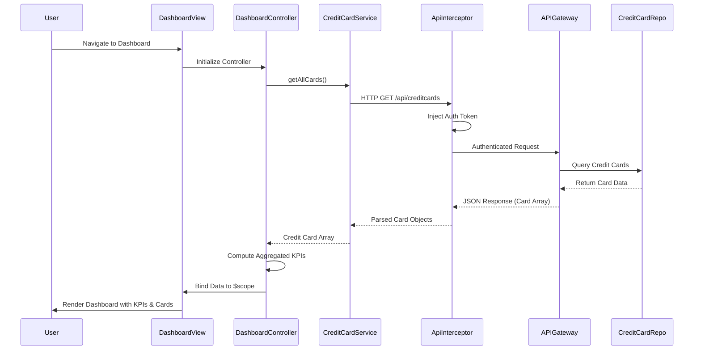

# Low-Level Design: Credit Card Dashboard and KPI Management

**Epic ID:** QE-9206  
**Component:** Credit Card Analysis Dashboard  
**Technology Stack:** AngularJS 1.x, JavaScript ES6, HTML5, CSS3, Bootstrap, REST APIs, MVC Architecture

---

## a. Architecture Mapping

| HLD Component | AngularJS Artifact | Purpose |
|---------------|-------------------|----------|
| Dashboard UI Layer | Module: `creditCardDashboard` | Root module for dashboard feature |
| Dashboard UI Layer | Controller: `DashboardController` | Manages KPI display logic and multi-card view |
| Dashboard UI Layer | Directive: `kpiCard` | Reusable KPI display component |
| Dashboard UI Layer | Directive: `creditCardList` | Renders multiple credit cards (up to 10) |
| Credit Card Service | Service: `CreditCardService` | Fetches credit card data from API Gateway |
| User Authentication Service | Service: `AuthService` | Manages user session and token validation |
| API Gateway | Factory: `ApiInterceptor` | Handles API requests, authentication headers, and error responses |

**Recommended Folder Structure:**
```
app/
├── modules/
│   └── dashboard/
│       ├── controllers/
│       │   └── DashboardController.js
│       ├── services/
│       │   ├── CreditCardService.js
│       │   └── AuthService.js
│       ├── directives/
│       │   ├── kpiCard.js
│       │   └── creditCardList.js
│       ├── views/
│       │   ├── dashboard.html
│       │   └── templates/
│       │       ├── kpi-card.html
│       │       └── credit-card-list.html
│       └── dashboard.module.js
├── shared/
│   └── interceptors/
│       └── ApiInterceptor.js
└── assets/
    └── css/
        └── dashboard.css
```

---

## b. Component Specifications

| Component Name | Artifact Type | Responsibility | Key Dependencies |
|----------------|---------------|----------------|------------------|
| `creditCardDashboard` | Module | Root module that bootstraps dashboard feature and declares all dependencies | `ngRoute`, `AuthService`, `CreditCardService` |
| `DashboardController` | Controller | Orchestrates KPI data retrieval, manages card list state, handles responsive layout logic | `CreditCardService`, `$scope`, `$q` |
| `CreditCardService` | Service | Fetches credit card details, limits, balances, and spending data from REST API | `$http`, `ApiInterceptor`, `API_ENDPOINTS` |
| `AuthService` | Service | Validates user session, manages authentication tokens, provides user identity | `$http`, `$window.localStorage` |
| `kpiCard` | Directive | Renders individual KPI (Monthly Spend, Credit Limit, Available Credit, Outstanding Amount) with responsive styling | `$filter` (for currency formatting) |
| `creditCardList` | Directive | Displays up to 10 credit cards with summary information in a responsive grid layout | `CreditCardService` |
| `ApiInterceptor` | Factory | Injects authentication headers, handles 401/403 errors, manages API request/response pipeline | `$q`, `AuthService` |

---

## c. Data Model

**CreditCard Object:**
```javascript
{
  cardId: String,              // Unique identifier for the credit card
  cardNumber: String,          // Masked card number (e.g., "**** **** **** 1234")
  cardType: String,            // Card type (e.g., "Visa", "MasterCard")
  cardHolderName: String,      // Name on the card
  totalCreditLimit: Number,    // Total credit limit in currency units
  availableCredit: Number,     // Available credit remaining
  outstandingAmount: Number,   // Current outstanding balance
  monthlySpend: Number,        // Spending for the current month
  isActive: Boolean            // Card active status
}
```

**DashboardKPI Object:**
```javascript
{
  totalMonthlySpend: Number,      // Aggregated monthly spend across all cards
  totalCreditLimit: Number,       // Sum of credit limits across all cards
  totalAvailableCredit: Number,   // Sum of available credit across all cards
  totalOutstanding: Number        // Sum of outstanding amounts across all cards
}
```

---

## d. Data Flow

User navigates to the dashboard route, triggering `DashboardController` initialization. The controller invokes `CreditCardService.getAllCards()`, which sends an authenticated GET request via `ApiInterceptor` to the REST API endpoint `/api/creditcards`. The API Gateway validates the user token through `AuthService`, retrieves credit card data from the Credit Card Data Repository, and returns an array of `CreditCard` objects. The controller receives the response, computes aggregated KPIs using array reduce operations, and binds both the card list and KPI data to `$scope`. The view (`dashboard.html`) renders KPI cards using the `kpiCard` directive and displays the credit card list using the `creditCardList` directive with Bootstrap responsive grid classes, ensuring the dashboard adapts to desktop, tablet, and mobile viewports within the 2-second load time requirement.

---

## e. Primary Sequence Diagram



---

## f. Implementation Notes

- Use AngularJS Dependency Injection to inject `CreditCardService` and `AuthService` into `DashboardController` for testability and modularity.
- Implement ES6 arrow functions and `const`/`let` for cleaner, block-scoped code in services and controllers.
- Use `$http` service with promise chaining (`.then()`) for asynchronous API calls; leverage `$q.all()` if parallel requests are needed.
- Apply Bootstrap responsive grid classes (`col-xs-*`, `col-sm-*`, `col-md-*`, `col-lg-*`) in directives to ensure mobile-first responsive design.
- Cache credit card data in `CreditCardService` using a simple in-memory cache with timestamp to reduce redundant API calls and meet 2-second load time.

---

## g. Error Handling

Client-side errors are managed via `ApiInterceptor` using `responseError` callback; HTTP 4xx/5xx responses trigger user-friendly notifications via a shared `NotificationService`, and failed promises are logged to console.

---

## h. Security Notes

Requires token-based authentication via existing SSO; `ApiInterceptor` injects JWT tokens in Authorization headers for all API requests, and sensitive card data is masked on the client side.