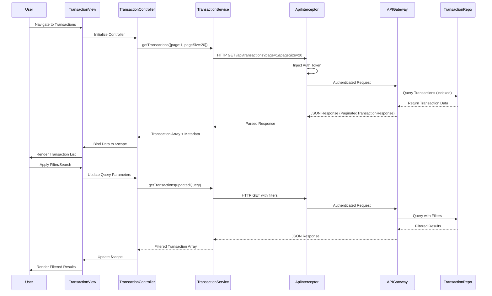

# Low-Level Design: Credit Card Transaction Management

**Epic ID:** QE-9207  
**Component:** Transaction Management Module  
**Technology Stack:** AngularJS 1.x, JavaScript ES6, HTML5, CSS3, Bootstrap, REST APIs, MVC Architecture

---

## a. Architecture Mapping

| HLD Component | AngularJS Artifact | Purpose |
|---------------|-------------------|----------|
| User Interface | Module: `transactionManagement` | Root module for transaction features |
| Transaction Management Module | Controller: `TransactionController` | Manages transaction list, search, filter, and pagination logic |
| Transaction Management Module | Controller: `TransactionDetailController` | Handles display of individual transaction details |
| Transaction Service | Service: `TransactionService` | Fetches transaction data from API with filtering and pagination support |
| Credit Card Service | Service: `CreditCardService` | Provides credit card metadata for transaction-card linking |
| Transaction Management Module | Directive: `transactionList` | Renders paginated transaction table with search/filter UI |
| Transaction Management Module | Directive: `transactionDetail` | Displays detailed transaction information in modal or separate view |
| API Gateway | Factory: `ApiInterceptor` | Handles authentication, request/response interception, and error handling |

**Recommended Folder Structure:**
```
app/
├── modules/
│   └── transactions/
│       ├── controllers/
│       │   ├── TransactionController.js
│       │   └── TransactionDetailController.js
│       ├── services/
│       │   ├── TransactionService.js
│       │   └── CreditCardService.js
│       ├── directives/
│       │   ├── transactionList.js
│       │   └── transactionDetail.js
│       ├── views/
│       │   ├── transactions.html
│       │   ├── transaction-detail.html
│       │   └── templates/
│       │       ├── transaction-list.html
│       │       └── transaction-detail-modal.html
│       └── transactions.module.js
├── shared/
│   └── interceptors/
│       └── ApiInterceptor.js
└── assets/
    └── css/
        └── transactions.css
```

---

## b. Component Specifications

| Component Name | Artifact Type | Responsibility | Key Dependencies |
|----------------|---------------|----------------|------------------|
| `transactionManagement` | Module | Root module for transaction management feature with routing and dependency declarations | `ngRoute`, `ui.bootstrap`, `TransactionService`, `CreditCardService` |
| `TransactionController` | Controller | Manages transaction list state, handles search/filter input, orchestrates pagination, and triggers detail view | `TransactionService`, `$scope`, `$location` |
| `TransactionDetailController` | Controller | Loads and displays detailed transaction information including merchant, amount, date, category | `TransactionService`, `$routeParams`, `$scope` |
| `TransactionService` | Service | Fetches transactions via REST API with query parameters for filtering, search, pagination, and date ranges | `$http`, `ApiInterceptor`, `API_ENDPOINTS` |
| `CreditCardService` | Service | Retrieves credit card metadata to link transactions to specific cards | `$http`, `ApiInterceptor` |
| `transactionList` | Directive | Renders paginated transaction table with search input, filter dropdowns, and responsive layout | `TransactionService`, `$filter` |
| `transactionDetail` | Directive | Displays transaction details in a modal or dedicated view with merchant name, amount, date, category | None |
| `ApiInterceptor` | Factory | Injects authentication tokens, handles API errors, manages request/response pipeline | `$q`, `AuthService` |

---

## c. Data Model

**Transaction Object:**
```javascript
{
  transactionId: String,       // Unique transaction identifier
  cardId: String,              // Associated credit card ID
  merchantName: String,        // Name of the merchant
  transactionAmount: Number,   // Transaction amount in currency units
  transactionDate: Date,       // Date and time of transaction (ISO 8601)
  category: String,            // Transaction category (e.g., "Food & Dining", "Fuel")
  transactionType: String,     // Type: "debit" or "credit"
  status: String,              // Status: "completed", "pending", "failed"
  description: String          // Additional transaction notes or description
}
```

**TransactionQuery Object:**
```javascript
{
  cardId: String,              // Optional: filter by specific card
  category: String,            // Optional: filter by category
  startDate: Date,             // Optional: start date for date range filter
  endDate: Date,               // Optional: end date for date range filter
  searchTerm: String,          // Optional: search term for merchant name
  page: Number,                // Current page number (1-indexed)
  pageSize: Number             // Number of transactions per page (default: 20)
}
```

**PaginatedTransactionResponse Object:**
```javascript
{
  transactions: Array<Transaction>,  // Array of transaction objects for current page
  totalCount: Number,                // Total number of transactions matching query
  currentPage: Number,               // Current page number
  totalPages: Number                 // Total number of pages
}
```

---

## d. Data Flow

User navigates to the transactions view, triggering `TransactionController` initialization. The controller calls `TransactionService.getTransactions()` with default pagination parameters (page 1, pageSize 20). The service constructs a query object and sends an authenticated GET request via `ApiInterceptor` to `/api/transactions?page=1&pageSize=20`. The API Gateway validates the token, queries the Transaction Data Repository with indexed fields (date, merchant, category, cardId), and returns a `PaginatedTransactionResponse` within 1 second. The controller binds the transaction array and pagination metadata to `$scope`. The `transactionList` directive renders the table with Bootstrap responsive classes. When the user enters a search term or applies filters, the controller updates the `TransactionQuery` object and re-invokes `TransactionService.getTransactions()`, triggering a new API call and view update. Clicking a transaction row navigates to the detail view, where `TransactionDetailController` fetches full transaction details via `TransactionService.getTransactionById()` and displays them using the `transactionDetail` directive.

---

## e. Primary Sequence Diagram



---

## f. Implementation Notes

- Use AngularJS `$http` service with query parameter serialization for dynamic filtering and pagination; leverage `$httpParamSerializer` for clean URL construction.
- Implement debouncing on search input using `$timeout` or lodash `_.debounce` to reduce API calls while user types (e.g., 300ms delay).
- Use AngularJS `ng-repeat` with `track by transactionId` for efficient DOM updates when rendering transaction lists.
- Apply Bootstrap table classes (`table`, `table-striped`, `table-responsive`) and pagination component (`uib-pagination` from ui-bootstrap) for responsive design.
- Store current query state in `TransactionService` to maintain filter/search context across navigation and enable back-button support.

---

## g. Error Handling

Client-side errors handled via `ApiInterceptor` with `responseError` callback; API failures trigger user notifications via shared `NotificationService`, and empty result sets display a "No transactions found" message in the view.

---

## h. Security Notes

Requires token-based authentication via existing SSO; all transaction API requests include JWT tokens in Authorization headers via `ApiInterceptor`, and transaction data access is scoped to authenticated user's cards only.