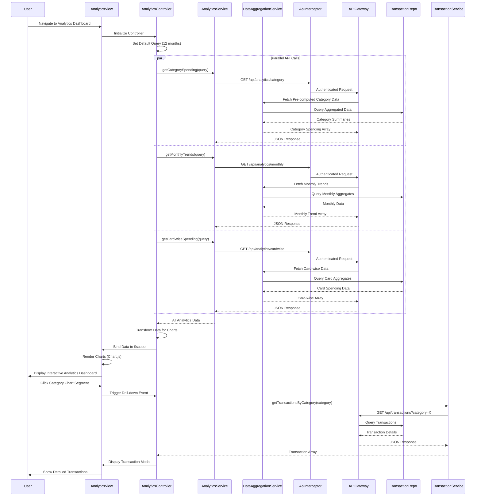

# Low-Level Design: Spending Analytics and Insights

**Epic ID:** QE-9208  
**Component:** Analytics Dashboard  
**Technology Stack:** AngularJS 1.x, JavaScript ES6, HTML5, CSS3, Bootstrap, REST APIs, MVC Architecture, Chart.js/D3.js

---

## a. Architecture Mapping

| HLD Component | AngularJS Artifact | Purpose |
|---------------|-------------------|----------|
| User Interface | Module: `spendingAnalytics` | Root module for analytics and insights features |
| Analytics Dashboard | Controller: `AnalyticsController` | Manages analytics data retrieval, chart configuration, and interactive filter logic |
| Analytics Engine | Service: `AnalyticsService` | Fetches aggregated spending data from REST API for category, monthly, and card-wise analysis |
| Data Aggregation Service | Service: `DataAggregationService` | Provides pre-computed spending summaries and category totals |
| Transaction Data Repository | Service: `TransactionService` | Supplies raw transaction data for drill-down capabilities |
| Credit Card Service | Service: `CreditCardService` | Provides card metadata for card-wise spend analysis |
| Analytics Dashboard | Directive: `categorySpendingChart` | Renders interactive category-wise spending visualization (pie/bar chart) |
| Analytics Dashboard | Directive: `monthlyTrendChart` | Displays monthly spend trend line chart with time-series data |
| Analytics Dashboard | Directive: `cardWiseSpendChart` | Renders card-wise spending comparison (bar/column chart) |
| API Gateway | Factory: `ApiInterceptor` | Handles authentication, request/response interception, and error management |

**Recommended Folder Structure:**
```
app/
├── modules/
│   └── analytics/
│       ├── controllers/
│       │   └── AnalyticsController.js
│       ├── services/
│       │   ├── AnalyticsService.js
│       │   ├── DataAggregationService.js
│       │   ├── TransactionService.js
│       │   └── CreditCardService.js
│       ├── directives/
│       │   ├── categorySpendingChart.js
│       │   ├── monthlyTrendChart.js
│       │   └── cardWiseSpendChart.js
│       ├── views/
│       │   ├── analytics.html
│       │   └── templates/
│       │       ├── category-chart.html
│       │       ├── monthly-trend-chart.html
│       │       └── card-wise-chart.html
│       └── analytics.module.js
├── shared/
│   └── interceptors/
│       └── ApiInterceptor.js
└── assets/
    ├── css/
    │   └── analytics.css
    └── libs/
        └── chart.js (or d3.js)
```

---

## b. Component Specifications

| Component Name | Artifact Type | Responsibility | Key Dependencies |
|----------------|---------------|----------------|------------------|
| `spendingAnalytics` | Module | Root module for analytics feature with routing, chart library integration, and service declarations | `ngRoute`, `chart.js`, `AnalyticsService`, `DataAggregationService` |
| `AnalyticsController` | Controller | Orchestrates data retrieval for all analytics views, manages filter state (date range, card selection), and configures chart options | `AnalyticsService`, `DataAggregationService`, `$scope`, `$filter` |
| `AnalyticsService` | Service | Fetches aggregated spending data from REST API endpoints for category-wise, monthly trend, and card-wise analysis | `$http`, `ApiInterceptor`, `API_ENDPOINTS` |
| `DataAggregationService` | Service | Provides pre-computed spending summaries and category totals to meet 3-second rendering requirement | `$http`, `ApiInterceptor` |
| `TransactionService` | Service | Supplies raw transaction data for drill-down capabilities when user clicks on chart segments | `$http`, `ApiInterceptor` |
| `CreditCardService` | Service | Retrieves credit card metadata for card-wise spend analysis and filtering | `$http`, `ApiInterceptor` |
| `categorySpendingChart` | Directive | Renders interactive pie or bar chart for category-wise spending across nine categories with click-to-drill-down | `Chart.js`, `AnalyticsService` |
| `monthlyTrendChart` | Directive | Displays line chart showing monthly spend trends over up to 12 months with interactive hover tooltips | `Chart.js`, `AnalyticsService` |
| `cardWiseSpendChart` | Directive | Renders bar or column chart comparing spending across multiple credit cards | `Chart.js`, `AnalyticsService` |
| `ApiInterceptor` | Factory | Injects authentication tokens, handles API errors, manages request/response pipeline | `$q`, `AuthService` |

---

## c. Data Model

**CategorySpending Object:**
```javascript
{
  category: String,            // Category name (e.g., "Food & Dining", "Fuel", "Shopping")
  totalAmount: Number,         // Total spending in this category
  transactionCount: Number,    // Number of transactions in this category
  percentage: Number           // Percentage of total spending
}
```

**MonthlySpendTrend Object:**
```javascript
{
  month: String,               // Month identifier (e.g., "2024-01", "2024-02")
  totalSpend: Number,          // Total spending for the month
  transactionCount: Number     // Number of transactions in the month
}
```

**CardWiseSpend Object:**
```javascript
{
  cardId: String,              // Credit card identifier
  cardName: String,            // Card display name (e.g., "Visa *1234")
  totalSpend: Number,          // Total spending on this card
  categoryBreakdown: Array<CategorySpending>  // Category-wise breakdown for this card
}
```

**AnalyticsQuery Object:**
```javascript
{
  startDate: Date,             // Start date for analytics period (default: 12 months ago)
  endDate: Date,               // End date for analytics period (default: today)
  cardIds: Array<String>,      // Optional: filter by specific card IDs
  categories: Array<String>    // Optional: filter by specific categories
}
```

**SpendingCategories Enum:**
```javascript
const SPENDING_CATEGORIES = [
  'Food & Dining',
  'Fuel',
  'Shopping',
  'Travel',
  'Entertainment',
  'Utilities',
  'Healthcare',
  'Education',
  'Miscellaneous'
];
```

---

## d. Data Flow

User navigates to the analytics dashboard, triggering `AnalyticsController` initialization. The controller sets default query parameters (last 12 months, all cards, all categories) and invokes three parallel API calls via `AnalyticsService`: `getCategorySpending()`, `getMonthlyTrends()`, and `getCardWiseSpending()`. Each service method sends an authenticated GET request through `ApiInterceptor` to respective endpoints (`/api/analytics/category`, `/api/analytics/monthly`, `/api/analytics/cardwise`). The API Gateway routes requests to the Data Aggregation Service, which retrieves pre-computed summaries from the Transaction Data Repository to meet the 3-second rendering requirement. The controller receives all three responses via `$q.all()`, transforms the data into chart-compatible formats, and binds them to `$scope`. The three chart directives (`categorySpendingChart`, `monthlyTrendChart`, `cardWiseSpendChart`) initialize Chart.js instances with the bound data and render interactive visualizations. When the user applies filters (date range or card selection), the controller updates the query parameters and re-fetches data, triggering chart updates via AngularJS two-way binding. Clicking a chart segment (e.g., a category slice) triggers a drill-down event that invokes `TransactionService.getTransactionsByCategory()` to display detailed transactions in a modal or side panel.

---

## e. Primary Sequence Diagram



---

## f. Implementation Notes

- Use Chart.js library for rendering interactive charts; initialize chart instances in directive's `link` function with `$scope.$watch` to handle data updates.
- Leverage `$q.all()` to execute parallel API calls for category, monthly, and card-wise data to optimize load time and meet 3-second rendering requirement.
- Implement chart data transformation logic in `AnalyticsController` using ES6 `Array.map()` and `Array.reduce()` to convert API responses into Chart.js-compatible formats.
- Use AngularJS `$filter` service for date formatting and currency display in chart tooltips and legends.
- Cache analytics data in `AnalyticsService` with timestamp-based invalidation (e.g., 5-minute cache) to reduce redundant API calls when user toggles between chart views.

---

## g. Error Handling

Client-side errors managed via `ApiInterceptor` using `responseError` callback; API failures display user-friendly error messages via shared `NotificationService`, and chart directives show "Data unavailable" placeholder when data fetch fails.

---

## h. Security Notes

Requires token-based authentication via existing SSO; all analytics API requests include JWT tokens in Authorization headers via `ApiInterceptor`, and spending data access is restricted to authenticated user's transaction history only.