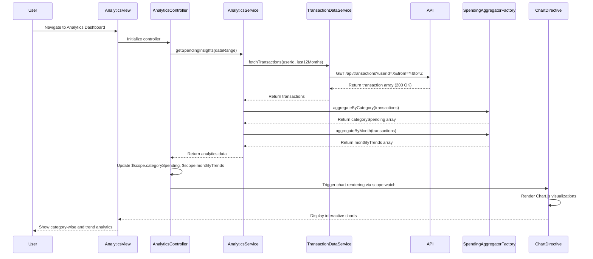

# Low-Level Design: QE-9209 - Analytics and Spending Insights

## a. Architecture Mapping

**Component to Artifact Mapping:**
- Analytics Dashboard UI → AngularJS Module (`app.analytics`) + Controller (`AnalyticsController`) + HTML View
- Analytics Service → AngularJS Service (`AnalyticsService`) for business logic and API calls
- Data Aggregation Logic → Factory (`SpendingAggregatorFactory`) for client-side data transformation
- Visualization Rendering → Directive (`spendingChart`) wrapping Chart.js or D3.js library
- Transaction Data Retrieval → Service (`TransactionDataService`) for REST API integration
- Category Filter → Controller method + UI component for category selection

**Recommended Folder Structure:**
```
app/
├── modules/
│   └── analytics/
│       ├── analytics.module.js
│       ├── controllers/
│       │   └── analytics.controller.js
│       ├── services/
│       │   ├── analytics.service.js
│       │   └── transaction-data.service.js
│       ├── factories/
│       │   └── spending-aggregator.factory.js
│       ├── directives/
│       │   └── spending-chart.directive.js
│       └── views/
│           └── analytics-dashboard.html
```

## b. Component Specifications

| Component Name | Artifact Type | Responsibility | Key Dependencies |
|---|---|---|---|
| AnalyticsModule | Module | Register analytics feature components and configure routing | ngRoute, chart.js |
| AnalyticsController | Controller | Manage analytics view state, handle user interactions, coordinate data flow | AnalyticsService, SpendingAggregatorFactory, $scope |
| AnalyticsService | Service | Orchestrate analytics operations, fetch transaction data, manage 12-month history | TransactionDataService, $http, $q |
| TransactionDataService | Service | Execute REST API calls to retrieve categorized transaction history | $http, API_CONFIG |
| SpendingAggregatorFactory | Factory | Transform raw transaction data into category totals and monthly trends | lodash/native ES6 |
| spendingChart | Directive | Render interactive category-wise and trend charts with Chart.js | Chart.js library |
| CategoryFilter | Controller Method | Filter transactions by selected categories (Food, Fuel, Shopping, Travel, etc.) | $filter |

## c. Data Model

**Transaction Model:**
```javascript
{
  transactionId: String,
  cardId: String,
  amount: Number,
  category: String, // 'Food & Dining', 'Fuel', 'Shopping', 'Travel', 'Entertainment', 'Utilities', 'Healthcare', 'Education', 'Miscellaneous'
  date: Date,
  merchant: String,
  description: String
}
```

**CategorySpending Model:**
```javascript
{
  category: String,
  totalAmount: Number,
  transactionCount: Number,
  percentage: Number
}
```

**MonthlyTrend Model:**
```javascript
{
  month: String, // 'YYYY-MM'
  totalSpend: Number,
  categoryBreakdown: Array<CategorySpending>
}
```

**AnalyticsViewModel (Controller scope):**
```javascript
{
  transactions: Array<Transaction>,
  categorySpending: Array<CategorySpending>,
  monthlyTrends: Array<MonthlyTrend>,
  selectedCategories: Array<String>,
  dateRange: { start: Date, end: Date },
  isLoading: Boolean
}
```

## d. Data Flow

User navigates to Analytics Dashboard → AnalyticsController initializes and calls AnalyticsService.getSpendingInsights(dateRange) → AnalyticsService invokes TransactionDataService.fetchTransactions(userId, dateRange) which makes REST API call to /api/transactions → API returns 12 months of categorized transaction data → SpendingAggregatorFactory processes raw transactions into CategorySpending and MonthlyTrend objects → Controller updates $scope with aggregated data → spendingChart directive watches scope changes and renders interactive Chart.js visualizations → User interacts with category filters → Controller re-aggregates data and updates charts in real-time.

## e. Primary Sequence Diagram



## f. Implementation Notes

- Use AngularJS dependency injection to inject AnalyticsService, TransactionDataService, and SpendingAggregatorFactory into AnalyticsController
- Implement TransactionDataService using $http with promise-based API calls; cache 12-month data in $cacheFactory to avoid redundant API requests
- Use ES6 array methods (map, filter, reduce) in SpendingAggregatorFactory for efficient client-side aggregation of transaction data
- Implement spendingChart directive with isolated scope and two-way binding to chart data; use Chart.js for rendering with responsive configuration
- Apply AngularJS $filter for real-time category filtering without re-fetching data from API

## g. Error Handling

HTTP interceptor captures API errors; TransactionDataService wraps calls in try/catch with $q.reject; AnalyticsController displays user-friendly error notifications via toastr or custom alert service.

## h. Security Notes

Requires token-based authentication via existing SSO; API endpoints validate user session and enforce userId-based data access control.