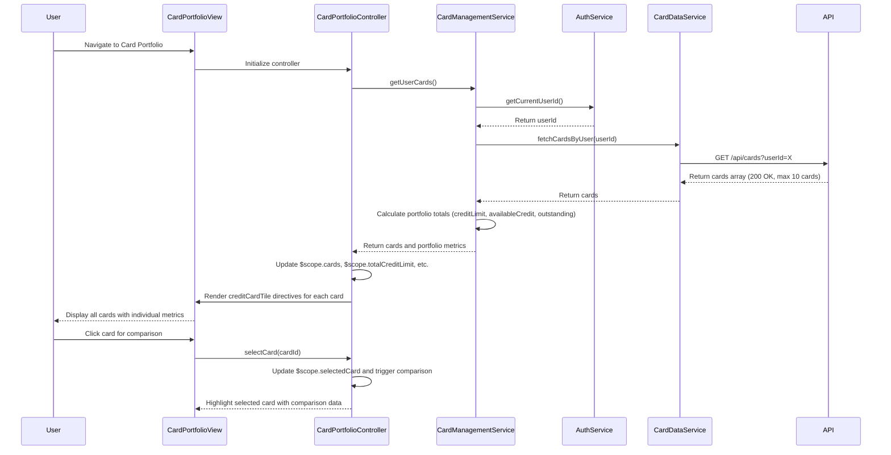

# Low-Level Design: QE-9210 - Multiple Credit Card Management

## a. Architecture Mapping

**Component to Artifact Mapping:**
- Card Portfolio View UI → AngularJS Module (`app.cards`) + Controller (`CardPortfolioController`) + HTML View
- Card Management Service → AngularJS Service (`CardManagementService`) for card operations and API integration
- Card Data Repository Access → Service (`CardDataService`) for REST API calls to retrieve card information
- User Authentication → Existing Service (`AuthService`) for user identity and session management
- Card Comparison Logic → Factory (`CardComparisonFactory`) for client-side card metrics comparison
- Individual Card Display → Directive (`creditCardTile`) for reusable card UI component

**Recommended Folder Structure:**
```
app/
├── modules/
│   └── cards/
│       ├── cards.module.js
│       ├── controllers/
│       │   └── card-portfolio.controller.js
│       ├── services/
│       │   ├── card-management.service.js
│       │   └── card-data.service.js
│       ├── factories/
│       │   └── card-comparison.factory.js
│       ├── directives/
│       │   └── credit-card-tile.directive.js
│       └── views/
│           └── card-portfolio.html
```

## b. Component Specifications

| Component Name | Artifact Type | Responsibility | Key Dependencies |
|---|---|---|---|
| CardsModule | Module | Register card management components and configure routing | ngRoute, AuthService |
| CardPortfolioController | Controller | Manage card portfolio view state, load multiple cards, handle user interactions | CardManagementService, CardComparisonFactory, $scope |
| CardManagementService | Service | Orchestrate card operations, fetch card details for authenticated user, coordinate card-wise analysis | CardDataService, AuthService, $q |
| CardDataService | Service | Execute REST API calls to retrieve card information from repository | $http, API_CONFIG |
| CardComparisonFactory | Factory | Compare card metrics (credit limit, available credit, outstanding balance, spend) across multiple cards | lodash/native ES6 |
| creditCardTile | Directive | Render individual card details in reusable tile component with card-specific metrics | None (isolated scope) |
| AuthService | Service (existing) | Provide authenticated user ID for associating cards with user account | $http, $window |

## c. Data Model

**CreditCard Model:**
```javascript
{
  cardId: String,
  userId: String,
  cardNumber: String, // masked, e.g., '**** **** **** 1234'
  cardType: String, // 'Visa', 'MasterCard', 'Amex'
  cardName: String,
  creditLimit: Number,
  availableCredit: Number,
  outstandingBalance: Number,
  monthlySpend: Number,
  issuer: String,
  expiryDate: String // 'MM/YY'
}
```

**CardPortfolioViewModel (Controller scope):**
```javascript
{
  cards: Array<CreditCard>, // up to 10 cards
  selectedCard: CreditCard,
  totalCreditLimit: Number,
  totalAvailableCredit: Number,
  totalOutstanding: Number,
  isLoading: Boolean,
  errorMessage: String
}
```

**CardComparison Model:**
```javascript
{
  cardId: String,
  cardName: String,
  utilizationRate: Number, // (outstandingBalance / creditLimit) * 100
  spendPercentage: Number // card spend as % of total portfolio spend
}
```

## d. Data Flow

User navigates to Card Portfolio View → CardPortfolioController initializes and calls CardManagementService.getUserCards() → CardManagementService retrieves userId from AuthService and invokes CardDataService.fetchCardsByUser(userId) → CardDataService makes REST API call to /api/cards?userId=X → API returns array of up to 10 credit cards with card-specific details → CardManagementService processes response and calculates portfolio totals → Controller updates $scope.cards and portfolio metrics → creditCardTile directives render each card with individual credit limit, available credit, and outstanding balance → User selects card for detailed view → Controller updates $scope.selectedCard and CardComparisonFactory generates comparison metrics.

## e. Primary Sequence Diagram



## f. Implementation Notes

- Use AngularJS dependency injection to inject CardManagementService, CardDataService, and AuthService into CardPortfolioController
- Implement CardDataService using $http with promise-based API; ensure sub-500ms latency by optimizing API endpoint and using batch retrieval
- Use ES6 array methods in CardManagementService to calculate portfolio-level totals (reduce for summing credit limits, available credit, outstanding balances)
- Implement creditCardTile directive with isolated scope accepting card object as attribute; use ng-repeat in view to render up to 10 tiles
- Apply CardComparisonFactory to calculate utilization rates and spending percentages for card-wise analysis without additional API calls

## g. Error Handling

HTTP interceptor captures API errors; CardDataService uses try/catch with $q.reject for failed requests; CardPortfolioController displays error messages via $scope.errorMessage and user notification service.

## h. Security Notes

Requires token-based auth via existing SSO; API validates user session and enforces userId-based access control to ensure users only retrieve their own cards.