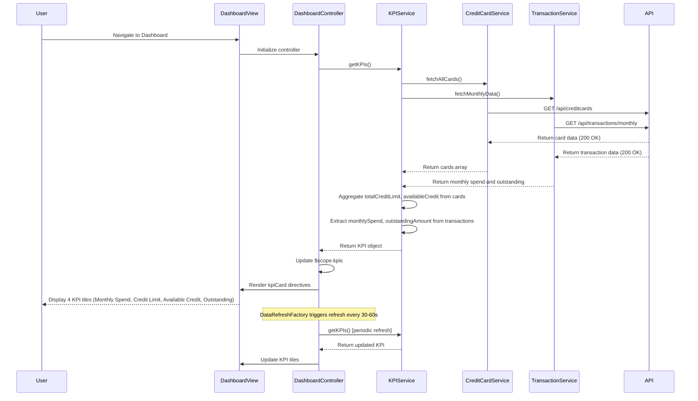

# Low-Level Design: QE-9211 - Dashboard and KPI Management

## a. Architecture Mapping

**Component to Artifact Mapping:**
- Dashboard UI → AngularJS Module (`app.dashboard`) + Controller (`DashboardController`) + HTML View
- KPI Calculation Service → AngularJS Service (`KPIService`) for business logic and KPI computation
- Credit Card Data Retrieval → Service (`CreditCardService`) for REST API calls to fetch card balances and limits
- Transaction Data Retrieval → Service (`TransactionService`) for REST API calls to fetch monthly spend and outstanding amounts
- Real-time Data Refresh → Factory (`DataRefreshFactory`) with $interval for periodic KPI updates
- KPI Display Components → Directives (`kpiCard`) for reusable KPI tile rendering

**Recommended Folder Structure:**
```
app/
├── modules/
│   └── dashboard/
│       ├── dashboard.module.js
│       ├── controllers/
│       │   └── dashboard.controller.js
│       ├── services/
│       │   ├── kpi.service.js
│       │   ├── credit-card.service.js
│       │   └── transaction.service.js
│       ├── factories/
│       │   └── data-refresh.factory.js
│       ├── directives/
│       │   └── kpi-card.directive.js
│       └── views/
│           └── dashboard.html
```

## b. Component Specifications

| Component Name | Artifact Type | Responsibility | Key Dependencies |
|---|---|---|---|
| DashboardModule | Module | Register dashboard components and configure routing | ngRoute, Bootstrap CSS |
| DashboardController | Controller | Manage dashboard state, coordinate KPI loading, handle refresh logic | KPIService, DataRefreshFactory, $scope, $interval |
| KPIService | Service | Orchestrate KPI calculation by aggregating data from CreditCardService and TransactionService | CreditCardService, TransactionService, $q |
| CreditCardService | Service | Fetch credit card data (balances, limits) via REST API | $http, API_CONFIG |
| TransactionService | Service | Fetch transaction data (monthly spend, outstanding amounts) via REST API | $http, API_CONFIG |
| DataRefreshFactory | Factory | Manage periodic data refresh using $interval (30-60 second intervals) | $interval |
| kpiCard | Directive | Render individual KPI tile (Monthly Spend, Credit Limit, Available Credit, Outstanding) with responsive styling | Bootstrap |

## c. Data Model

**KPI Model:**
```javascript
{
  monthlySpend: Number,
  totalCreditLimit: Number,
  availableCredit: Number,
  outstandingAmount: Number,
  lastUpdated: Date
}
```

**CreditCardData Model:**
```javascript
{
  cardId: String,
  creditLimit: Number,
  availableCredit: Number,
  currentBalance: Number
}
```

**TransactionData Model:**
```javascript
{
  userId: String,
  monthlySpend: Number,
  outstandingAmount: Number,
  transactionCount: Number
}
```

**DashboardViewModel (Controller scope):**
```javascript
{
  kpis: KPI,
  cards: Array<CreditCardData>,
  isLoading: Boolean,
  refreshInterval: Number, // milliseconds
  errorMessage: String
}
```

## d. Data Flow

User navigates to Dashboard → DashboardController initializes and calls KPIService.getKPIs() → KPIService concurrently invokes CreditCardService.fetchAllCards() and TransactionService.fetchMonthlyData() using $q.all → CreditCardService makes REST API call to /api/creditcards and TransactionService calls /api/transactions/monthly → Both APIs return data → KPIService aggregates credit limits and available credit from card data, extracts monthly spend and outstanding amount from transaction data → KPIService returns computed KPI object → Controller updates $scope.kpis → kpiCard directives render four KPI tiles with responsive Bootstrap layout → DataRefreshFactory triggers $interval every 30-60 seconds → Controller re-invokes KPIService.getKPIs() to refresh data → UI updates in real-time.

## e. Primary Sequence Diagram



## f. Implementation Notes

- Use AngularJS dependency injection to inject KPIService, CreditCardService, TransactionService, and $interval into DashboardController
- Implement KPIService using $q.all to parallelize CreditCardService and TransactionService API calls for sub-2-second dashboard load time
- Use ES6 reduce method in KPIService to aggregate totalCreditLimit and availableCredit from multiple credit cards
- Implement kpiCard directive with isolated scope accepting kpi type and value as attributes; use Bootstrap grid (col-md-3) for responsive 4-column layout
- Use DataRefreshFactory with $interval to invoke KPIService.getKPIs() every 30-60 seconds; ensure $interval is cancelled on controller $destroy to prevent memory leaks

## g. Error Handling

HTTP interceptor-based error handling; CreditCardService and TransactionService wrap API calls in try/catch with $q.reject; DashboardController displays error notifications via toastr and sets $scope.errorMessage.

## h. Security Notes

Requires token-based auth via existing SSO; API endpoints validate user session and enforce user-specific data access control for credit card and transaction data.