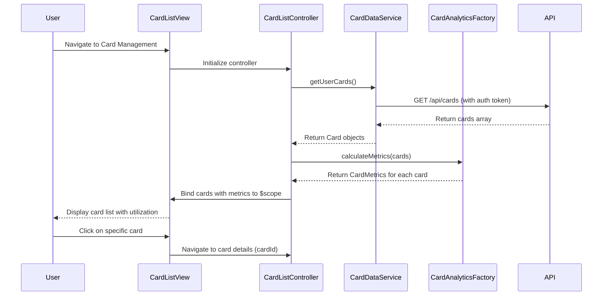

# Low-Level Design: Credit Card Management and Monitoring
**Epic ID:** QE-9212

## a. Architecture Mapping

- **Card Management Module** → AngularJS Module (`app.cardManagement`)
- **Card List Controller** → Controller (`CardListController`) - manages card display and selection
- **Card Details Controller** → Controller (`CardDetailsController`) - handles individual card view
- **Card Data Service** → Service (`CardDataService`) - fetches card data from REST API
- **Transaction Service** → Service (`TransactionService`) - retrieves card-specific transactions
- **Card Analytics Service** → Factory (`CardAnalyticsFactory`) - calculates utilization and metrics
- **Card Item Directive** → Directive (`cardItem`) - renders individual card tile

**Recommended Folder Structure:**
```
app/
├── modules/
│   └── card-management/
│       ├── controllers/
│       │   ├── card-list.controller.js
│       │   └── card-details.controller.js
│       ├── services/
│       │   ├── card-data.service.js
│       │   ├── transaction.service.js
│       │   └── card-analytics.factory.js
│       ├── directives/
│       │   └── card-item.directive.js
│       ├── views/
│       │   ├── card-list.html
│       │   └── card-details.html
│       └── card-management.module.js
```

## b. Component Specifications

| Name | Artifact Type | Responsibility | Key Dependencies |
|------|--------------|----------------|------------------|
| CardManagementModule | Module | Encapsulates all card management functionality | angular, ngRoute, ui.bootstrap |
| CardListController | Controller | Fetches and displays all user cards with key metrics | CardDataService, CardAnalyticsFactory, $scope |
| CardDetailsController | Controller | Displays detailed view of selected card with transactions | CardDataService, TransactionService, $routeParams, $scope |
| CardDataService | Service | REST API calls to retrieve card information and balances | $http, $q, AuthService |
| TransactionService | Service | REST API calls to fetch card-specific transaction history | $http, $q, AuthService |
| CardAnalyticsFactory | Factory | Calculates card utilization, monthly spend, and comparison metrics | None |
| cardItem | Directive | Renders card tile with card number, balance, limit, and utilization | CardAnalyticsFactory |

## c. Data Model

**Card Object:**
```javascript
{
  cardId: String,
  cardNumber: String,          // masked, e.g., "**** **** **** 1234"
  cardHolderName: String,
  cardType: String,            // "Visa", "MasterCard", "Amex"
  creditLimit: Number,
  currentBalance: Number,
  outstandingAmount: Number,
  availableCredit: Number,
  expiryDate: String,          // "MM/YY"
  status: String               // "Active", "Blocked"
}
```

**Transaction Object:**
```javascript
{
  transactionId: String,
  cardId: String,
  amount: Number,
  merchantName: String,
  category: String,
  transactionDate: Date,
  description: String,
  transactionType: String      // "Debit", "Credit"
}
```

**CardMetrics Object:**
```javascript
{
  cardId: String,
  utilization: Number,         // percentage (0-100)
  monthlySpend: Number,
  transactionCount: Number,
  lastTransactionDate: Date
}
```

## d. Data Flow

User navigates to Card Management view → CardListController invokes CardDataService.getUserCards() → Service makes GET /api/cards REST call with auth token → API returns array of Card objects → CardAnalyticsFactory computes utilization for each card → Controller binds cards to $scope → View renders card tiles using cardItem directive → User clicks on a card → CardDetailsController loads using $routeParams.cardId → Controller calls CardDataService.getCardById() and TransactionService.getTransactionsByCard() in parallel → Services fetch card details and transactions via REST APIs → Controller aggregates data and binds to $scope → View displays card details, transaction list, and card-wise spend analysis with filtering options.

## e. Primary Sequence Diagram



## f. Implementation Notes

- Use AngularJS dependency injection to inject services into controllers; follow `$inject` annotation pattern for minification safety.
- Implement ES6 classes for services and factories; use arrow functions for promise chains to maintain lexical `this` context.
- Use `$http` service with interceptors for auth token injection and global error handling; configure base API URL in app constants.
- Leverage Bootstrap grid system (col-md-4, col-sm-6) for responsive card tile layout; use Bootstrap cards component for card UI.
- Implement client-side caching in CardDataService using $cacheFactory to reduce redundant API calls for card data.

## g. Error Handling

HTTP interceptor-based error handling with try/catch in service methods; display user-friendly error notifications using Bootstrap alerts or toast service.

## h. Security Notes

Requires token-based authentication via existing SSO; all API calls include Authorization header with JWT token validated by backend.