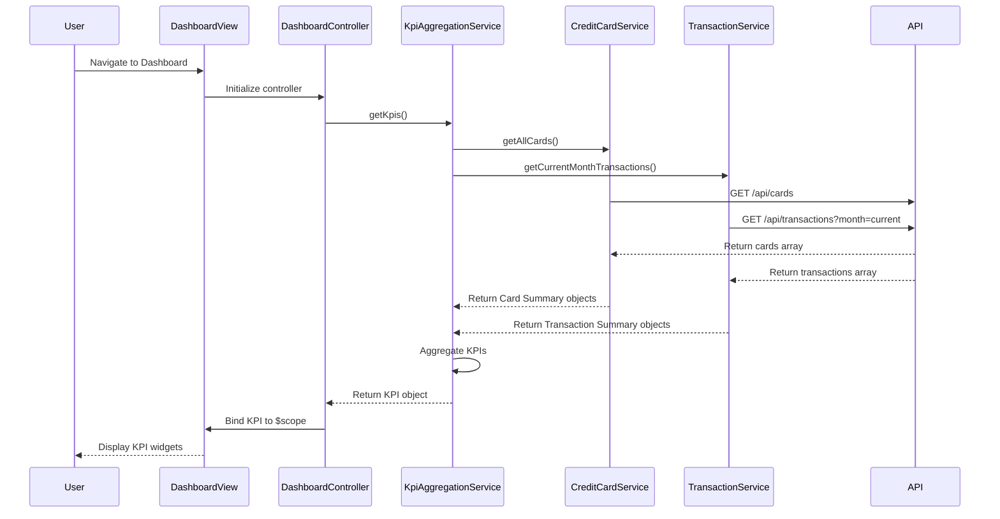

# Low-Level Design: Dashboard and KPI Management
**Epic ID:** QE-9213

## a. Architecture Mapping

- **Dashboard Module** → AngularJS Module (`app.dashboard`)
- **Dashboard Controller** → Controller (`DashboardController`) - orchestrates KPI display and refresh
- **KPI Aggregation Service** → Service (`KpiAggregationService`) - aggregates metrics across all cards
- **Credit Card Service** → Service (`CreditCardService`) - fetches card data via REST API
- **Transaction Service** → Service (`TransactionService`) - retrieves transaction data for monthly spend
- **KPI Widget Directive** → Directive (`kpiWidget`) - renders individual KPI tile
- **Refresh Service** → Factory (`RefreshFactory`) - handles periodic data refresh logic

**Recommended Folder Structure:**
```
app/
├── modules/
│   └── dashboard/
│       ├── controllers/
│       │   └── dashboard.controller.js
│       ├── services/
│       │   ├── kpi-aggregation.service.js
│       │   ├── credit-card.service.js
│       │   ├── transaction.service.js
│       │   └── refresh.factory.js
│       ├── directives/
│       │   └── kpi-widget.directive.js
│       ├── views/
│       │   └── dashboard.html
│       └── dashboard.module.js
```

## b. Component Specifications

| Name | Artifact Type | Responsibility | Key Dependencies |
|------|--------------|----------------|------------------|
| DashboardModule | Module | Encapsulates dashboard and KPI functionality | angular, ngRoute, ui.bootstrap |
| DashboardController | Controller | Loads and refreshes KPI data, manages dashboard state | KpiAggregationService, RefreshFactory, $scope, $interval |
| KpiAggregationService | Service | Aggregates KPIs (total limit, available credit, monthly spend, outstanding) across all cards | CreditCardService, TransactionService, $q |
| CreditCardService | Service | REST API calls to retrieve all user cards with balances and limits | $http, $q, AuthService |
| TransactionService | Service | REST API calls to fetch current month transactions for monthly spend calculation | $http, $q, AuthService |
| kpiWidget | Directive | Renders individual KPI tile with label, value, and icon | None |
| RefreshFactory | Factory | Manages periodic refresh logic and on-demand refresh triggers | $interval, $rootScope |

## c. Data Model

**KPI Object:**
```javascript
{
  totalCreditLimit: Number,
  availableCredit: Number,
  totalOutstanding: Number,
  monthlySpend: Number,
  lastUpdated: Date
}
```

**Card Summary Object:**
```javascript
{
  cardId: String,
  creditLimit: Number,
  currentBalance: Number,
  outstandingAmount: Number
}
```

**Transaction Summary Object:**
```javascript
{
  transactionId: String,
  amount: Number,
  transactionDate: Date,
  transactionType: String      // "Debit", "Credit"
}
```

## d. Data Flow

User accesses Dashboard → DashboardController initializes and calls KpiAggregationService.getKpis() → Service invokes CreditCardService.getAllCards() and TransactionService.getCurrentMonthTransactions() in parallel using $q.all() → CreditCardService makes GET /api/cards REST call, TransactionService makes GET /api/transactions?month=current REST call → Both services return data → KpiAggregationService aggregates: totalCreditLimit = sum of all card limits, availableCredit = totalCreditLimit - sum of all outstanding, monthlySpend = sum of current month debit transactions → Aggregated KPI object returned to DashboardController → Controller binds KPI to $scope → View renders four kpiWidget directives (one per KPI) using Bootstrap responsive grid → RefreshFactory triggers periodic refresh every 60 seconds or user clicks refresh button → KPI data updates in UI without full page reload.

## e. Primary Sequence Diagram



## f. Implementation Notes

- Use AngularJS $q.all() to parallelize CreditCardService and TransactionService API calls for faster dashboard load time.
- Implement ES6 classes for services; use const/let for variable declarations and arrow functions in promise chains.
- Configure $http interceptor to inject Authorization header with JWT token; set API base URL in app.constant().
- Use Bootstrap grid (col-md-3 for desktop, col-sm-6 for tablet, col-xs-12 for mobile) for responsive KPI widget layout.
- Implement $interval in RefreshFactory for periodic refresh; cancel interval on $scope.$on('$destroy') to prevent memory leaks.

## g. Error Handling

HTTP interceptor catches API errors; service methods use try/catch and reject promises with error objects; DashboardController displays error toast using Bootstrap alert component.

## h. Security Notes

Requires token-based auth via existing SSO; JWT token passed in Authorization header for all API calls; backend validates token and user identity.