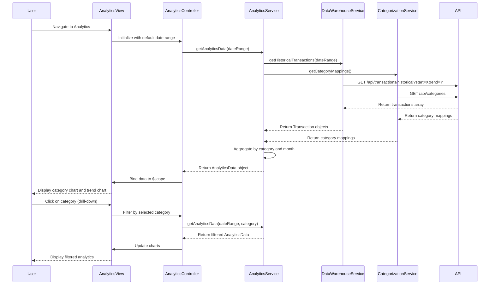

# Low-Level Design: Analytics and Spending Insights
**Epic ID:** QE-9214

## a. Architecture Mapping

- **Analytics Module** → AngularJS Module (`app.analytics`)
- **Analytics Controller** → Controller (`AnalyticsController`) - manages analytics view and user interactions
- **Analytics Service** → Service (`AnalyticsService`) - fetches and processes analytics data from REST API
- **Categorization Service** → Service (`CategorizationService`) - retrieves category mappings and transaction categorization
- **Chart Directive** → Directive (`spendingChart`) - renders interactive charts using Chart.js or D3.js
- **Filter Service** → Factory (`FilterFactory`) - manages filtering and drill-down logic
- **Data Warehouse Service** → Service (`DataWarehouseService`) - retrieves historical transaction data

**Recommended Folder Structure:**
```
app/
├── modules/
│   └── analytics/
│       ├── controllers/
│       │   └── analytics.controller.js
│       ├── services/
│       │   ├── analytics.service.js
│       │   ├── categorization.service.js
│       │   ├── data-warehouse.service.js
│       │   └── filter.factory.js
│       ├── directives/
│       │   └── spending-chart.directive.js
│       ├── views/
│       │   └── analytics.html
│       └── analytics.module.js
```

## b. Component Specifications

| Name | Artifact Type | Responsibility | Key Dependencies |
|------|--------------|----------------|------------------|
| AnalyticsModule | Module | Encapsulates analytics and insights functionality | angular, ngRoute, ui.bootstrap, chart.js |
| AnalyticsController | Controller | Loads analytics data, manages filter state, handles user interactions | AnalyticsService, FilterFactory, $scope |
| AnalyticsService | Service | Aggregates spending data by category and time period, calculates trends | DataWarehouseService, CategorizationService, $q |
| CategorizationService | Service | REST API calls to retrieve category mappings for transactions | $http, $q, AuthService |
| DataWarehouseService | Service | REST API calls to fetch historical transactions (12+ months) | $http, $q, AuthService |
| spendingChart | Directive | Renders interactive pie/bar/line charts with drill-down capability using Chart.js | FilterFactory |
| FilterFactory | Factory | Manages filter state (date range, category selection) and emits filter change events | $rootScope |

## c. Data Model

**CategorySpending Object:**
```javascript
{
  category: String,            // "Food & Dining", "Fuel", "Shopping", etc.
  totalSpend: Number,
  transactionCount: Number,
  percentageOfTotal: Number
}
```

**MonthlyTrend Object:**
```javascript
{
  month: String,               // "2024-01", "2024-02", etc.
  totalSpend: Number,
  categoryBreakdown: Array     // Array of {category: String, amount: Number}
}
```

**Transaction Object:**
```javascript
{
  transactionId: String,
  amount: Number,
  category: String,
  merchantName: String,
  transactionDate: Date,
  cardId: String
}
```

**AnalyticsData Object:**
```javascript
{
  categorySpending: Array,     // Array of CategorySpending objects
  monthlyTrends: Array,        // Array of MonthlyTrend objects
  totalSpend: Number,
  dateRange: {start: Date, end: Date},
  categories: Array            // ["Food & Dining", "Fuel", "Shopping", "Travel", "Entertainment", "Utilities", "Healthcare", "Education", "Miscellaneous"]
}
```

## d. Data Flow

User navigates to Analytics view → AnalyticsController initializes with default date range (last 12 months) → Controller calls AnalyticsService.getAnalyticsData(dateRange) → Service invokes DataWarehouseService.getHistoricalTransactions(dateRange) to fetch transactions via GET /api/transactions/historical REST call → CategorizationService.getCategoryMappings() retrieves category assignments via GET /api/categories REST call → AnalyticsService aggregates transactions by category and month, calculates percentages and trends → Service returns AnalyticsData object → Controller binds data to $scope → View renders spendingChart directive twice: once for category-wise pie/bar chart, once for monthly trend line chart → User interacts with chart (clicks category slice) → spendingChart directive emits drill-down event → FilterFactory updates filter state → AnalyticsController detects filter change and re-fetches filtered data → Charts update to show filtered view.

## e. Primary Sequence Diagram



## f. Implementation Notes

- Use Chart.js library integrated via angular-chart.js directive for rendering interactive charts; configure responsive options for mobile/desktop.
- Implement ES6 classes for services; use async/await pattern with $q promises for cleaner asynchronous code in AnalyticsService.
- Use $http service with interceptors for auth token injection; implement request caching for category mappings to reduce API calls.
- Leverage Bootstrap grid (col-md-6 for side-by-side charts on desktop, col-xs-12 for stacked on mobile) for responsive layout.
- Implement FilterFactory using $rootScope.$broadcast for filter change events; controllers listen via $scope.$on to react to filter updates.

## g. Error Handling

HTTP interceptor-based error handling with try/catch in service methods; display user-friendly error messages using Bootstrap alert component or toast notifications.

## h. Security Notes

Requires token-based authentication via existing SSO; all API calls include Authorization header with JWT token; standard input validation for date range filters to prevent injection attacks.