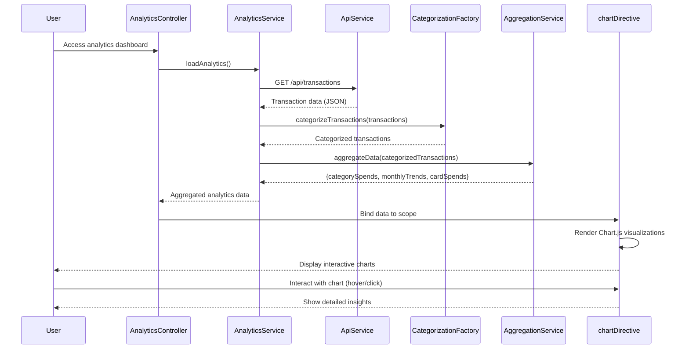

# Low-Level Design: QE-9215 - Spending Analytics and Insights

## a. Architecture Mapping

- **User Analytics Interface** → AngularJS Module: `app.analytics` with Controller: `AnalyticsController` and View template: `analytics.html`
- **Analytics Service** → AngularJS Service: `AnalyticsService` (handles business logic and orchestration)
- **Transaction Categorization Engine** → AngularJS Factory: `CategorizationFactory` (classifies transactions into 9 categories)
- **Data Aggregation Service** → AngularJS Service: `AggregationService` (computes category totals, trends, card-wise breakdowns)
- **Charting Library Integration** → AngularJS Directive: `chartDirective` (wraps Chart.js for rendering interactive visualizations)
- **Transaction Data Store** → REST API integration via `$http` service

**Recommended Folder Structure:**
```
app/
├── modules/
│   └── analytics/
│       ├── analytics.module.js
│       ├── analytics.controller.js
│       ├── analytics.service.js
│       ├── aggregation.service.js
│       ├── categorization.factory.js
│       ├── chart.directive.js
│       └── views/
│           └── analytics.html
├── shared/
│   └── services/
│       └── api.service.js
└── assets/
    └── css/
        └── analytics.css
```

## b. Component Specifications

| Component Name | Artifact Type | Responsibility | Key Dependencies |
|----------------|---------------|----------------|------------------|
| AnalyticsController | Controller | Manages analytics view state, handles user interactions, coordinates data loading and chart rendering | AnalyticsService, AggregationService, $scope |
| AnalyticsService | Service | Fetches transaction data from REST API, orchestrates categorization and aggregation workflows | $http, CategorizationFactory, AggregationService |
| CategorizationFactory | Factory | Classifies transactions into 9 categories (Food & Dining, Fuel, Shopping, Travel, Entertainment, Utilities, Healthcare, Education, Miscellaneous) using MCC codes or merchant name matching | None (pure logic) |
| AggregationService | Service | Computes category totals, monthly trends (12-month rolling), and card-wise spend breakdowns from categorized transactions | None (computation logic) |
| chartDirective | Directive | Wraps Chart.js library to render interactive pie, line, and bar charts with responsive behavior | Chart.js library |
| ApiService | Service | Centralized REST API communication handler with error interceptor | $http, $q |

## c. Data Model

**Transaction Model:**
```javascript
class Transaction {
  id: String
  date: Date
  merchant: String
  amount: Number
  category: String  // One of 9 predefined categories
  cardId: String
  status: String
}
```

**CategorySpend Model:**
```javascript
class CategorySpend {
  category: String
  totalAmount: Number
  transactionCount: Number
  percentage: Number
}
```

**MonthlyTrend Model:**
```javascript
class MonthlyTrend {
  month: String      // Format: 'YYYY-MM'
  totalSpend: Number
  categoryBreakdown: Array<CategorySpend>
}
```

**CardSpend Model:**
```javascript
class CardSpend {
  cardId: String
  cardName: String
  totalSpend: Number
  categoryBreakdown: Array<CategorySpend>
}
```

## d. Data Flow

User accesses analytics dashboard → AnalyticsController initializes and calls AnalyticsService.loadAnalytics() → AnalyticsService fetches transaction data via REST API ($http GET /api/transactions) → CategorizationFactory classifies each transaction into one of 9 categories → AggregationService computes category totals, 12-month trends, and card-wise breakdowns → Aggregated data is bound to $scope → chartDirective watches scope changes and renders interactive Chart.js visualizations (pie chart for categories, line chart for trends, bar chart for card-wise) within 1.5 seconds → User interacts with charts (hover, click) triggering directive event handlers that update view with detailed insights.

## e. Primary Sequence Diagram



## f. Implementation Notes

- Use AngularJS 1.x module pattern with explicit dependency injection (`$inject` annotation) to ensure minification safety
- Leverage ES6 classes for model definitions and arrow functions for callbacks; transpile with Babel if targeting older browsers
- Integrate Chart.js via custom directive with isolated scope to encapsulate chart lifecycle (create, update, destroy)
- Implement REST API calls using $http service with promise chaining; handle responses in service layer before passing to controllers
- Use $q.all() for parallel data fetching if multiple API endpoints are involved; cache aggregated results in service for 5 minutes to reduce API calls

## g. Error Handling

HTTP interceptor-based error handling with $http interceptor that catches API failures, displays user-friendly notifications via Bootstrap alerts, and logs errors to console.

## h. Security Notes

Standard input validation and secure API calls assumed; requires token-based auth via existing SSO for API access.