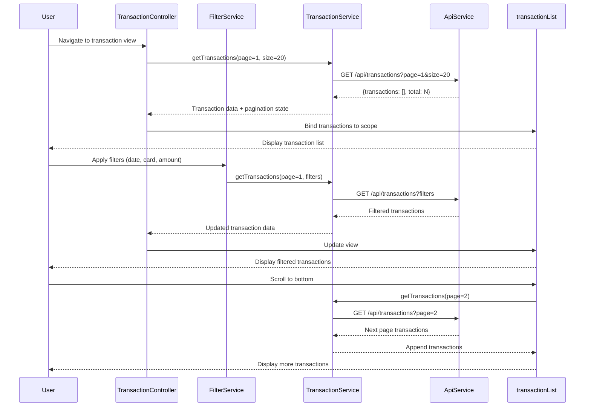

# Low-Level Design: QE-9216 - Transaction Monitoring and Viewing

## a. Architecture Mapping

- **User Interface** → AngularJS Module: `app.transactions` with Controller: `TransactionController` and View template: `transactions.html`
- **Transaction Service** → AngularJS Service: `TransactionService` (handles API calls and business logic)
- **Transaction Data Repository** → REST API integration via `$http` service
- **Transaction Filter and Sort Engine** → AngularJS Filter: `transactionFilter` and Service: `FilterService` (client-side filtering and sorting)
- **Transaction Display Component** → AngularJS Directive: `transactionList` (renders paginated transaction list with infinite scroll)

**Recommended Folder Structure:**
```
app/
├── modules/
│   └── transactions/
│       ├── transactions.module.js
│       ├── transaction.controller.js
│       ├── transaction.service.js
│       ├── filter.service.js
│       ├── transaction.filter.js
│       ├── transaction-list.directive.js
│       └── views/
│           └── transactions.html
├── shared/
│   └── services/
│       └── api.service.js
└── assets/
    └── css/
        └── transactions.css
```

## b. Component Specifications

| Component Name | Artifact Type | Responsibility | Key Dependencies |
|----------------|---------------|----------------|------------------|
| TransactionController | Controller | Manages transaction view state, handles pagination, coordinates filtering/sorting, triggers data loading | TransactionService, FilterService, $scope |
| TransactionService | Service | Fetches paginated transaction data from REST API, manages transaction cache, handles API communication | $http, $q, ApiService |
| FilterService | Service | Applies user-specified filters (date range, card, amount range) and sorting (date, amount, merchant) to transaction dataset | None (pure logic) |
| transactionFilter | Filter | AngularJS filter for client-side transaction filtering by search term or card ID | None |
| transactionList | Directive | Renders paginated transaction list with infinite scroll support, handles scroll events, displays transaction details | TransactionService |
| ApiService | Service | Centralized REST API handler with error interceptor and request/response transformation | $http, $q |

## c. Data Model

**Transaction Model:**
```javascript
class Transaction {
  id: String
  date: Date
  merchant: String
  amount: Number
  category: String
  cardId: String
  cardName: String
  status: String       // 'completed', 'pending', 'failed'
  description: String
}
```

**PaginationState Model:**
```javascript
class PaginationState {
  currentPage: Number
  pageSize: Number     // Default: 20-50
  totalRecords: Number
  hasMore: Boolean
}
```

**FilterCriteria Model:**
```javascript
class FilterCriteria {
  startDate: Date
  endDate: Date
  cardIds: Array<String>
  minAmount: Number
  maxAmount: Number
  searchTerm: String
  sortBy: String       // 'date', 'amount', 'merchant'
  sortOrder: String    // 'asc', 'desc'
}
```

## d. Data Flow

User navigates to transaction view → TransactionController initializes with default pagination (page 1, size 20) and calls TransactionService.getTransactions() → TransactionService sends REST API request ($http GET /api/transactions?page=1&size=20) → API returns paginated transaction data with total count → TransactionService caches response and returns to controller → Controller binds transactions to $scope → transactionList directive renders transaction rows in responsive table/card layout → User applies filters (date range, card selection) via FilterService → FilterService updates filter criteria and triggers new API call with query parameters → User scrolls to bottom triggering infinite scroll → Directive detects scroll event, increments page, calls TransactionService.getTransactions(page+1) → New transactions appended to existing list with sub-1-second response time.

## e. Primary Sequence Diagram



## f. Implementation Notes

- Use AngularJS 1.x with explicit DI (`$inject` array notation) for minification safety; structure modules using component-based architecture
- Implement infinite scroll using custom directive that watches scroll position and triggers pagination via $scope.$apply() when threshold reached
- REST API integration via $http with query parameter serialization for filters; use $httpParamSerializer for complex filter objects
- Cache transaction pages in TransactionService using ES6 Map for fast lookup; invalidate cache on filter changes
- Use Bootstrap responsive grid (col-md-*, col-sm-*) for transaction card layout; switch between table and card views based on viewport width

## g. Error Handling

HTTP interceptor catches API errors, displays Bootstrap alert notifications to user, and provides retry mechanism via try/catch in service methods.

## h. Security Notes

Requires token-based auth via existing SSO; API calls include Authorization header with JWT token; standard input validation on filter inputs.