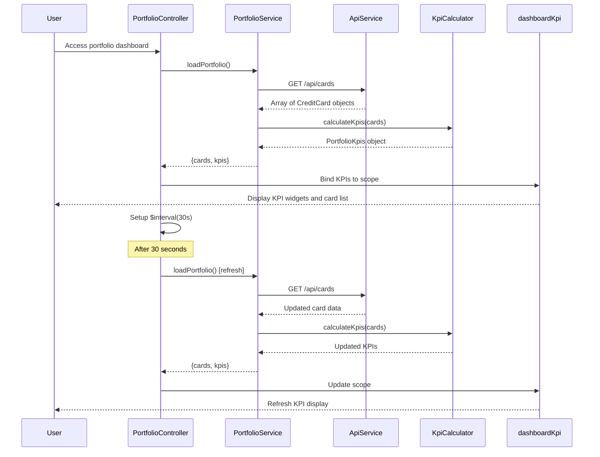

# Low-Level Design: QE-9217 - Credit Card Portfolio Management

## a. Architecture Mapping

- **User Interface Layer** → AngularJS Module: `app.portfolio` with Controller: `PortfolioController` and View template: `portfolio.html`
- **Portfolio Management Service** → AngularJS Service: `PortfolioService` (orchestrates data fetching and KPI calculation)
- **Credit Card Data Source** → REST API integration via `$http` service
- **KPI Calculation Engine** → AngularJS Factory: `KpiCalculator` (aggregates metrics across all cards)
- **Dashboard Renderer** → AngularJS Directive: `dashboardKpi` (renders individual KPI widgets with real-time updates)

**Recommended Folder Structure:**
```
app/
├── modules/
│   └── portfolio/
│       ├── portfolio.module.js
│       ├── portfolio.controller.js
│       ├── portfolio.service.js
│       ├── kpi-calculator.factory.js
│       ├── dashboard-kpi.directive.js
│       └── views/
│           └── portfolio.html
├── shared/
│   └── services/
│       └── api.service.js
└── assets/
    └── css/
        └── portfolio.css
```

## b. Component Specifications

| Component Name | Artifact Type | Responsibility | Key Dependencies |
|----------------|---------------|----------------|------------------|
| PortfolioController | Controller | Manages portfolio dashboard state, handles real-time refresh polling, coordinates data loading and KPI display | PortfolioService, $scope, $interval |
| PortfolioService | Service | Fetches credit card data from REST API, manages card collection, orchestrates KPI calculation workflow | $http, KpiCalculator, ApiService |
| KpiCalculator | Factory | Aggregates metrics (total credit limit, available credit, outstanding amount, monthly spend) across all user credit cards | None (pure calculation logic) |
| dashboardKpi | Directive | Renders individual KPI widget with icon, label, value, and trend indicator; supports responsive layout | None |
| ApiService | Service | Centralized REST API handler with error interceptor and retry logic | $http, $q |

## c. Data Model

**CreditCard Model:**
```javascript
class CreditCard {
  cardId: String
  cardNumber: String      // Masked: **** **** **** 1234
  cardName: String
  cardType: String        // 'Visa', 'Mastercard', 'Amex'
  creditLimit: Number
  availableCredit: Number
  outstandingAmount: Number
  currentBalance: Number
  dueDate: Date
  status: String          // 'active', 'blocked', 'expired'
}
```

**PortfolioKpis Model:**
```javascript
class PortfolioKpis {
  totalCreditLimit: Number
  totalAvailableCredit: Number
  totalOutstanding: Number
  monthlySpend: Number
  creditUtilization: Number  // Percentage
  activeCardCount: Number
}
```

## d. Data Flow

User accesses portfolio dashboard → PortfolioController initializes and calls PortfolioService.loadPortfolio() → PortfolioService sends REST API request ($http GET /api/cards) → API returns array of CreditCard objects → PortfolioService passes card data to KpiCalculator.calculateKpis() → KpiCalculator aggregates total credit limit, available credit, outstanding amounts, and monthly spend across all cards → Calculated KPIs bound to $scope → dashboardKpi directives render each KPI widget in responsive Bootstrap grid → PortfolioController sets up $interval polling (every 30 seconds) to refresh data → On each interval, PortfolioService re-fetches card data and updates KPIs → Dashboard re-renders with updated values within 2-second load time constraint.

## e. Primary Sequence Diagram



## f. Implementation Notes

- Use AngularJS 1.x module pattern with explicit DI (`$inject` notation) for all controllers, services, and factories
- Implement real-time refresh using $interval service (30-second polling); cancel interval on $scope.$destroy to prevent memory leaks
- REST API integration via $http with promise chaining; handle API responses in PortfolioService before passing to controller
- Use Bootstrap grid system (row/col-*) for responsive KPI widget layout; stack widgets vertically on mobile, display in 2x2 grid on tablet, 4x1 on desktop
- KpiCalculator implements pure functions using ES6 arrow functions and array reduce() for aggregation; no side effects

## g. Error Handling

HTTP interceptor-based error handling with user notification via Bootstrap alerts and console logging for debugging.

## h. Security Notes

Requires token-based auth via existing SSO; API calls include Authorization header; card numbers are masked in API responses and UI display.