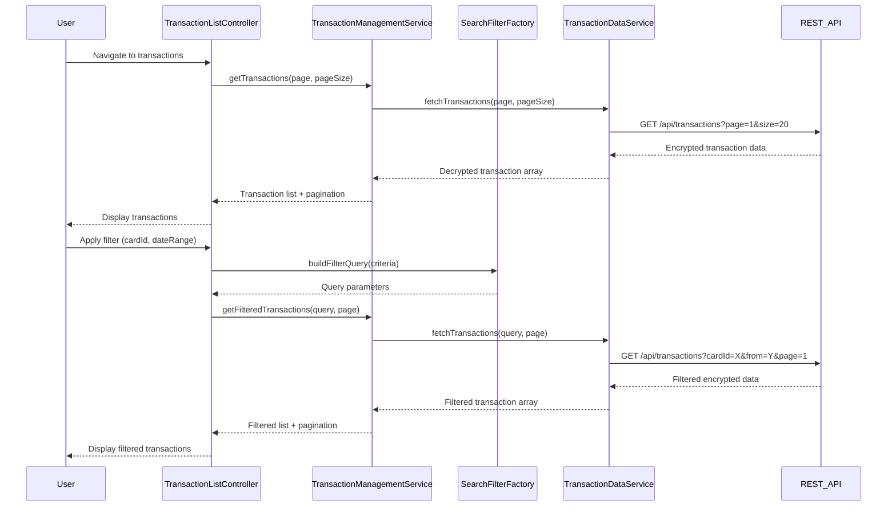

# Low-Level Design: Transaction Management and Monitoring
**Epic ID:** QE-9218

## a. Architecture Mapping

- **User Interface** → AngularJS Module (`transactionModule`) + Controller (`TransactionListController`) + View Template
- **Transaction Management Module** → AngularJS Service (`TransactionManagementService`)
- **Search and Filter Engine** → AngularJS Factory (`SearchFilterFactory`)
- **Transaction Data Service** → AngularJS Service (`TransactionDataService`) with REST API integration
- **Credit Card Service** → AngularJS Service (`CreditCardService`) with REST API integration

**Recommended Folder Structure:**
```
/app
  /modules
    /transactions
      /controllers (TransactionListController.js)
      /services (TransactionManagementService.js, TransactionDataService.js, CreditCardService.js)
      /factories (SearchFilterFactory.js)
      /views (transaction-list.html)
      transactionModule.js
```

## b. Component Specifications

| Component Name | Artifact Type | Responsibility | Key Dependencies |
|----------------|---------------|----------------|------------------|
| transactionModule | AngularJS Module | Root module for transaction management feature | ngRoute, ngResource |
| TransactionListController | Controller | Manages transaction list view state, pagination, user interactions | TransactionManagementService, $scope |
| TransactionManagementService | Service | Orchestrates transaction retrieval, coordinates search/filter operations | TransactionDataService, CreditCardService, SearchFilterFactory |
| SearchFilterFactory | Factory | Builds query parameters for search/filter operations, maintains filter state | None |
| TransactionDataService | Service | Handles REST API calls for transaction data with encryption headers | $http, $q |
| CreditCardService | Service | Provides card-specific filtering parameters via REST API | $http, $q |
| transactionListView | HTML5 View | Displays paginated transaction table with search/filter controls | Bootstrap for responsive layout |

## c. Data Model

**Transaction Object:**
```javascript
{
  id: String,
  cardId: String,
  date: Date,
  amount: Number,
  merchant: String,
  category: String,
  description: String,
  status: String
}
```

**FilterCriteria Object:**
```javascript
{
  cardId: String,
  dateFrom: Date,
  dateTo: Date,
  searchTerm: String,
  category: String,
  minAmount: Number,
  maxAmount: Number
}
```

**PaginationState Object:**
```javascript
{
  currentPage: Number,
  pageSize: Number,
  totalRecords: Number,
  totalPages: Number
}
```

## d. Data Flow

User navigates to transaction view → TransactionListController initializes and calls TransactionManagementService → Service retrieves paginated transaction list from TransactionDataService (REST API with encryption headers) → Transactions displayed in view → User applies search/filter → SearchFilterFactory builds query parameters → TransactionManagementService requests filtered data from TransactionDataService → User selects card filter → CreditCardService provides card filtering parameters → Updated transaction list rendered with pagination controls → User navigates pages via controller-managed pagination state.

## e. Primary Sequence Diagram



## f. Implementation Notes

- Use AngularJS Dependency Injection for all services and controllers; register via module.controller() and module.service()
- Implement server-side pagination with query parameters (page, pageSize) to handle 10,000+ transactions efficiently
- Use $http interceptor to add encryption headers and handle 401/403 responses globally
- Apply debouncing (300ms) on search input using $timeout to reduce API calls during typing
- Use ng-repeat with track by transaction.id for optimal rendering performance in large lists

## g. Error Handling

HTTP interceptor catches API errors; display user-friendly messages via Bootstrap alert directive; retry logic for network failures with exponential backoff.

## h. Security Notes

Data encrypted at rest and in transit; token-based authentication via existing SSO; all API calls include auth token in headers.