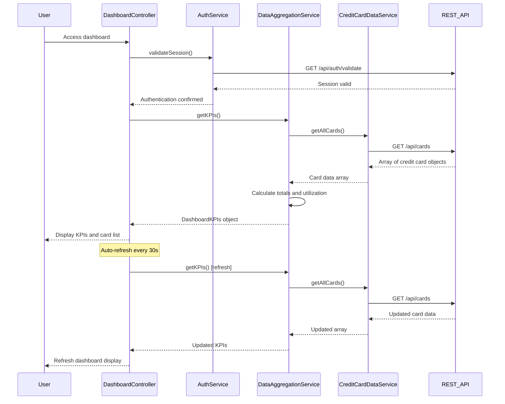

# Low-Level Design: Dashboard KPIs and Credit Card Overview
**Epic ID:** QE-9219

## a. Architecture Mapping

- **Dashboard UI** → AngularJS Module (`dashboardModule`) + Controller (`DashboardController`) + View Template
- **Data Aggregation Service** → AngularJS Service (`DataAggregationService`)
- **Credit Card Data Service** → AngularJS Service (`CreditCardDataService`) with REST API integration
- **User Authentication Service** → AngularJS Service (`AuthService`) with REST API integration

**Recommended Folder Structure:**
```
/app
  /modules
    /dashboard
      /controllers (DashboardController.js)
      /services (DataAggregationService.js, CreditCardDataService.js, AuthService.js)
      /views (dashboard.html)
      dashboardModule.js
```

## b. Component Specifications

| Component Name | Artifact Type | Responsibility | Key Dependencies |
|----------------|---------------|----------------|------------------|
| dashboardModule | AngularJS Module | Root module for dashboard feature | ngRoute, ngResource |
| DashboardController | Controller | Manages dashboard state, triggers KPI refresh, handles user interactions | DataAggregationService, AuthService, $scope, $interval |
| DataAggregationService | Service | Calculates aggregated KPIs (total credit, available credit, outstanding, monthly spend) | CreditCardDataService |
| CreditCardDataService | Service | Fetches individual card data (balances, limits, transactions) via REST API | $http, $q |
| AuthService | Service | Validates user authentication, manages session tokens | $http, $window |
| dashboardView | HTML5 View | Displays KPI cards and credit card list in responsive Bootstrap grid | Bootstrap for responsive layout |

## c. Data Model

**CreditCard Object:**
```javascript
{
  cardId: String,
  cardNumber: String,
  cardType: String,
  creditLimit: Number,
  availableCredit: Number,
  outstandingAmount: Number,
  monthlySpend: Number
}
```

**DashboardKPIs Object:**
```javascript
{
  totalCreditLimit: Number,
  totalAvailableCredit: Number,
  totalOutstanding: Number,
  totalMonthlySpend: Number,
  creditUtilization: Number
}
```

## d. Data Flow

User authenticates via AuthService → DashboardController loads and calls DataAggregationService.getKPIs() → Service invokes CreditCardDataService.getAllCards() → REST API returns array of credit card objects → DataAggregationService calculates total credit limit, available credit, outstanding amounts, monthly spend, and utilization percentage → Aggregated KPIs returned to DashboardController → Controller updates $scope → Dashboard view renders KPI cards and card list using Bootstrap responsive grid → Auto-refresh triggered every 30 seconds via $interval to maintain real-time data.

## e. Primary Sequence Diagram



## f. Implementation Notes

- Use AngularJS DI to inject all services into DashboardController; configure routes in dashboardModule.config()
- Implement $interval service for 30-second auto-refresh; cancel interval on $scope.$on('$destroy') to prevent memory leaks
- Use Promise.all pattern in DataAggregationService if multiple API calls needed for aggregation
- Apply Bootstrap grid classes (col-md-3, col-sm-6, col-xs-12) for responsive KPI cards
- Cache card data in CreditCardDataService for 30 seconds to reduce redundant API calls during aggregation

## g. Error Handling

HTTP interceptor handles API failures; display error banner using Bootstrap alert; retry failed requests once before showing error to user.

## h. Security Notes

Requires token-based auth via existing SSO; all API calls include JWT token in Authorization header.