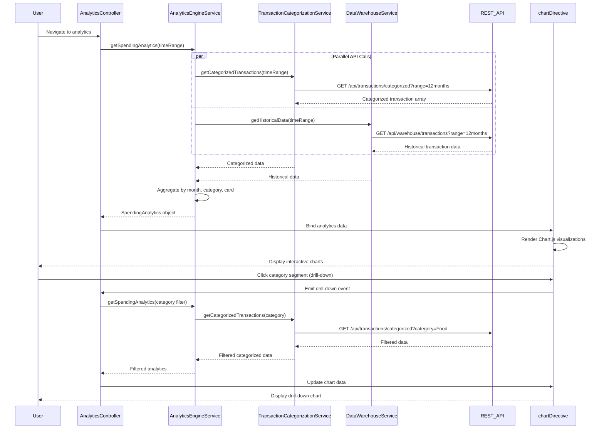

# Low-Level Design: Spending Analytics and Insights
**Epic ID:** QE-9220

## a. Architecture Mapping

- **User Interface** → AngularJS Module (`analyticsModule`) + Controller (`AnalyticsController`) + View Template
- **Analytics Engine** → AngularJS Service (`AnalyticsEngineService`)
- **Transaction Categorization Service** → AngularJS Service (`TransactionCategorizationService`) with REST API integration
- **Data Warehouse** → REST API endpoint accessed via AngularJS Service (`DataWarehouseService`)
- **Visualization Library** → AngularJS Directive (`chartDirective`) wrapping Chart.js or D3.js

**Recommended Folder Structure:**
```
/app
  /modules
    /analytics
      /controllers (AnalyticsController.js)
      /services (AnalyticsEngineService.js, TransactionCategorizationService.js, DataWarehouseService.js)
      /directives (chartDirective.js)
      /views (analytics.html)
      analyticsModule.js
```

## b. Component Specifications

| Component Name | Artifact Type | Responsibility | Key Dependencies |
|----------------|---------------|----------------|------------------|
| analyticsModule | AngularJS Module | Root module for analytics feature | ngRoute, ngResource |
| AnalyticsController | Controller | Manages analytics view state, handles user drill-down interactions | AnalyticsEngineService, $scope |
| AnalyticsEngineService | Service | Aggregates spending data by time period, category, and card | TransactionCategorizationService, DataWarehouseService |
| TransactionCategorizationService | Service | Retrieves categorized transactions via REST API | $http, $q |
| DataWarehouseService | Service | Fetches historical transaction data (12+ months) from data warehouse API | $http, $q |
| chartDirective | Directive | Renders interactive charts (line for trends, pie for categories) using Chart.js | Chart.js library |
| analyticsView | HTML5 View | Displays charts and category breakdown tables with drill-down controls | Bootstrap for responsive layout |

## c. Data Model

**SpendingAnalytics Object:**
```javascript
{
  monthlyTrends: Array<{month: String, amount: Number}>,
  categoryBreakdown: Array<{category: String, amount: Number, percentage: Number}>,
  cardWiseSpend: Array<{cardId: String, cardName: String, amount: Number}>
}
```

**CategoryEnum:**
```javascript
['Food & Dining', 'Fuel', 'Shopping', 'Travel', 'Entertainment', 'Utilities', 'Healthcare', 'Education', 'Miscellaneous']
```

**ChartConfig Object:**
```javascript
{
  type: String, // 'line', 'pie', 'bar'
  data: Object,
  options: Object
}
```

## d. Data Flow

User navigates to analytics view → AnalyticsController calls AnalyticsEngineService.getSpendingAnalytics() → Service requests categorized transactions from TransactionCategorizationService and historical data from DataWarehouseService in parallel → Engine aggregates data by month, category, and card → Processed analytics object returned to controller → Controller passes data to chartDirective via scope binding → Directive renders interactive Chart.js visualizations → User clicks on chart segment (drill-down) → Controller updates filter and re-requests filtered analytics → Updated chart rendered with drill-down data.

## e. Primary Sequence Diagram



## f. Implementation Notes

- Use AngularJS DI for all services; isolate scope in chartDirective with two-way binding for chart data
- Leverage Promise.all in AnalyticsEngineService to parallelize API calls to TransactionCategorizationService and DataWarehouseService
- Implement Chart.js with responsive:true option and onClick handler for drill-down functionality
- Use ES6 Array.reduce() for aggregation logic in AnalyticsEngineService for performance
- Cache aggregated analytics in service for 5 minutes to avoid redundant processing on view re-entry

## g. Error Handling

HTTP interceptor catches API errors; display error message in analytics view using Bootstrap alert; gracefully degrade to cached data if available.

## h. Security Notes

Standard input validation and secure API calls assumed; authentication token passed in all REST API requests.