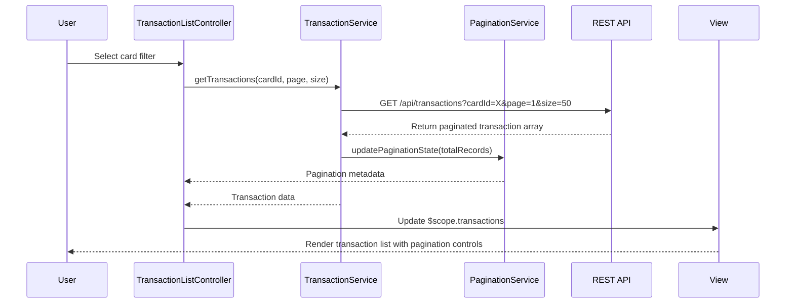

# Low-Level Design: Transaction Management and Monitoring
**Epic ID:** QE-9245

## a. Architecture Mapping

- **Module:** `transactionModule` - Main AngularJS module for transaction management features
- **Controller:** `TransactionListController` - Manages transaction list view, filtering, and pagination state
- **Controller:** `TransactionDetailController` - Handles individual transaction detail view
- **Service:** `TransactionService` - Handles REST API calls for transaction data retrieval
- **Service:** `CreditCardService` - Validates card identification and access permissions
- **Service:** `PaginationService` - Manages pagination logic and state for large datasets
- **Directive:** `transactionCard` - Reusable component for displaying individual transaction items
- **Factory:** `TransactionCache` - Caches transaction data to reduce API calls

**Folder Structure:**
```
/app
  /modules
    /transaction
      /controllers
      /services
      /directives
      /views
      /models
```

## b. Component Specifications

| Name | Artifact Type | Responsibility | Key Dependencies |
|------|---------------|----------------|------------------|
| transactionModule | Module | Bootstrap transaction management feature | angular, ngRoute, ngResource |
| TransactionListController | Controller | Manage list view, filters, pagination UI state | TransactionService, PaginationService, $scope |
| TransactionDetailController | Controller | Display single transaction details | TransactionService, $routeParams, $scope |
| TransactionService | Service | Execute REST API calls for transaction CRUD | $http, $q, API_CONFIG |
| CreditCardService | Service | Validate card access and retrieve card metadata | $http, $q, API_CONFIG |
| PaginationService | Service | Handle page state, size, navigation logic | None |
| transactionCard | Directive | Render transaction item with merchant, amount, date | None |
| TransactionCache | Factory | Cache transaction responses with TTL | $cacheFactory |

## c. Data Model

**Transaction Object:**
```javascript
{
  transactionId: String,
  cardId: String,
  merchantName: String,
  amount: Number,
  currency: String,
  transactionDate: Date,
  category: String,
  status: String, // 'posted', 'pending'
  description: String
}
```

**PaginationState Object:**
```javascript
{
  currentPage: Number,
  pageSize: Number,
  totalRecords: Number,
  totalPages: Number
}
```

**FilterCriteria Object:**
```javascript
{
  cardId: String,
  startDate: Date,
  endDate: Date,
  category: String,
  minAmount: Number,
  maxAmount: Number
}
```

## d. Data Flow

User selects a card or all-cards view from the UI → TransactionListController captures selection and invokes TransactionService with card filter → TransactionService calls REST API `/api/transactions?cardId={id}&page={n}&size={m}` → PaginationService manages page state and chunk retrieval → API returns paginated transaction array → TransactionCache stores response → Controller updates $scope with transaction list → View renders transaction cards via transactionCard directive → User clicks a transaction → TransactionDetailController fetches full details via TransactionService → Detail view displays merchant, amount, date, category, and status.

## e. Primary Sequence Diagram



## f. Implementation Notes

- Use AngularJS $http service with promise-based pattern for all REST API calls; inject API_CONFIG constant for base URL and endpoints.
- Apply Dependency Injection for all services and controllers; use strict DI annotation (`$inject` array) for minification safety.
- Implement client-side pagination UI with PaginationService managing state; server returns page metadata (total records, total pages).
- Use `ng-repeat` with `track by transactionId` for transaction list rendering to optimize DOM updates.
- Cache transaction responses using $cacheFactory with 5-minute TTL to reduce redundant API calls for repeated views.

## g. Error Handling

HTTP interceptor captures API errors (4xx/5xx), logs to console, and displays user-friendly toast notification via a shared NotificationService.

## h. Security Notes

Requires token-based authentication via existing SSO; all API calls include Authorization header with JWT token validated server-side.