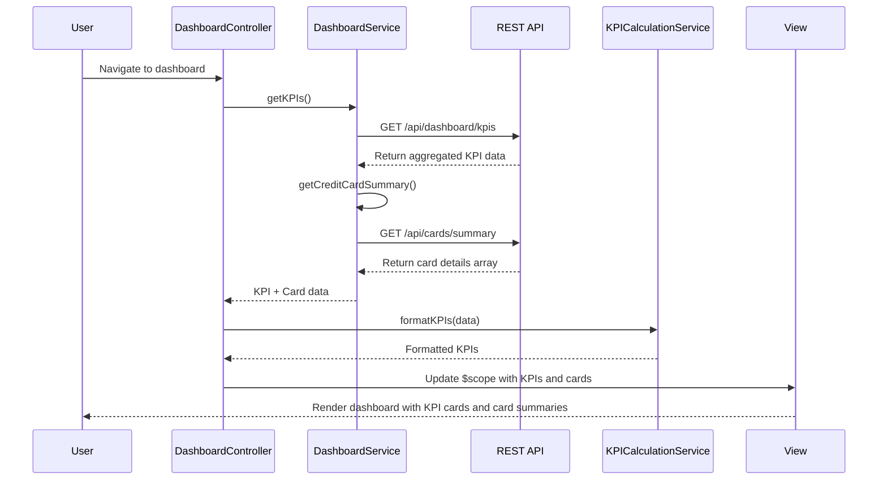

# Low-Level Design: Dashboard KPIs and Credit Card Overview
**Epic ID:** QE-9246

## a. Architecture Mapping

- **Module:** `dashboardModule` - Main AngularJS module for dashboard features
- **Controller:** `DashboardController` - Manages dashboard state, KPI display, and card overview
- **Service:** `DashboardService` - Fetches aggregated KPI data via REST API
- **Service:** `CreditCardDataService` - Retrieves card details, balances, and limits
- **Service:** `KPICalculationService` - Client-side KPI computation and formatting
- **Directive:** `kpiCard` - Reusable component for displaying individual KPI metrics
- **Directive:** `creditCardSummary` - Displays individual card summary with balance and limit
- **Factory:** `DashboardCache` - Caches dashboard data with refresh mechanism

**Folder Structure:**
```
/app
  /modules
    /dashboard
      /controllers
      /services
      /directives
      /views
      /models
```

## b. Component Specifications

| Name | Artifact Type | Responsibility | Key Dependencies |
|------|---------------|----------------|------------------|
| dashboardModule | Module | Bootstrap dashboard feature module | angular, ngRoute, ngResource |
| DashboardController | Controller | Manage dashboard view, refresh KPIs, handle user interactions | DashboardService, $scope, $interval |
| DashboardService | Service | Execute REST API calls for aggregated KPI data | $http, $q, API_CONFIG |
| CreditCardDataService | Service | Retrieve card details, balances, credit limits | $http, $q, API_CONFIG |
| KPICalculationService | Service | Format and compute derived KPIs (utilization %, available credit) | None |
| kpiCard | Directive | Render single KPI with label, value, icon, trend indicator | None |
| creditCardSummary | Directive | Display card name, balance, limit, available credit | None |
| DashboardCache | Factory | Cache dashboard responses with auto-refresh every 5 minutes | $cacheFactory, $interval |

## c. Data Model

**DashboardKPI Object:**
```javascript
{
  monthlySpend: Number,
  totalCreditLimit: Number,
  availableCredit: Number,
  outstandingAmount: Number,
  utilizationPercentage: Number,
  lastUpdated: Date
}
```

**CreditCard Object:**
```javascript
{
  cardId: String,
  cardName: String,
  cardNumber: String, // masked
  creditLimit: Number,
  currentBalance: Number,
  availableCredit: Number,
  outstandingAmount: Number,
  dueDate: Date
}
```

## d. Data Flow

User navigates to dashboard → DashboardController initializes and calls DashboardService.getKPIs() → DashboardService invokes REST API `/api/dashboard/kpis` and `/api/cards/summary` → API Gateway routes requests to CreditCardDataService and KPI Calculation Engine → Backend computes monthly spend, total credit limit, available credit, outstanding amounts across all cards → Aggregated KPI data returned as JSON → KPICalculationService formats values (currency, percentages) → DashboardController updates $scope with KPI and card data → View renders KPI cards and credit card summaries using kpiCard and creditCardSummary directives → Auto-refresh triggers every 5 minutes via $interval to update KPIs.

## e. Primary Sequence Diagram



## f. Implementation Notes

- Use AngularJS $http service with promise chaining for parallel API calls (KPI + card summary); combine results using $q.all().
- Apply Bootstrap grid system (col-md-3, col-sm-6, col-xs-12) for responsive KPI card layout across desktop, tablet, mobile.
- Implement auto-refresh using $interval service (5-minute interval) to call DashboardService.refresh() and update $scope.
- Use ng-class for dynamic styling of KPI trend indicators (positive/negative) and utilization percentage thresholds (green/yellow/red).
- Cache dashboard data using DashboardCache factory with TTL; invalidate cache on user-triggered refresh action.

## g. Error Handling

HTTP interceptor captures API failures, logs errors, and displays dismissible alert banner with retry option via NotificationService.

## h. Security Notes

Requires token-based auth via existing SSO; all API requests include Authorization header with JWT token validated by API Gateway.