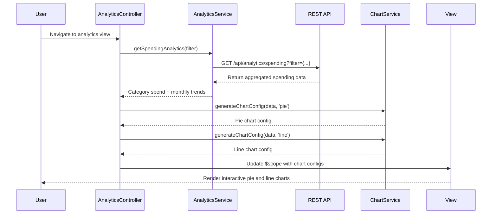

# Low-Level Design: Spending Analytics and Insights
**Epic ID:** QE-9247

## a. Architecture Mapping

- **Module:** `analyticsModule` - Main AngularJS module for analytics and insights features
- **Controller:** `AnalyticsController` - Manages analytics view, chart interactions, filter state
- **Service:** `AnalyticsService` - Fetches aggregated spending data via REST API
- **Service:** `TransactionDataService` - Retrieves raw transaction data for analysis
- **Service:** `CategoryService` - Provides category metadata and classification logic
- **Service:** `ChartService` - Generates chart configurations for visualization library
- **Directive:** `spendingChart` - Renders interactive charts using Chart.js or D3.js
- **Directive:** `categoryFilter` - Multi-select dropdown for category filtering
- **Factory:** `AnalyticsCache` - Caches analytics data to optimize performance

**Folder Structure:**
```
/app
  /modules
    /analytics
      /controllers
      /services
      /directives
      /views
      /models
```

## b. Component Specifications

| Name | Artifact Type | Responsibility | Key Dependencies |
|------|---------------|----------------|------------------|
| analyticsModule | Module | Bootstrap analytics feature module | angular, ngRoute, chart.js |
| AnalyticsController | Controller | Manage analytics view, filters, chart interactions | AnalyticsService, ChartService, $scope |
| AnalyticsService | Service | Execute REST API calls for aggregated spending data | $http, $q, API_CONFIG |
| TransactionDataService | Service | Retrieve raw transaction data for custom aggregation | $http, $q, API_CONFIG |
| CategoryService | Service | Provide category list, validate category assignments | None |
| ChartService | Service | Generate chart.js config objects for different chart types | None |
| spendingChart | Directive | Render interactive chart with drill-down capability | ChartService, chart.js |
| categoryFilter | Directive | Multi-select filter UI for category selection | CategoryService |
| AnalyticsCache | Factory | Cache analytics responses with category-based keys | $cacheFactory |

## c. Data Model

**CategorySpend Object:**
```javascript
{
  category: String,
  totalSpend: Number,
  transactionCount: Number,
  percentage: Number
}
```

**MonthlyTrend Object:**
```javascript
{
  month: String, // 'YYYY-MM'
  totalSpend: Number,
  categoryBreakdown: Array<CategorySpend>
}
```

**CardWiseSpend Object:**
```javascript
{
  cardId: String,
  cardName: String,
  totalSpend: Number,
  categorySpends: Array<CategorySpend>
}
```

**AnalyticsFilter Object:**
```javascript
{
  cardIds: Array<String>,
  categories: Array<String>,
  startDate: Date,
  endDate: Date
}
```

## d. Data Flow

User navigates to analytics view → AnalyticsController initializes with default filter (all cards, all categories, last 6 months) → AnalyticsService calls REST API `/api/analytics/spending?filter={...}` → API invokes Data Aggregation Engine which queries TransactionDataService for raw transactions → Category Classification Service enriches/validates category data → Aggregated results (category-wise spend, monthly trends, card-wise breakdown) returned as JSON → ChartService generates chart configurations for pie chart (category breakdown) and line chart (monthly trends) → AnalyticsController updates $scope with chart data → spendingChart directive renders interactive charts → User applies filter (e.g., select specific categories or cards) → Controller re-invokes AnalyticsService with updated filter → Charts update dynamically.

## e. Primary Sequence Diagram



## f. Implementation Notes

- Use Chart.js library integrated via angular-chart.js directive for responsive, interactive charts (pie, line, bar).
- Apply AngularJS $watch on filter object to trigger re-fetch and chart update when user changes category or card selection.
- Implement ChartService to abstract chart configuration logic; support drill-down by emitting custom events on chart click.
- Use ng-repeat with categoryFilter directive to render multi-select checkboxes for predefined categories (Food, Fuel, Shopping, etc.).
- Cache analytics data using AnalyticsCache with composite keys (filter hash) to avoid redundant API calls for identical filter combinations.

## g. Error Handling

HTTP interceptor captures API errors, logs to console, and displays inline error message in analytics view with retry button.

## h. Security Notes

Standard input validation and secure API calls assumed; token-based authentication via existing SSO with JWT in Authorization header.