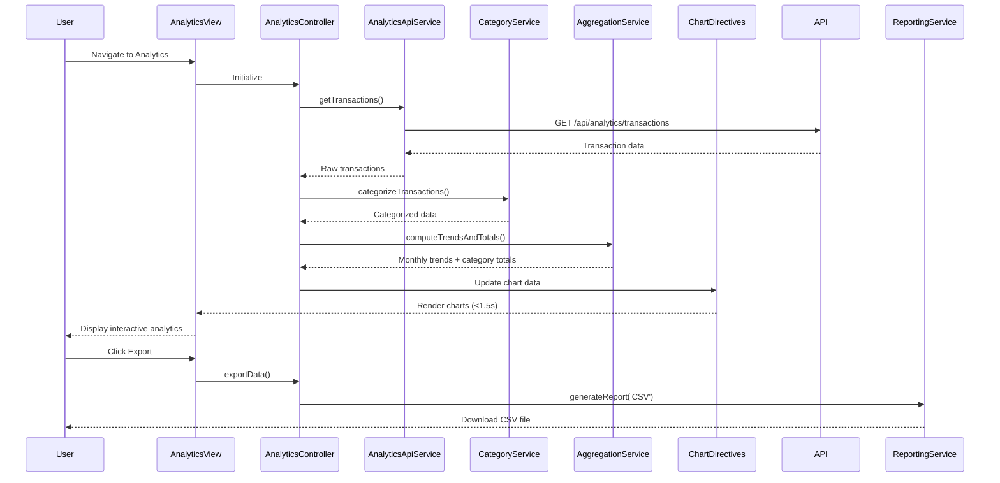

# Low-Level Design: Analytics and Spending Insights
**Epic ID:** QE-9254

## a. Architecture Mapping

**AngularJS Artifact Mapping:**
- Analytics UI with Charts → AngularJS Module: `analyticsModule` + Controller: `AnalyticsController` + Directives: `spendTrendChart`, `categoryPieChart`
- API Gateway interaction → Service: `AnalyticsApiService` (handles REST API calls)
- Transaction data retrieval → Factory: `TransactionDataFactory` (data caching and transformation)
- Category classification → Service: `CategoryService` (category mapping logic)
- Data aggregation → Service: `AggregationService` (trend and category calculations)
- Export functionality → Service: `ReportingService` (CSV/PDF generation)

**Recommended Folder Structure:**
```
/app
  /analytics
    analytics.module.js
    analytics.controller.js
    analytics-api.service.js
    aggregation.service.js
    category.service.js
    reporting.service.js
    /directives
      spend-trend-chart.directive.js
      category-pie-chart.directive.js
    /factories
      transaction-data.factory.js
    analytics.html
    analytics.css
```

## b. Component Specifications

| Name | Artifact Type | Responsibility | Key Dependencies |
|------|---------------|----------------|------------------|
| analyticsModule | Module | Root module for analytics feature, declares all components | angular, ngRoute, chart.js |
| AnalyticsController | Controller | Manages analytics view state, coordinates data fetching and chart rendering | AnalyticsApiService, AggregationService, CategoryService, $scope |
| AnalyticsApiService | Service | Fetches transaction data from backend REST API via API Gateway | $http, $q |
| TransactionDataFactory | Factory | Caches and transforms raw transaction data for consumption | None |
| CategoryService | Service | Maps transactions to 9 predefined categories + Miscellaneous | TransactionDataFactory |
| AggregationService | Service | Computes monthly trends and category-wise totals from transaction data | CategoryService |
| ReportingService | Service | Generates CSV/PDF exports of analytics data | None |
| spendTrendChart | Directive | Renders interactive line chart for monthly spend trends (12 months) | chart.js, AggregationService |
| categoryPieChart | Directive | Renders interactive pie/bar chart for category-wise spending breakdown | chart.js, CategoryService |

## c. Data Model

**Transaction Model:**
```javascript
{
  transactionId: String,
  cardId: String,
  amount: Number,
  date: Date,
  category: String, // One of 9 categories or 'Miscellaneous'
  merchantName: String
}
```

**MonthlyTrend Model:**
```javascript
{
  month: String, // 'YYYY-MM'
  totalSpend: Number
}
```

**CategorySpend Model:**
```javascript
{
  category: String, // 'Food & Dining', 'Fuel', 'Shopping', 'Travel', 'Entertainment', 'Utilities', 'Healthcare', 'Education', 'Miscellaneous'
  amount: Number,
  percentage: Number
}
```

## d. Data Flow

User navigates to Analytics view → AnalyticsController initializes and calls AnalyticsApiService.getTransactions() → Service fetches transaction data via REST API (GET /api/analytics/transactions) → TransactionDataFactory caches and transforms response → CategoryService categorizes transactions into 9 categories + Miscellaneous → AggregationService computes monthly trends (12 months) and category-wise totals → Controller updates $scope with aggregated data → spendTrendChart and categoryPieChart directives render interactive visualizations (within 1.5s) → User interacts with charts to explore patterns → On export action, ReportingService generates CSV/PDF and triggers download.

## e. Primary Sequence Diagram



## f. Implementation Notes

- Use AngularJS Dependency Injection for all services, factories, and controllers to ensure testability and modularity.
- Leverage Chart.js library via AngularJS directives for interactive, responsive visualizations with two-way data binding.
- Implement REST API calls using $http service with promise-based error handling; cache transaction data in TransactionDataFactory to minimize API calls.
- Use ES6 arrow functions, const/let, and template literals for cleaner, modern JavaScript code within AngularJS 1.x constraints.
- Apply MVC pattern: Controller manages state and orchestration, Services handle business logic and API integration, Directives encapsulate chart rendering logic.

## g. Error Handling

HTTP interceptor-based error handling with user-friendly notifications via toast/modal for API failures; try/catch blocks in aggregation logic with fallback to empty state.

## h. Security Notes

Requires token-based authentication via existing SSO; API Gateway enforces authorization for transaction data access; standard input validation and secure API calls assumed.