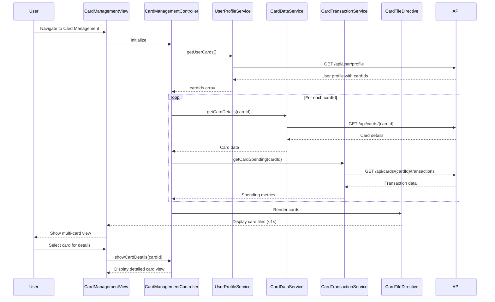

# Low-Level Design: Multiple Credit Card Management and Monitoring
**Epic ID:** QE-9255

## a. Architecture Mapping

**AngularJS Artifact Mapping:**
- Credit Card Management UI → AngularJS Module: `cardManagementModule` + Controller: `CardManagementController` + Directive: `creditCardTile`
- API Gateway interaction → Service: `CardApiService` (handles REST API calls)
- User-card associations → Service: `UserProfileService` (fetches user profile and card associations)
- Card master data retrieval → Service: `CardDataService` (fetches card details and limits)
- Card-wise transaction data → Service: `CardTransactionService` (fetches and aggregates card-wise spending)
- Card filtering/selection → Filter: `cardStatusFilter` + Controller logic

**Recommended Folder Structure:**
```
/app
  /card-management
    card-management.module.js
    card-management.controller.js
    card-api.service.js
    card-data.service.js
    card-transaction.service.js
    user-profile.service.js
    /directives
      credit-card-tile.directive.js
    /filters
      card-status.filter.js
    card-management.html
    card-management.css
```

## b. Component Specifications

| Name | Artifact Type | Responsibility | Key Dependencies |
|------|---------------|----------------|------------------|
| cardManagementModule | Module | Root module for card management feature, declares all components | angular, ngRoute |
| CardManagementController | Controller | Manages multi-card view state, coordinates data fetching and card display | CardApiService, CardDataService, CardTransactionService, UserProfileService, $scope |
| CardApiService | Service | Orchestrates API calls to fetch user cards, card details, and transactions | $http, $q |
| UserProfileService | Service | Fetches user profile and associated card IDs from backend | $http |
| CardDataService | Service | Retrieves card master data (card number, limit, status) for each card | $http |
| CardTransactionService | Service | Fetches card-wise transaction data and computes spending, outstanding balance, available credit | $http |
| creditCardTile | Directive | Renders individual card tile with card details, spending, limits, and status indicator | CardDataService |
| cardStatusFilter | Filter | Filters cards by status (active/inactive/blocked) for UI display | None |

## c. Data Model

**CreditCard Model:**
```javascript
{
  cardId: String,
  cardNumber: String, // Masked (e.g., '**** **** **** 1234')
  cardType: String, // 'Visa', 'MasterCard', 'Amex'
  creditLimit: Number,
  availableCredit: Number,
  outstandingBalance: Number,
  status: String, // 'active', 'inactive', 'blocked'
  expiryDate: String // 'MM/YY'
}
```

**CardSpending Model:**
```javascript
{
  cardId: String,
  monthlySpend: Number,
  totalTransactions: Number,
  lastTransactionDate: Date
}
```

**UserCardAssociation Model:**
```javascript
{
  userId: String,
  cardIds: Array<String>
}
```

## d. Data Flow

User navigates to Card Management view → CardManagementController initializes and calls UserProfileService.getUserCards() → Service fetches user-card associations via REST API (GET /api/user/profile) → For each cardId, CardApiService orchestrates parallel calls: CardDataService.getCardDetails(cardId) (GET /api/cards/{cardId}) and CardTransactionService.getCardSpending(cardId) (GET /api/cards/{cardId}/transactions) → Services return card details and spending data (within 1 second) → Controller merges data into CreditCard model array → creditCardTile directives render individual card tiles with details, spending, limits, and status indicators → User can filter cards by status using cardStatusFilter or select a card to drill down into detailed view.

## e. Primary Sequence Diagram



## f. Implementation Notes

- Use AngularJS Dependency Injection for all services and controllers; implement $q.all() for parallel API calls to meet 1-second retrieval NFR.
- Implement creditCardTile as an isolated scope directive with two-way binding for card data to ensure reusability across views.
- Use REST API pattern with $http service; implement response caching in services to optimize performance for repeated card data access.
- Apply ES6 features (const/let, arrow functions, template literals) for cleaner code; use AngularJS filters for card status filtering in UI.
- Follow MVC architecture: Controller orchestrates data flow, Services handle API integration and business logic, Directives encapsulate card tile rendering.

## g. Error Handling

HTTP interceptor-based error handling for API failures with user-friendly toast notifications; try/catch in data aggregation with graceful degradation to partial card display if individual card fetch fails.

## h. Security Notes

Requires token-based authentication via existing SSO; card numbers are masked server-side before API response; API Gateway enforces user-card association validation; standard input validation and secure API calls assumed.