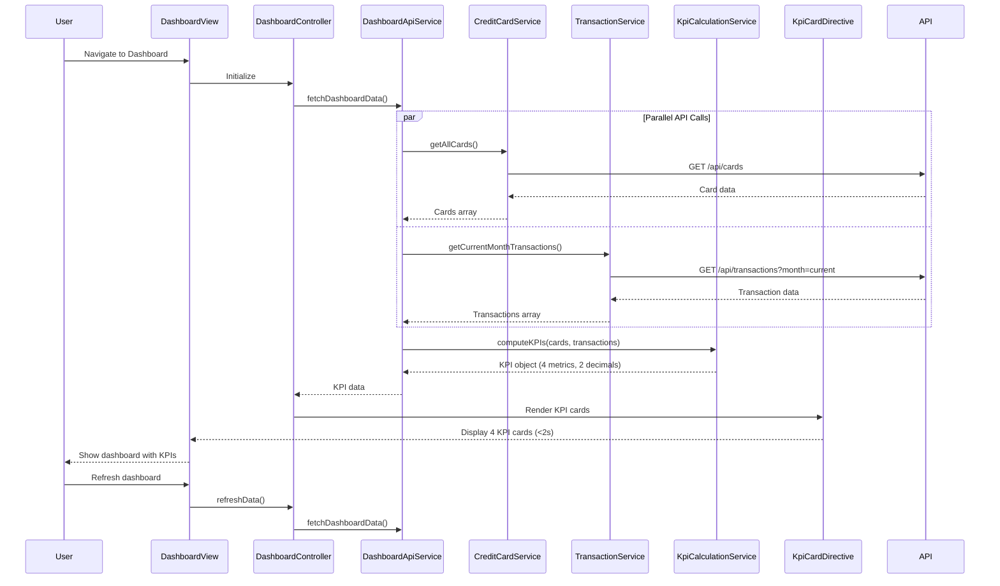

# Low-Level Design: Dashboard and KPI Management
**Epic ID:** QE-9256

## a. Architecture Mapping

**AngularJS Artifact Mapping:**
- Dashboard UI Layer → AngularJS Module: `dashboardModule` + Controller: `DashboardController` + Directive: `kpiCard`
- API Gateway interaction → Service: `DashboardApiService` (handles REST API calls)
- KPI computation → Service: `KpiCalculationService` (aggregates and computes KPIs)
- Credit card data retrieval → Service: `CreditCardService` (fetches card details and limits)
- Transaction data retrieval → Service: `TransactionService` (fetches spending data)
- User authentication → Service: `AuthService` (handles authentication state)

**Recommended Folder Structure:**
```
/app
  /dashboard
    dashboard.module.js
    dashboard.controller.js
    dashboard-api.service.js
    kpi-calculation.service.js
    credit-card.service.js
    transaction.service.js
    /directives
      kpi-card.directive.js
    dashboard.html
    dashboard.css
```

## b. Component Specifications

| Name | Artifact Type | Responsibility | Key Dependencies |
|------|---------------|----------------|------------------|
| dashboardModule | Module | Root module for dashboard feature, declares all components | angular, ngRoute |
| DashboardController | Controller | Manages dashboard state, orchestrates KPI data fetching and display | DashboardApiService, KpiCalculationService, AuthService, $scope |
| DashboardApiService | Service | Orchestrates API calls to fetch credit card and transaction data | $http, $q, CreditCardService, TransactionService |
| KpiCalculationService | Service | Computes four KPIs: Monthly Spend, Total Credit Limit, Available Credit, Outstanding Amount (accurate to 2 decimals) | None |
| CreditCardService | Service | Fetches credit card details and limits from backend REST API | $http |
| TransactionService | Service | Fetches transaction data for current month from backend REST API | $http |
| AuthService | Service | Manages user authentication state and token for secure API access | $http, $window |
| kpiCard | Directive | Renders individual KPI card with metric name, value, and visual indicator | None |

## c. Data Model

**KPI Model:**
```javascript
{
  monthlySpend: Number, // Current month total spend
  totalCreditLimit: Number, // Sum of all card limits
  availableCredit: Number, // Total limit - outstanding amount
  outstandingAmount: Number // Sum of all card outstanding balances
}
```

**CreditCard Model:**
```javascript
{
  cardId: String,
  creditLimit: Number,
  outstandingBalance: Number
}
```

**Transaction Model:**
```javascript
{
  transactionId: String,
  amount: Number,
  date: Date,
  cardId: String
}
```

## d. Data Flow

User authenticates via AuthService and navigates to Dashboard → DashboardController initializes and calls DashboardApiService.fetchDashboardData() → Service makes parallel REST API calls: CreditCardService.getAllCards() (GET /api/cards) and TransactionService.getCurrentMonthTransactions() (GET /api/transactions?month=current) → Both services return data within 2 seconds → KpiCalculationService receives card and transaction data, computes four KPIs (Monthly Spend = sum of current month transaction amounts, Total Credit Limit = sum of all card limits, Outstanding Amount = sum of all card outstanding balances, Available Credit = Total Credit Limit - Outstanding Amount), all rounded to 2 decimals → Computed KPIs are passed to DashboardController → Controller updates $scope with KPI data → kpiCard directives render four KPI cards in responsive grid layout → User views consolidated financial metrics in real-time.

## e. Primary Sequence Diagram



## f. Implementation Notes

- Use AngularJS Dependency Injection for all services and controllers; implement $q.all() for parallel API calls to meet 2-second load time NFR.
- Implement kpiCard as a reusable directive with isolated scope and attribute binding for KPI name, value, and icon.
- Use Bootstrap grid system for responsive layout (col-xs-12, col-sm-6, col-md-3) to ensure dashboard adapts to desktop, tablet, and mobile.
- Apply ES6 features (const/let, arrow functions, Number.toFixed(2) for 2-decimal precision) within AngularJS 1.x constraints.
- Follow MVC architecture: Controller orchestrates data flow, Services handle API integration and KPI calculation logic, Directives encapsulate KPI card rendering.

## g. Error Handling

HTTP interceptor-based error handling for API failures with user-friendly error messages displayed via toast notifications; try/catch in KPI calculation with fallback to zero values if data is incomplete.

## h. Security Notes

Requires token-based authentication via existing SSO (AuthService manages JWT token); API Gateway enforces user authorization for card and transaction data access; standard input validation and secure API calls assumed.