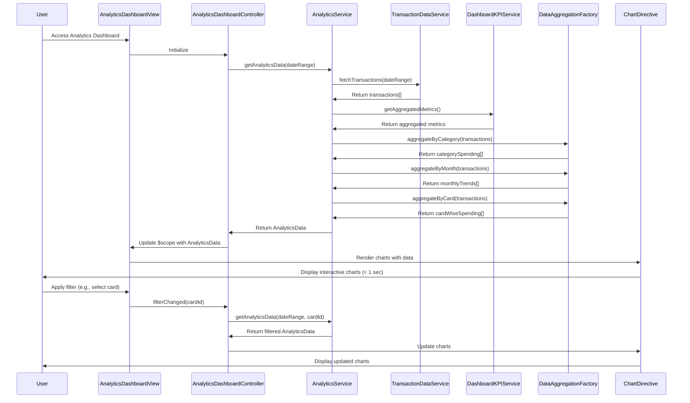

# Low-Level Design: QE-9257 - Spending Analytics and Insights

## a. Architecture Mapping

- **AngularJS Module**: `creditCard.analytics` - Main analytics module
- **Controller**: `AnalyticsDashboardController` - Manages analytics view state and user interactions
- **Service**: `AnalyticsService` - Handles data aggregation and API calls for analytics data
- **Service**: `TransactionDataService` - Retrieves transaction data from Transaction Management Module
- **Service**: `DashboardKPIService` - Fetches aggregated spending metrics
- **Directive**: `spendingChart` - Renders interactive charts (category-wise, monthly trends, card-wise)
- **Factory**: `DataAggregationFactory` - Processes and aggregates transaction data by category, card, and time period

**Folder Structure**:
```
/app
  /modules
    /analytics
      /controllers
        - analytics-dashboard.controller.js
      /services
        - analytics.service.js
        - transaction-data.service.js
        - dashboard-kpi.service.js
      /directives
        - spending-chart.directive.js
      /factories
        - data-aggregation.factory.js
      /views
        - analytics-dashboard.html
      - analytics.module.js
```

## b. Component Specifications

| Name | Artifact Type | Responsibility | Key Dependencies |
|------|---------------|----------------|------------------|
| creditCard.analytics | Module | Root module for analytics feature | ngRoute, chart.js |
| AnalyticsDashboardController | Controller | Manages analytics view state, handles user filter interactions, coordinates data flow | AnalyticsService, $scope |
| AnalyticsService | Service | Orchestrates data retrieval from transaction and KPI services, caches analytics data | TransactionDataService, DashboardKPIService, $http, $q |
| TransactionDataService | Service | Fetches transaction records from Transaction Management Module API | $http, $q |
| DashboardKPIService | Service | Retrieves aggregated spending metrics from Dashboard KPI Module | $http |
| spendingChart | Directive | Renders interactive charts using Chart.js, handles chart updates on data changes | Chart.js library |
| DataAggregationFactory | Factory | Aggregates transactions by category (9 categories), card, and monthly time periods for up to 12 months | None (pure JS logic) |

## c. Data Model

**AnalyticsData** (JavaScript Object):
```javascript
{
  categorySpending: Array<{category: String, amount: Number, percentage: Number}>,
  monthlyTrends: Array<{month: String, amount: Number, year: Number}>,
  cardWiseSpending: Array<{cardId: String, cardName: String, amount: Number}>,
  dateRange: {startDate: Date, endDate: Date},
  totalSpend: Number
}
```

**Transaction** (JavaScript Object):
```javascript
{
  transactionId: String,
  date: Date,
  amount: Number,
  merchant: String,
  category: String, // One of 9 predefined categories
  cardId: String,
  cardName: String
}
```

**ChartConfig** (JavaScript Object):
```javascript
{
  type: String, // 'pie', 'bar', 'line'
  data: Object,
  options: Object
}
```

## d. Data Flow

User accesses analytics dashboard → AnalyticsDashboardController initializes and calls AnalyticsService.getAnalyticsData() → AnalyticsService requests transaction data via TransactionDataService and aggregated metrics via DashboardKPIService using REST API calls → DataAggregationFactory processes retrieved transactions, grouping by category (9 categories), card, and month for up to 12 months → Aggregated data is returned to AnalyticsService, which caches it → Controller receives AnalyticsData object and binds to $scope → View renders spendingChart directives with chart configurations → Chart.js renders interactive visualizations (category pie/bar, monthly line, card-wise bar) within 1 second → User applies filters (date range, card, category) → Controller updates filters and re-invokes AnalyticsService → Updated aggregated data refreshes charts dynamically.

## e. Primary Sequence Diagram



## f. Implementation Notes

- Use AngularJS 1.x Dependency Injection to inject all services and factories into controllers and directives
- Leverage ES6 arrow functions, const/let, and Promises ($q) for asynchronous API calls to TransactionDataService and DashboardKPIService
- Integrate Chart.js library via directive for rendering; directive watches data changes and updates charts reactively
- Implement client-side caching in AnalyticsService using a simple object store to avoid redundant API calls for 12-month historical data
- Use Bootstrap grid system for responsive layout; ensure charts resize using Chart.js responsive options

## g. Error Handling

HTTP interceptor captures API errors; user-friendly notifications displayed via toaster service; try/catch in aggregation logic with fallback to empty datasets.

## h. Security Notes

Standard input validation and secure API calls assumed; requires token-based auth via existing SSO for API access.