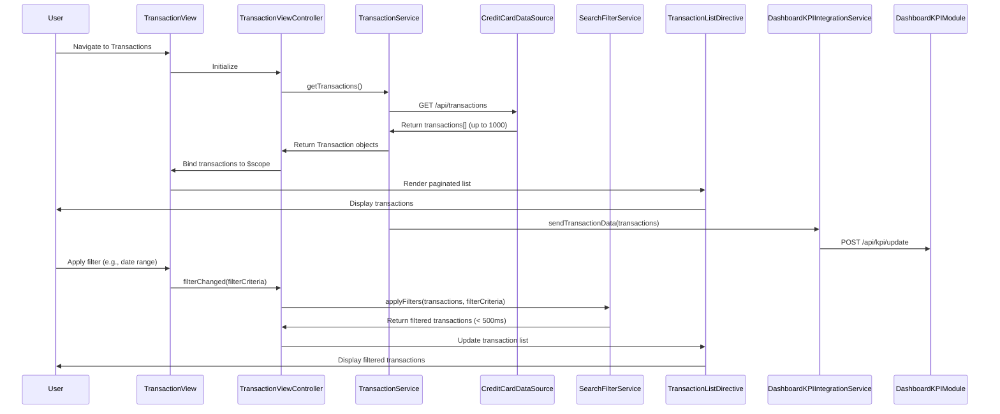

# Low-Level Design: QE-9258 - Transaction Management and Viewing

## a. Architecture Mapping

- **AngularJS Module**: `creditCard.transactions` - Main transaction management module
- **Controller**: `TransactionViewController` - Manages transaction list view, filters, and search
- **Service**: `TransactionService` - Handles transaction data retrieval and API communication
- **Service**: `SearchFilterService` - Processes search and filter operations on transactions
- **Service**: `DashboardKPIIntegrationService` - Sends transaction data to Dashboard KPI Module
- **Directive**: `transactionList` - Renders paginated transaction list with responsive layout
- **Factory**: `TransactionModelFactory` - Creates and validates transaction objects

**Folder Structure**:
```
/app
  /modules
    /transactions
      /controllers
        - transaction-view.controller.js
      /services
        - transaction.service.js
        - search-filter.service.js
        - dashboard-kpi-integration.service.js
      /directives
        - transaction-list.directive.js
      /factories
        - transaction-model.factory.js
      /views
        - transaction-view.html
      - transactions.module.js
```

## b. Component Specifications

| Name | Artifact Type | Responsibility | Key Dependencies |
|------|---------------|----------------|------------------|
| creditCard.transactions | Module | Root module for transaction management feature | ngRoute, ui.bootstrap |
| TransactionViewController | Controller | Manages transaction view state, handles search/filter inputs, coordinates pagination | TransactionService, SearchFilterService, $scope |
| TransactionService | Service | Fetches transaction records from Credit Card Data Source API, handles up to 1000 transactions per user | $http, $q, TransactionModelFactory |
| SearchFilterService | Service | Applies search and filter criteria (date, amount, category, merchant) to transaction list, optimized for <500ms response | None (client-side filtering) |
| DashboardKPIIntegrationService | Service | Sends aggregated transaction data to Dashboard KPI Module for spend calculations | $http |
| transactionList | Directive | Renders paginated transaction list with responsive Bootstrap layout, displays transaction details | None |
| TransactionModelFactory | Factory | Creates Transaction objects with standard attributes (transactionId, date, amount, merchant, category, cardId, status) | None |

## c. Data Model

**Transaction** (JavaScript Object):
```javascript
{
  transactionId: String,
  date: Date,
  amount: Number,
  merchant: String,
  category: String,
  cardId: String,
  cardName: String,
  status: String // 'posted', 'pending'
}
```

**FilterCriteria** (JavaScript Object):
```javascript
{
  dateRange: {startDate: Date, endDate: Date},
  amountRange: {min: Number, max: Number},
  categories: Array<String>,
  searchTerm: String,
  cardIds: Array<String>
}
```

**PaginationConfig** (JavaScript Object):
```javascript
{
  currentPage: Number,
  itemsPerPage: Number,
  totalItems: Number
}
```

## d. Data Flow

User navigates to transaction view → TransactionViewController initializes and calls TransactionService.getTransactions() → TransactionService makes REST API call to Credit Card Data Source → API returns transaction records (up to 1000) → TransactionService creates Transaction objects via TransactionModelFactory and returns to controller → Controller binds transactions to $scope and initializes pagination → transactionList directive renders paginated list with transaction details (date, merchant, amount, category, card) → User applies filters or search term → Controller invokes SearchFilterService.applyFilters(transactions, filterCriteria) → SearchFilterService filters transactions client-side within 500ms → Filtered results update $scope → View re-renders transaction list → TransactionService also sends transaction data to DashboardKPIIntegrationService for aggregated spend metrics in Dashboard KPI Module.

## e. Primary Sequence Diagram



## f. Implementation Notes

- Use AngularJS Dependency Injection for all services, controllers, and directives
- Leverage ES6 features (const/let, arrow functions, template literals) and Promises ($q) for asynchronous API calls
- Implement client-side filtering in SearchFilterService using Array.filter() with indexed lookups for <500ms performance
- Use ui.bootstrap pagination component for transaction list; configure itemsPerPage based on screen size (responsive)
- Bootstrap responsive grid ensures transaction list adapts to desktop, tablet, and mobile layouts

## g. Error Handling

HTTP interceptor-based error handling with user notifications via toaster; try/catch in filter logic with graceful degradation to unfiltered list.

## h. Security Notes

Requires token-based auth via existing SSO; standard input validation and secure API calls assumed.