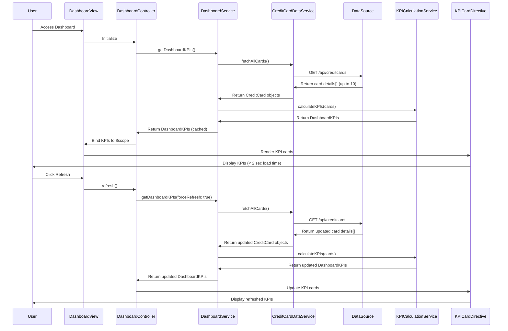

# Low-Level Design: QE-9259 - Dashboard KPIs and Credit Card Overview

## a. Architecture Mapping

- **AngularJS Module**: `creditCard.dashboard` - Main dashboard module
- **Controller**: `DashboardController` - Manages dashboard view state and KPI display
- **Service**: `DashboardService` - Orchestrates KPI data retrieval and aggregation
- **Service**: `CreditCardDataService` - Fetches credit card details from data source
- **Service**: `KPICalculationService` - Computes KPIs (monthly spend, total limit, available credit, outstanding amounts)
- **Directive**: `kpiCard` - Renders individual KPI metric cards with responsive layout
- **Factory**: `CreditCardModelFactory` - Creates and validates credit card objects

**Folder Structure**:
```
/app
  /modules
    /dashboard
      /controllers
        - dashboard.controller.js
      /services
        - dashboard.service.js
        - credit-card-data.service.js
        - kpi-calculation.service.js
      /directives
        - kpi-card.directive.js
      /factories
        - credit-card-model.factory.js
      /views
        - dashboard.html
      - dashboard.module.js
```

## b. Component Specifications

| Name | Artifact Type | Responsibility | Key Dependencies |
|------|---------------|----------------|------------------|
| creditCard.dashboard | Module | Root module for dashboard feature | ngRoute, ui.bootstrap |
| DashboardController | Controller | Manages dashboard state, handles refresh requests, coordinates KPI display for up to 10 cards | DashboardService, $scope, $interval |
| DashboardService | Service | Orchestrates data retrieval from CreditCardDataService and KPICalculationService, caches KPI data | CreditCardDataService, KPICalculationService, $http, $q |
| CreditCardDataService | Service | Fetches credit card details (cardId, limit, balance, monthly spend) from Data Source/Mock Service via REST API | $http, CreditCardModelFactory |
| KPICalculationService | Service | Computes aggregated KPIs: total credit limit, available credit, outstanding amounts, monthly spend across all cards | None (pure calculation logic) |
| kpiCard | Directive | Renders individual KPI metric card (e.g., Monthly Spend, Total Limit) with responsive Bootstrap styling | None |
| CreditCardModelFactory | Factory | Creates CreditCard objects with attributes (cardId, cardName, limit, balance, monthlySpend, outstandingAmount) | None |

## c. Data Model

**CreditCard** (JavaScript Object):
```javascript
{
  cardId: String,
  cardName: String,
  cardType: String, // 'Visa', 'MasterCard', etc.
  creditLimit: Number,
  currentBalance: Number,
  availableCredit: Number,
  monthlySpend: Number,
  outstandingAmount: Number
}
```

**DashboardKPIs** (JavaScript Object):
```javascript
{
  totalCreditLimit: Number,
  totalAvailableCredit: Number,
  totalOutstanding: Number,
  totalMonthlySpend: Number,
  creditUtilizationPercentage: Number,
  cards: Array<CreditCard>
}
```

## d. Data Flow

User accesses dashboard → DashboardController initializes and calls DashboardService.getDashboardKPIs() → DashboardService requests credit card data via CreditCardDataService.fetchAllCards() → CreditCardDataService makes REST API call to Data Source/Mock Service → API returns card details (cardId, limit, balance, monthly spend) for up to 10 cards → CreditCardDataService creates CreditCard objects via CreditCardModelFactory → DashboardService passes card data to KPICalculationService.calculateKPIs(cards) → KPICalculationService computes total credit limit, available credit, outstanding amounts, monthly spend, and utilization percentage → DashboardService caches KPIs and returns DashboardKPIs object to controller → Controller binds KPIs to $scope → View renders kpiCard directives for each metric (Monthly Spend, Total Limit, Available Credit, Outstanding) and displays consolidated card list → Dashboard loads within 2 seconds → User can trigger refresh, repeating the flow.

## e. Primary Sequence Diagram



## f. Implementation Notes

- Use AngularJS Dependency Injection for all services, controllers, and directives
- Leverage ES6 const/let, arrow functions, and Promises ($q) for asynchronous API calls to Data Source
- Implement server-side KPI calculation caching with TTL (e.g., 5 minutes) to meet <2 second load time; client-side cache in DashboardService using $cacheFactory
- Use Bootstrap responsive grid and card components for kpiCard directive; ensure dashboard adapts to desktop, tablet, and mobile
- Use $interval for optional auto-refresh (e.g., every 5 minutes) if user remains on dashboard

## g. Error Handling

HTTP interceptor captures API errors; user-friendly error messages displayed via toaster service; try/catch in KPI calculation with fallback to zero values.

## h. Security Notes

Requires token-based auth via existing SSO for API access; standard input validation and secure API calls assumed.