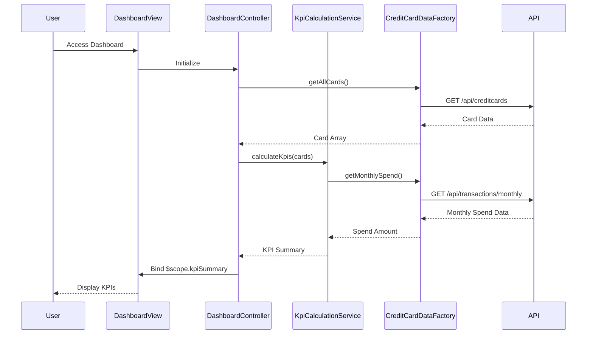

# Low-Level Design: Credit Card Dashboard and KPI Management
**Epic ID:** QE-9272  
**Technology Stack:** AngularJS 1.x, JavaScript ES6, HTML5, CSS3, Bootstrap, REST APIs, MVC Architecture

---

## a. Architecture Mapping

- **Dashboard UI Layer** → AngularJS Module (`creditCardApp.dashboard`) + Controller (`DashboardController`)
- **KPI Calculation Engine** → AngularJS Service (`KpiCalculationService`)
- **Data Retrieval** → AngularJS Factory (`CreditCardDataFactory`) for API calls
- **Responsive Layout** → HTML5 + Bootstrap grid system + CSS3 media queries
- **Real-time Refresh** → AngularJS `$interval` service or WebSocket integration via custom Service

**Recommended Folder Structure:**
```
/app
  /dashboard
    dashboard.module.js
    dashboard.controller.js
    dashboard.html
  /services
    kpi-calculation.service.js
    credit-card-data.factory.js
  /models
    credit-card.model.js
  /styles
    dashboard.css
```

---

## b. Component Specifications

| Component Name | Artifact Type | Responsibility | Key Dependencies |
|----------------|---------------|----------------|------------------|
| `creditCardApp.dashboard` | Module | Encapsulates dashboard feature | `ngRoute`, `creditCardApp.services` |
| `DashboardController` | Controller | Manages dashboard view logic, binds KPI data to UI | `KpiCalculationService`, `CreditCardDataFactory`, `$scope` |
| `KpiCalculationService` | Service | Calculates monthly spend, total limit, available credit, outstanding amount | `CreditCardDataFactory` |
| `CreditCardDataFactory` | Factory | Fetches credit card and transaction data via REST API | `$http`, `$q` |
| `dashboardRefreshDirective` | Directive | Handles real-time data refresh UI indicator | `$interval`, `KpiCalculationService` |

---

## c. Data Model

**CreditCard Model:**
```javascript
{
  cardId: String,
  cardNumber: String (masked),
  cardHolderName: String,
  creditLimit: Number,
  outstandingAmount: Number,
  availableCredit: Number,
  lastUpdated: Date
}
```

**KpiSummary Model:**
```javascript
{
  monthlySpend: Number,
  totalCreditLimit: Number,
  totalAvailableCredit: Number,
  totalOutstanding: Number
}
```

---

## d. Data Flow

User accesses the dashboard → `DashboardController` initializes and calls `CreditCardDataFactory.getAllCards()` → Factory makes REST API call to `/api/creditcards` → Response is passed to `KpiCalculationService.calculateKpis()` → Service aggregates data (sums limits, outstanding, calculates available credit, fetches monthly spend from `/api/transactions/monthly`) → Calculated KPI data is bound to `$scope.kpiSummary` → View renders KPI cards with Bootstrap grid → Real-time refresh via `$interval` polling or WebSocket updates triggers re-calculation and UI update.

---

## e. Primary Sequence Diagram



---

## f. Implementation Notes

- Use AngularJS Dependency Injection for all services and factories; register components via module chaining.
- Implement ES6 classes for Services and Factories; transpile with Babel if needed for browser compatibility.
- REST API integration via `$http` service with promise-based error handling; use `$q` for chaining multiple API calls.
- Bootstrap responsive grid (col-xs/sm/md/lg) for KPI card layout; CSS3 flexbox for fine-tuned alignment.
- Real-time refresh: Use `$interval` (polling every 30s) or integrate WebSocket service for push-based updates.

---

## g. Error Handling

Client-side HTTP interceptor captures API errors; display user-friendly notifications via Bootstrap alerts or toast service.

---

## h. Security Notes

Requires token-based auth via existing SSO; all API calls include Authorization header with JWT token.

---