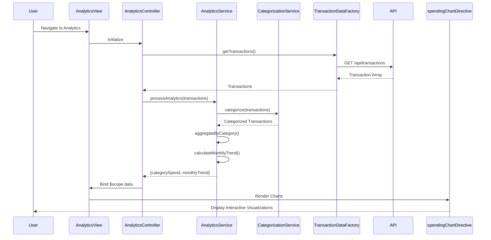

# Low-Level Design: Spending Analytics and Insights
**Epic ID:** QE-9273  
**Technology Stack:** AngularJS 1.x, JavaScript ES6, HTML5, CSS3, Bootstrap, REST APIs, MVC Architecture

---

## a. Architecture Mapping

- **Analytics Dashboard UI** → AngularJS Module (`creditCardApp.analytics`) + Controller (`AnalyticsController`)
- **Transaction Categorization Engine** → AngularJS Service (`CategorizationService`)
- **Visualization Component** → AngularJS Directive (`spendingChartDirective`) integrating Chart.js or D3.js
- **Data Retrieval** → AngularJS Factory (`TransactionDataFactory`) for API calls
- **Monthly Trend Analysis** → Service method within `AnalyticsService`

**Recommended Folder Structure:**
```
/app
  /analytics
    analytics.module.js
    analytics.controller.js
    analytics.html
  /services
    categorization.service.js
    analytics.service.js
    transaction-data.factory.js
  /directives
    spending-chart.directive.js
  /models
    transaction.model.js
  /styles
    analytics.css
```

---

## b. Component Specifications

| Component Name | Artifact Type | Responsibility | Key Dependencies |
|----------------|---------------|----------------|------------------|
| `creditCardApp.analytics` | Module | Encapsulates analytics feature | `ngRoute`, `creditCardApp.services`, `chart.js` |
| `AnalyticsController` | Controller | Manages analytics view, binds categorized spend and trend data | `AnalyticsService`, `TransactionDataFactory`, `$scope` |
| `AnalyticsService` | Service | Orchestrates categorization and trend calculation | `CategorizationService`, `TransactionDataFactory` |
| `CategorizationService` | Service | Classifies transactions into 9 predefined categories | None (pure logic) |
| `TransactionDataFactory` | Factory | Fetches transaction data via REST API | `$http`, `$q` |
| `spendingChartDirective` | Directive | Renders interactive category-wise and trend charts | Chart.js or D3.js library |

---

## c. Data Model

**Transaction Model:**
```javascript
{
  transactionId: String,
  cardId: String,
  amount: Number,
  category: String, // One of 9 predefined categories
  merchant: String,
  transactionDate: Date,
  description: String
}
```

**CategorySpend Model:**
```javascript
{
  category: String,
  totalAmount: Number,
  transactionCount: Number
}
```

**MonthlyTrend Model:**
```javascript
{
  month: String, // e.g., "2023-10"
  totalSpend: Number
}
```

---

## d. Data Flow

User navigates to Analytics → `AnalyticsController` calls `TransactionDataFactory.getTransactions()` → Factory fetches from `/api/transactions` → Transactions passed to `CategorizationService.categorize()` → Service applies rules to assign each transaction to one of 9 categories → `AnalyticsService.aggregateByCategory()` sums amounts per category → `AnalyticsService.calculateMonthlyTrend()` groups transactions by month → Aggregated data bound to `$scope.categorySpend` and `$scope.monthlyTrend` → `spendingChartDirective` renders interactive charts → User interacts with charts for drill-down insights.

---

## e. Primary Sequence Diagram



---

## f. Implementation Notes

- Use AngularJS DI for all services; `CategorizationService` implements rule-based logic (if/else or lookup map) for 9 categories.
- Integrate Chart.js via `spendingChartDirective` for responsive, interactive charts (bar, pie, line); use `link` function to bind data.
- `TransactionDataFactory` supports date range filters via query params (e.g., `/api/transactions?startDate=...&endDate=...`).
- ES6 array methods (`.map()`, `.filter()`, `.reduce()`) for efficient categorization and aggregation.
- Lazy-load chart library in analytics module to optimize initial page load.

---

## g. Error Handling

HTTP interceptor handles API failures; display error message in analytics view with retry option via Bootstrap alert.

---

## h. Security Notes

Standard input validation and secure API calls assumed; transaction data filtered by authenticated user's cardIds.

---