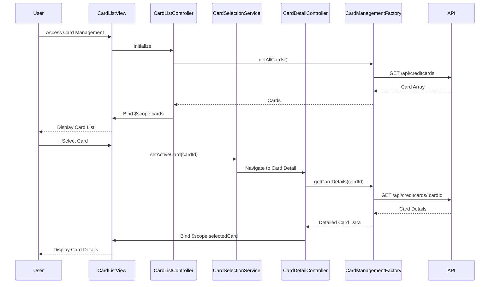

# Low-Level Design: Multiple Credit Card Management
**Epic ID:** QE-9274  
**Technology Stack:** AngularJS 1.x, JavaScript ES6, HTML5, CSS3, Bootstrap, REST APIs, MVC Architecture

---

## a. Architecture Mapping

- **Card Listing UI** → AngularJS Module (`creditCardApp.cardManagement`) + Controller (`CardListController`)
- **Card Detail View** → Controller (`CardDetailController`) + HTML template
- **Card Selection Controller** → Service (`CardSelectionService`) for managing active card state
- **Data Retrieval** → AngularJS Factory (`CardManagementFactory`) for API calls
- **Card Switching** → AngularJS `$state` (UI-Router) or `$route` for navigation

**Recommended Folder Structure:**
```
/app
  /card-management
    card-management.module.js
    card-list.controller.js
    card-detail.controller.js
    card-list.html
    card-detail.html
  /services
    card-selection.service.js
    card-management.factory.js
  /models
    credit-card.model.js
  /styles
    card-management.css
```

---

## b. Component Specifications

| Component Name | Artifact Type | Responsibility | Key Dependencies |
|----------------|---------------|----------------|------------------|
| `creditCardApp.cardManagement` | Module | Encapsulates card management feature | `ui.router` or `ngRoute`, `creditCardApp.services` |
| `CardListController` | Controller | Displays list of all user's credit cards | `CardManagementFactory`, `CardSelectionService`, `$scope` |
| `CardDetailController` | Controller | Displays detailed view of selected card | `CardManagementFactory`, `CardSelectionService`, `$stateParams` or `$routeParams` |
| `CardSelectionService` | Service | Maintains currently selected card state across views | None (stateful singleton) |
| `CardManagementFactory` | Factory | Fetches card list and individual card details via REST API | `$http`, `$q` |
| `cardSwitcherDirective` | Directive | Provides UI component for quick card switching (dropdown/tabs) | `CardSelectionService` |

---

## c. Data Model

**CreditCard Model (Extended):**
```javascript
{
  cardId: String,
  cardNumber: String (masked),
  cardHolderName: String,
  cardType: String, // e.g., "Visa", "MasterCard"
  creditLimit: Number,
  outstandingAmount: Number,
  availableCredit: Number,
  lastTransactionDate: Date,
  monthlySpend: Number,
  isActive: Boolean
}
```

---

## d. Data Flow

User accesses card management → `CardListController` calls `CardManagementFactory.getAllCards()` → Factory fetches from `/api/creditcards` → Card array bound to `$scope.cards` → View renders card list with Bootstrap cards/list-group → User clicks card → `CardSelectionService.setActiveCard(cardId)` updates state → UI-Router navigates to `/cards/:cardId` → `CardDetailController` retrieves `cardId` from `$stateParams` → Calls `CardManagementFactory.getCardDetails(cardId)` → API returns detailed card info and recent transactions → Data bound to `$scope.selectedCard` → View displays card details, limits, balances, usage patterns.

---

## e. Primary Sequence Diagram



---

## f. Implementation Notes

- Use UI-Router for state-based navigation with nested views (list and detail); configure states in module config.
- `CardSelectionService` is a singleton service storing `activeCardId`; use `$broadcast` or `$watch` for cross-controller communication.
- Implement card switching via Bootstrap tabs or dropdown in `cardSwitcherDirective`; directive listens to `CardSelectionService` changes.
- ES6 Promises via `$q` for chaining API calls; cache card list in factory to avoid redundant API calls.
- Bootstrap card components for responsive card display; CSS3 transitions for smooth card switching animation.

---

## g. Error Handling

HTTP interceptor captures API errors; display inline error messages in card list/detail views with retry button.

---

## h. Security Notes

Requires token-based auth via existing SSO; API filters cards by authenticated user's userId to prevent unauthorized access.

---