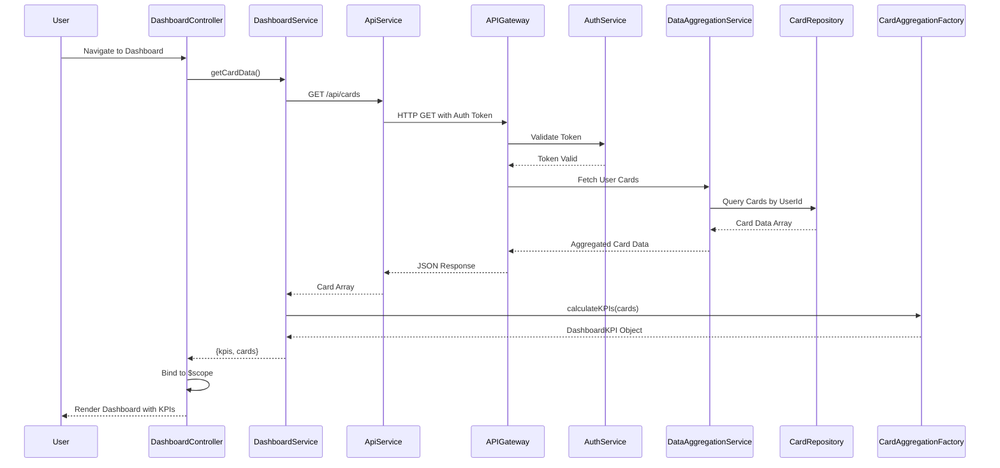

# Low-Level Design: QE-9287 - Dashboard KPIs and Credit Card Overview

## a. Architecture Mapping

**AngularJS Artifact Mapping:**
- Dashboard UI Layer → AngularJS Module: `creditCard.dashboard` with Controller: `DashboardController`
- Dashboard Service → AngularJS Service: `DashboardService` (handles API calls)
- Data Aggregation Service → AngularJS Factory: `CardAggregationFactory` (consolidates multi-card data)
- KPI Visualization → AngularJS Directive: `kpiCard` (reusable KPI display component)
- API Gateway Integration → AngularJS Service: `ApiService` (centralized HTTP wrapper)

**Recommended Folder Structure:**
```
app/
├── modules/
│   └── dashboard/
│       ├── dashboard.module.js
│       ├── dashboard.controller.js
│       ├── dashboard.html
│       └── directives/
│           └── kpi-card.directive.js
├── services/
│   ├── dashboard.service.js
│   ├── api.service.js
│   └── card-aggregation.factory.js
├── models/
│   └── card.model.js
└── assets/
    └── css/
        └── dashboard.css
```

## b. Component Specifications

| Component Name | Artifact Type | Responsibility | Key Dependencies |
|----------------|---------------|----------------|------------------|
| creditCard.dashboard | Module | Root module for dashboard feature, declares all dashboard components | angular, ui.router |
| DashboardController | Controller | Orchestrates dashboard view, fetches and displays KPIs and card data | DashboardService, CardAggregationFactory, $scope |
| DashboardService | Service | Fetches credit card data from API Gateway, handles authentication token | ApiService, $http, $q |
| CardAggregationFactory | Factory | Consolidates multi-card data into aggregated KPIs (total limit, available credit, outstanding) | None |
| kpiCard | Directive | Renders individual KPI card with label, value, and optional trend indicator | None |
| ApiService | Service | Centralized HTTP service with interceptors for auth and error handling | $http, $q, AuthService |

## c. Data Model

**CreditCard Model:**
```javascript
{
  cardId: String,
  cardNumber: String (masked),
  cardType: String,
  creditLimit: Number,
  outstandingAmount: Number,
  availableCredit: Number,
  monthlySpend: Number,
  lastUpdated: Date
}
```

**DashboardKPI Model:**
```javascript
{
  totalCreditLimit: Number,
  totalAvailableCredit: Number,
  totalOutstanding: Number,
  totalMonthlySpend: Number,
  cardCount: Number
}
```

## d. Data Flow

User navigates to dashboard route → DashboardController initializes and calls DashboardService.getCardData() → DashboardService sends authenticated GET request to API Gateway (/api/cards) → API Gateway validates token via User Authentication Service and forwards request to Dashboard Service → Dashboard Service retrieves card data from Credit Card Data Repository via Data Aggregation Service → Response returns array of CreditCard objects → CardAggregationFactory processes array and calculates DashboardKPI aggregates → DashboardController binds KPIs and card list to $scope → View renders KPI cards using kpiCard directive and displays card overview list with two-way data binding.

## e. Primary Sequence Diagram



## f. Implementation Notes

- Use AngularJS 1.x module pattern with dependency injection for all services, factories, and controllers
- Implement ApiService with $http interceptors for automatic auth token injection and global error handling
- Use ES6 classes for service definitions with arrow functions for promise chaining
- Bootstrap grid system for responsive layout (col-md-3 for KPI cards, col-xs-12 for mobile)
- Implement $q.all() for parallel API calls if multiple endpoints are needed for complete card data

## g. Error Handling

HTTP interceptor-based error handling in ApiService with user notification via Bootstrap modal or toast for API failures, with try/catch in controller for local exceptions.

## h. Security Notes

Requires token-based authentication via existing SSO with JWT tokens stored in sessionStorage and injected in API headers via $http interceptor.